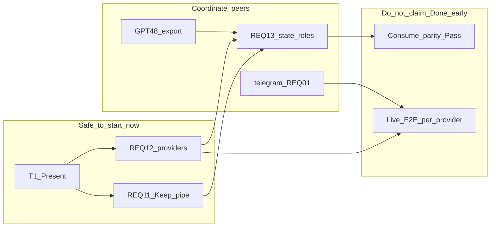

# REQ15 aibridge wave readiness — REQ-11 / REQ-12 / REQ-13

Date: **2026-11-01T13:30:59Z** (readiness) · Renumber note: **2026-11-01**  
Scope: Safety of sequential Zeya888 **Architect Studio → stories → implement** on aibridge children only, relative to parent vector REQ15.  
Does **not** claim full REQ15 E2E Done.

Parent: [`REQ15`](../requirements%20backlog/REQ15-DOGEstonia-Interview-DeepSeek-And-Telegram-Channel.md)  
T1: [`req15-t1-keep-adapt-replace-2026-11-01.md`](./req15-t1-keep-adapt-replace-2026-11-01.md)  
Children: [`REQ-11`](../../doge-ai-bridge/docs/requirements/REQ-11-REQ15-DUAL-CONFIRM-GATEWAY-SUBMIT-SPA-HANDOFF.md) · [`REQ-12`](../../doge-ai-bridge/docs/requirements/REQ-12-REQ15-INTERVIEW-DEEPSEEK-OPENAI-PROVIDERS.md) · [`REQ-13`](../../doge-ai-bridge/docs/requirements/REQ-13-REQ15-SEMANTIC-STATE-ROLES-INSTRUCTION-ASSEMBLY.md)

### Migration (old → new child numbers)

| Old | Topic | New |
|-----|-------|-----|
| REQ-13 | Dual confirm / stash / SPA | **REQ-11** |
| REQ-11 | Interview DeepSeek / OpenAI | **REQ-12** |
| REQ-12 | Semantic state / roles / C | **REQ-13** |

AC-AIB / L* ids follow the **new** child numbers. Parent `AC-REQ15-*` unchanged.

---

## 1) Verdict

| Question | Answer |
|----------|--------|
| Can operator run Zeya888 **arch → stories** on aibridge 11/12/13 **now**? | **Yes**, with order **11 → 12 → 13** and peer caveats |
| Is **full** REQ15 vector transformation “green” via aibridge alone? | **No** — yellow until GPT-48 archive/export, telegram REQ-01, live evidence, consume parity |
| Main tech risk inside aibridge | **REQ-13** on live Keep pipe (REQ-11) |
| Main process risk | Stories/implement before arch, or one monolith engine rewrite |

**One-liner:** T1 Present + product locks Q1–Q5 → **conditionally safe** to start Architect Studio per child; do **not** treat that as license to close entire REQ15 E2E without peers.

---

## 2) Green gates for arch → stories (aibridge only)

| Gate | Status | Cite |
|------|--------|------|
| Parent vector + locks L1–L20 | Present | REQ15 |
| T1 keep/adapt/replace + scenarios | Present | T1 · AC-REQ15-01 |
| Child functional REQs + AC + OOS | Present | REQ-11/12/13 |
| Product locks for arch | Present | L12-1 env · L12-2 model deferred · L13-1 soft confirm · L13-2 volume/fixture · L13-3/L11-1 Q5 A+transition C |
| Orthogonality worker REQ-10 | Explicit | REQ-12 AC-AIB-12-02 / parent AC-05 |
| Channel starting contract | Keep (T1) | `/v1/channel/turns` \| `actions` |
| REQ-11 Keep core | Present in code | dual confirm + stash + SPA continuation |

Next step matches parent §12 п.2 and `target-tech-architecture.md`: **Architect Studio per child**, not stories first.

---

## 3) Risk map (as-is → REQ15)



| Layer | Risk | Why |
|-------|------|-----|
| **REQ-11** | Low | T1 Keep; arch = coexistence + L11-1 hooks + evidence |
| **REQ-12** | Medium | Replace selector+DeepSeek under live OpenAI path; L12-2 model id not live-confirmed |
| **REQ-13** | High | Replace semantic state + 5 roles + assembly; GPT-48 export + AC-REQ15-13 consume parity |
| Peers outside aibridge | High for full Done | telegram AC-02; GPT-48 Incomplete (T1); gateway 59 / spa 25 verify-first |
| Monolith rewrite of interview engine in one PR | High | Breaks Keep dual-confirm; against T1 |

---

## 4) Mandatory sequence (operator)

Do **not** merge three children into one arch package. Three Architect Studio runs (or system-arch with explicit siblings), then stories:

1. **Architect Studio → REQ-11** — Keep-freeze + name L11-1 transition C→A hooks; no invent gateway API.  
2. **Architect Studio → REQ-12** — interview port + DeepSeek adapter behind Present engine; env `AIBRIDGE_INTERVIEW_PROVIDER`; boundary vs REQ-10.  
3. **Architect Studio → REQ-13** — state/roles/assembly/C; cite REQ-12 port + REQ-11 invalidation; consume-parity contract with GPT-48 (**no** instruction stubs).  
4. Only then **`req-to-backlog-stories`** per child (or one package with build order `11-adapt → 12 → 13`).  
5. Implement waves: do not touch worker REQ-09/10; do not change channel HTTP until arch proves insufficiency (parent non-goal).

**Parallel (does not block aibridge arch start; blocks content/E2E Done):** GPT UI REQ-48 archive+export; telegram REQ-01 cutover; gateway 59 / spa 25 verify.

---

## 5) Operator handoff — copy-paste prompts

### 5.1 Architect Studio — REQ-11 (first)

```text
Architect Studio on doge-ai-bridge child REQ-11 only.

REQ: doge-ai-bridge/docs/requirements/REQ-11-REQ15-DUAL-CONFIRM-GATEWAY-SUBMIT-SPA-HANDOFF.md
Parent: docs/requirements backlog/REQ15-DOGEstonia-Interview-DeepSeek-And-Telegram-Channel.md
T1 (cite as as-is SSOT): docs/analysis/req15-t1-keep-adapt-replace-2026-11-01.md
Readiness: docs/analysis/req15-aibridge-wave-readiness-2026-11-01.md

Goal: Keep-freeze Present dual-confirm + stash + SPA handoff; name L11-1 (Q5 A + transition C) coexistence hooks for semantic state without inventing new gateway HTTP. Code claims path:line. Do not rewrite interview engine. Do not stories yet.
Siblings cite only: REQ-12, REQ-13, GPT-48, gateway 59, spa 25, telegram REQ-01.
```

### 5.2 Architect Studio — REQ-12 (second)

```text
Architect Studio on doge-ai-bridge child REQ-12 only.

REQ: doge-ai-bridge/docs/requirements/REQ-12-REQ15-INTERVIEW-DEEPSEEK-OPENAI-PROVIDERS.md
T1: docs/analysis/req15-t1-keep-adapt-replace-2026-11-01.md
Readiness: docs/analysis/req15-aibridge-wave-readiness-2026-11-01.md
Prior arch: REQ-11 package (cite) if Present.

Goal: Interview provider port behind Present engine; env AIBRIDGE_INTERVIEW_PROVIDER (L12-1); DeepSeek adapter; orthogonal to AIBRIDGE_WORKER_* (REQ-10). L12-2 model id Open until live confirm. No channel HTTP invent. No worker rewrite. No stories yet.
```

### 5.3 Architect Studio — REQ-13 (third; after 11+12 arch Present)

```text
Architect Studio on doge-ai-bridge child REQ-13 only.

REQ: doge-ai-bridge/docs/requirements/REQ-13-REQ15-SEMANTIC-STATE-ROLES-INSTRUCTION-ASSEMBLY.md
T1 + readiness cites above. Prior arch: REQ-11 + REQ-12 packages required.

Goal: Semantic state + 5 roles + assembly + soft confirm (L13-1) + volume/fixture (L13-2) + L13-3/L11-1 transition C. Consume-parity contract with GPT UI REQ-48 (AC-REQ15-13) — do not create instruction stubs. Sensitivity «meaning change» for L13-3 — interview, do not silent invent. Cite REQ-12 port + REQ-11 invalidation. No monolith engine rewrite. No stories until this arch Present.
```

### 5.4 Stories gate (only after each corresponding arch)

```text
req-to-backlog-stories for aibridge child <REQ-11|REQ-12|REQ-13> using its Architect Studio package as SSOT.
Build order if batched: 11-adapt → 12 → 13. Cite T1. No monolith interview-engine rewrite story.
```

### 5.5 Parallel peers track (does not block §5.1–5.2)

| Peer | Next operator action | Blocks |
|------|----------------------|--------|
| GPT UI REQ-48 | archive + export path toward consume parity | REQ-13 content Done / AC-REQ15-13 |
| doge-telegram REQ-01 | transport cutover per its REQ | live AC-02 / channel E2E |
| gateway 59 | verify-first stash parity | REQ-11 evidence Done |
| spa-app 25 | verify-first `#/story/submit?draft_id=` | REQ-11 SPA continuity Done |
| Live evidence | window per provider (AC-10 / AC-AIB-11-07) | claim live Pass |

---

## 6) Transformation guards (must hold)

- Cite T1 in every arch/story run; code claim = `path:line`.  
- Never mix `AIBRIDGE_INTERVIEW_PROVIDER` with `AIBRIDGE_WORKER_*_PROVIDER`.  
- Never claim AC-REQ15-13 Done without both Pass (48 + 13).  
- Never claim live AC-10 / AC-AIB-11-07 without evidence window.  
- DeepSeek model string only after live confirm (L12-2); arch may leave model env Open.  
- L13-3 sensitivity = arch interview, not silent invent.  
- T1 §7 env-name drift cleared: L12-1 Present.

---

## 7) What this analysis closes vs leaves open

| Closed here | Left to operator sessions |
|-------------|---------------------------|
| Readiness verdict + sequence + guards | Actual Architect Studio interview + packages for 11/12/13 |
| Copy-paste prompts §5 | `req-to-backlog-stories` after each arch |
| Peer parallel checklist | GPT-48 / telegram / gateway59 / spa25 / live evidence execution |
| Child number = exec order | — |

---

## 8) Related

| Artifact | Role |
|----------|------|
| T1 keep/adapt/replace | As-is SSOT for arch |
| REQ-11/12/13 | Child functional REQs |
| REQ15 parent | Locks + AC |
| Plan (operator Cursor) | Source assessment; not repo SSOT |
