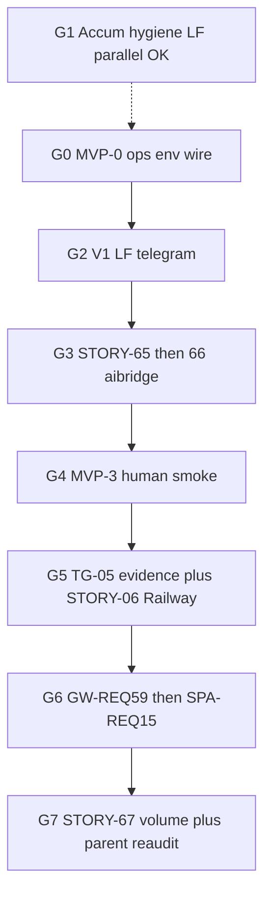

# REQ15 gap closure — execution order (G0–G7)

**Role:** operator runbook — развёрнутый порядок выполнения.  
**SSOT process:** [`req15-gap-closure-process-zeya888-2026-11-03.md`](./req15-gap-closure-process-zeya888-2026-11-03.md)  
**Method:** [`.cursor/rules/analysis.mdc`](../../.cursor/rules/analysis.mdc)

**Lock:** каждая исполняемая единица — отдельная строка-ссылка + **Status**. Группы **G0…G7**.  
**Параллель:** **G1** ∥ **G0** / начало **G2**. Цепочка после G0: **G2 → G3 → G4 → G5 → G6 → G7**.

**Status sync:** 2026-11-05 · **G0–G2 PASS** · **G3 STORY-65/66 Product Done** · **G4 Ready for human smoke** · MVP-3 evidence still **Open** · **G5–G7 package Done** (live/Railway/volume residuals Partial/Unknown; Phase F Open) · readiness note [`req15-mvp-readiness-validation-2026-11-05.md`](./req15-mvp-readiness-validation-2026-11-05.md).

---

## G0 — MVP-0 local ops wire

**Track:** MVP · **Class:** ops checklist (no STORY) · **Group status:** Local wire + six-probe **PASS** (2026-11-04)  
**Why:** снимает stub / bearer / dry-run блокеры перед live.  
**Evidence:** [`scripts/shell/local-five-serve-and-health.sh`](../../scripts/shell/local-five-serve-and-health.sh) — identity/gateway/threads/aibridge/telegram/spa all green (telegram `:8090` `/healthz`+`/readyz`). ≠ MVP-3 human interview smoke.

- **PASS (ops wire + script)** — [MVP-0 checklist · process §4](./req15-gap-closure-process-zeya888-2026-11-03.md) (раздел MVP-0)
- **Reference** — [MVP success criteria · process §2](./req15-gap-closure-process-zeya888-2026-11-03.md) (раздел §2)
- **Script** — [`local-five-serve-and-health.sh`](../../scripts/shell/local-five-serve-and-health.sh) (five + telegram)

---

## G1 — Accumulative docs hygiene LF

**Track:** B / parallel · **Class:** LF Pipe 3 · **Group status:** Executed · validate **PASS** (2026-11-04)  
**Project:** DOGEstonia root (cross-project) · **Execute in:** monorepo / root chat  
**Why:** docs/config-comment hygiene; ∥ G0/G2.  

- **PASS (triage)** — [`req15-lf-triage-ops-docs-hygiene-batch-2026-11-03.md`](./req15-lf-triage-ops-docs-hygiene-batch-2026-11-03.md)
- **Executed** — [`req15-ops-docs-hygiene-batch.md`](./req15-ops-docs-hygiene-batch.md)
- **PASS (validate H1–H5)** — [`req15-ops-docs-hygiene-batch-validate.md`](./req15-ops-docs-hygiene-batch-validate.md)
- **LAUNCH used** — [`req15-ops-docs-hygiene-batch-LAUNCH.md`](./req15-ops-docs-hygiene-batch-LAUNCH.md)

---

## G2 — V1 telegram continuation_url LF

**Track:** MVP-1 · **Class:** LF Pipe 2 · **Group status:** Executed · validate **PASS** (2026-11-04)  
**Project:** `doge-telegram` · **Execute in:** doge-telegram project chat / monorepo with telegram focus  
**Why:** handoff URL до meaningful smoke.

- **PASS (triage)** — [`req15-lf-triage-telegram-continuation-url-2026-11-03.md`](./req15-lf-triage-telegram-continuation-url-2026-11-03.md)
- **Executed** — [`doge-telegram/docs/analysis/telegram-continuation-url-delivery.md`](../../doge-telegram/docs/analysis/telegram-continuation-url-delivery.md)
- **PASS (validate V1–V4)** — [`doge-telegram/docs/analysis/telegram-continuation-url-delivery-validate.md`](../../doge-telegram/docs/analysis/telegram-continuation-url-delivery-validate.md)
- **LAUNCH used** — [`telegram-continuation-url-delivery-LAUNCH.md`](../../doge-telegram/docs/tasks/prompts/telegram-continuation-url-delivery-LAUNCH.md)

---

## G3 — AIBRIDGE roles/semantic on channel

**Track:** MVP-2 · **Class:** STORY · **Group status:** **Done · Product Done** (2026-11-04 wave; docs sync 2026-11-05)  
**Why:** role/semantic на channel до quality smoke. Порядок: **65 → 66**.  
**Evidence:** `channel_wire.apply_before_engine_turn` + roles-schema cutover in aibridge; wave [`wave-20261104-req13-wire-65-66`](../../doge-ai-bridge/docs/tasks/run-reports/operator-waves/wave-20261104-req13-wire-65-66.md) EXHAUSTED · P7 65/66.

- **Done · Product Done · pkg-000068** — [`STORY-AIBRIDGE-65-asgi-channel-semantic-roles-wire.md`](../../doge-ai-bridge/docs/tasks/backlog-stories/req-13-req15-semantic-state-roles-instruction-assembly/STORY-AIBRIDGE-65-asgi-channel-semantic-roles-wire.md) · [p7](../../doge-ai-bridge/docs/analysis/p7-reaudit-STORY-AIBRIDGE-65-asgi-channel-semantic-roles-wire-20261104.md)
- **Done · Product Done · pkg-000069** — [`STORY-AIBRIDGE-66-roles-schema-channel-cutover.md`](../../doge-ai-bridge/docs/tasks/backlog-stories/req-13-req15-semantic-state-roles-instruction-assembly/STORY-AIBRIDGE-66-roles-schema-channel-cutover.md) · [p7](../../doge-ai-bridge/docs/analysis/p7-reaudit-STORY-AIBRIDGE-66-roles-schema-channel-cutover-20261104.md)

---

## G4 — MVP-3 human E2E smoke

**Track:** MVP · **Class:** operator runbook · **Group status:** **Ready for human smoke** · evidence **Open** (G0–G3 code/ops closed)  
**Why:** local E2E (bot → OpenAI → confirm → gateway stash).  
**Agent:** **не** выполняет (нужен human + live stack); при FAIL может читать логи.

**Operator brief (do this):**
1. Six up + stub off + live OpenAI + `AIBRIDGE_DRY_RUN=false` + bearer pairing + gateway/SPA URLs.
2. Restart telegram after G2 so `continuation_url` append is live.
3. Prefer roles-schema env (`INSTRUCTIONS_*` / `ROLES_*` → `instructions-roles`); Phase-A mega = MVP caveat OK.
4. Human interview → dual confirm → factual gateway stash; URL in TG when Present.
5. Record PASS in process/execution-order (date, stash ok, URL Present/Absent, roles vs mega) — no secrets.

- **Reference · Ready** — [MVP success criteria · process §2](./req15-gap-closure-process-zeya888-2026-11-03.md) (раздел §2)
- **Open · awaiting human evidence** — [MVP-3 phase note · process §4](./req15-gap-closure-process-zeya888-2026-11-03.md) (раздел MVP-3)
- **Readiness (code)** — [`req15-mvp-readiness-validation-2026-11-05.md`](./req15-mvp-readiness-validation-2026-11-05.md) · prior ops [`req15-g4-smoke-session-2026-11-05.md`](./req15-g4-smoke-session-2026-11-05.md)

---

## G5 — Telegram live residual + Railway packaging

**Track:** B · **Class:** STORY · **Group status:** **Package Done · live/Railway Partial** (2026-11-05)  
**Why:** live residual, затем Railway.  
**Honesty:** package Done ≠ Railway deploy SUCCESS; 05 evidence = residual/synthetic path, not human MVP-3 stash.

- **Done · package · live residual Partial** — [`STORY-TELEGRAM-05-live-residual-path.md`](../../doge-telegram/docs/tasks/backlog-stories/req-01-telegram-channel-transport/STORY-TELEGRAM-05-live-residual-path.md)
- **Done · packaging · Railway deploy SUCCESS Absent** — [`STORY-TELEGRAM-06-railway-channel-packaging.md`](../../doge-telegram/docs/tasks/backlog-stories/req-01-telegram-channel-transport/STORY-TELEGRAM-06-railway-channel-packaging.md)

---

## G6 — Gateway then SPA verify packages

**Track:** B · **Class:** STORY (verify-first) · **Group status:** **Verify Done · live Unknown** (2026-11-05)  
**Why:** peer verify после path. Порядок: **GW-REQ59 → SPA-REQ15**.  
**Honesty:** harness/evidence Present; live aibridge→gateway stash / TG→SPA E2E **Unknown** (soft-depends G4).

- **Done (Awaiting Commits) · verify · live Unknown** — [`STORY-GW-REQ59-01-aibridge-stash-parity-verify.md`](../../doge-complaints-gateway/docs/tasks/backlog-stories/req59-req15-story-draft-stash-channel-parity-verify/STORY-GW-REQ59-01-aibridge-stash-parity-verify.md)
- **Done · verify · live Unknown** — [`STORY-SPA-REQ15-01-story-submit-handoff-continuity-verify.md`](../../spa-app/docs/tasks/backlog-stories/req15-story-submit-handoff-continuity-verify/STORY-SPA-REQ15-01-story-submit-handoff-continuity-verify.md)

---

## G7 — Volume consume + parent Product Done re-audit

**Track:** B · **Class:** STORY + docs wave · **Group status:** **67 Code Done · AC-05 live Explicit Partial · F Open** (2026-11-05)  
**Why:** volume/AC honesty; MVP Done ≠ Product Done.  
**Honesty:** code/docs Done with Explicit Partial on live volume; Phase F parent re-audit still Open.

- **Done · Product Done · Code Done · AC-05 Explicit Partial** — [`STORY-AIBRIDGE-67-consume-parity-volume-evidence.md`](../../doge-ai-bridge/docs/tasks/backlog-stories/req-13-req15-semantic-state-roles-instruction-assembly/STORY-AIBRIDGE-67-consume-parity-volume-evidence.md)
- **Open · parent SSOT** — [Parent REQ15](../requirements backlog/REQ15-DOGEstonia-Interview-DeepSeek-And-Telegram-Channel.md)
- **Reference · audit** — [Gap audit AC + V1–V8](./req15-target-state-code-gap-audit-2026-11-03.md)

---

## Related

- Process (checklist + fences): [`req15-gap-closure-process-zeya888-2026-11-03.md`](./req15-gap-closure-process-zeya888-2026-11-03.md)
- Triage pipes: [`req15-gap-triage-pipes-2026-11-03.md`](./req15-gap-triage-pipes-2026-11-03.md)
- MVP readiness validation: [`req15-mvp-readiness-validation-2026-11-05.md`](./req15-mvp-readiness-validation-2026-11-05.md)
