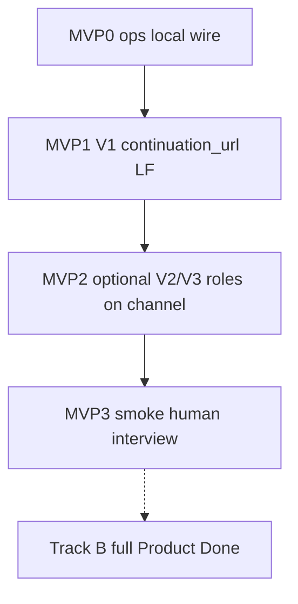
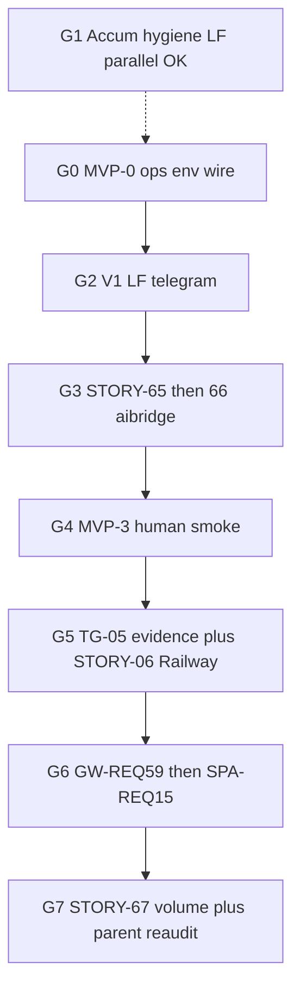

# REQ15 gap closure process (Zeya888) — 2026-11-03

**Role:** operator runbook. **Not** a Builder Queue prompt fence; **not** product code by itself.  
**Method:** [`.cursor/rules/analysis.mdc`](../../.cursor/rules/analysis.mdc).

**Operator lock (2026-11-03):** primary goal = **MVP local E2E readiness** — locally running services + real Telegram bot; operator conducts interview; OpenAI; draft reaches **real** gateway stash; continuation usable. Full parent Product Done / Railway / DeepSeek-primary / formal GW59+SPA25 packages = **Track B (after MVP)**.

**Materialize wave (2026-11-03):** requirements-only STORYs + LF dual plans + accumulative plans Present (no implement). See §6–§8.

---

## 0. Preconditions

| Artifact | Path |
|----------|------|
| Gap audit (AC + V1–V8) | [`req15-target-state-code-gap-audit-2026-11-03.md`](./req15-target-state-code-gap-audit-2026-11-03.md) |
| Triage → 3 pipes | [`req15-gap-triage-pipes-2026-11-03.md`](./req15-gap-triage-pipes-2026-11-03.md) |
| Parent | [`../requirements backlog/REQ15-DOGEstonia-Interview-DeepSeek-And-Telegram-Channel.md`](<../requirements backlog/REQ15-DOGEstonia-Interview-DeepSeek-And-Telegram-Channel.md>) |
| Vision sync | Operator: local stack + real bot + OpenAI + interview → normalize/validate → **gateway** (dialog by human) |

**Zeya888 map:** [`from-cross-project-req-to-story-packages`](../methodology/Zeya888-builder-queue/guides/from-cross-project-req-to-story-packages.md) · [`lightweight-followup`](../methodology/Zeya888-builder-queue/guides/lightweight-followup.md) · LF [triage](../methodology/Zeya888-builder-queue/prompts/operator/lightweight-followup-triage.md)/[author](../methodology/Zeya888-builder-queue/prompts/operator/lightweight-followup-author.md) · OP [how-to](../methodology/Zeya888-builder-queue/guides/operator-how-to-run-queue.md)/[start](../methodology/Zeya888-builder-queue/prompts/operator/operator-root-start.md)/[run](../methodology/Zeya888-builder-queue/prompts/operator/operator-root-subagent-run.md) · arch [`target-tech-architecture`](../methodology/Zeya888-builder-queue/prompts/architect/target-tech-architecture.md) · [`req-to-backlog-stories`](../methodology/Zeya888-builder-queue/prompts/architect/req-to-backlog-stories.md) · [`profiles.yaml`](../methodology/Zeya888-builder-queue/specs/profiles.yaml).

**Honesty:** MVP Done ≠ parent Product Story Done. Flip AC only with evidence.

---

## 1. Two tracks

| Track | Goal | In scope | Deferred |
|-------|------|----------|----------|
| **MVP (default now)** | Operator can run local stack and complete one real Telegram→OpenAI→confirm→**gateway stash** interview | Ops wire + **V1** + **V4 local** + **V5** + dry-run off; Prefer **V2/V3** if interview quality must be role-line; SPA local optional for link click | Railway; **V6** DeepSeek-primary; **V7** formal verify packages; full **V8**/AC-14 volume Product Done; parent Accepted |
| **B — Product Done** | Close remaining AC / packages | Former Phases A (full hygiene), C3 volume, D Railway, E GW59/SPA25, F full AC | — |

---

## 2. MVP success criteria (operator-checkable)

All must hold for **MVP Done**:

1. **aibridge** up locally; `AIBRIDGE_INTERVIEW_PROVIDER=openai`; key/balance usable.  
2. **doge-telegram** up; real `TELEGRAM_BOT_TOKEN`; **`BRIDGE_STUB` off**; `BRIDGE_BASE_URL` → local aibridge; `CHANNEL_BEARER` **value** = `AIBRIDGE_CHANNEL_BEARER_TOKEN`.  
3. **`AIBRIDGE_DRY_RUN=false`** (and schema gates allow `/ready`) so stash hits configured `GATEWAY_BASE_URL` (remote gateway OK for MVP if token live).  
4. Human interview in real bot reaches dual confirm and **factual** gateway success (not dry-run reply).  
5. **V1:** when `continuation_url` Present, Telegram message includes the URL.  
6. Optional MVP+: channel uses roles-schema / semantic path (**V2/V3**) — if skipped, document «Keep mega-pack interview» as MVP-quality caveat.

**Not required for MVP:** Railway; DeepSeek; gateway-59/spa-25 story packages; GPT-48 REQ Status Accepted; hybrid C Railway volume.

---

## 3. Fences

1. analysis.mdc — no invent AC; name ≠ create; ask-scoped.  
2. LF — dual plans; no mega-plan; telegram-only for V1.  
3. Do not paste secrets into analysis/docs.  
4. OP / STORY only when MVP needs code beyond ops+LF (V2/V3).  
5. Dry-run / stub / bearer = **ops checklist**, not STORY inflation.

---

## 4. Track MVP — phases

### MVP-0 — Local ops wire (no STORY)

**Status:** Ready-for-ops (checklist only)  
**Closes blockers:** stub peer (**V4** local), bearer (**V5**), dry-run vs real gateway.

| Step | Action |
|------|--------|
| 0.1 | Start aibridge with Present local `.env` (OpenAI). Confirm `/healthz` `/readyz`. |
| 0.2 | In `doge-telegram/.env`: set `BRIDGE_BASE_URL` to local aibridge; set `CHANNEL_BEARER` = same secret as bridge channel bearer; **`BRIDGE_STUB=0`**. |
| 0.3 | Set aibridge **`AIBRIDGE_DRY_RUN=false`** only when schema validation flags allow ready. |
| 0.4 | Confirm `GATEWAY_*` and `SPA_BASE_URL` match intended handoff. |
| 0.5 | Smoke: one TG message → bridge turn (not stub reply). |

### MVP-1 — V1 LF `telegram-continuation-url-delivery`

| Artifact | Link | Status |
|----------|------|--------|
| Triage | [`req15-lf-triage-telegram-continuation-url-2026-11-03.md`](./req15-lf-triage-telegram-continuation-url-2026-11-03.md) | **PASS** |
| Implement plan | [`doge-telegram/docs/analysis/telegram-continuation-url-delivery.md`](../../doge-telegram/docs/analysis/telegram-continuation-url-delivery.md) | **Executed** (2026-11-04) · **Project: doge-telegram** |
| Validate plan | [`doge-telegram/docs/analysis/telegram-continuation-url-delivery-validate.md`](../../doge-telegram/docs/analysis/telegram-continuation-url-delivery-validate.md) | **PASS** V1–V4 (2026-11-04) · **Project: doge-telegram** |
| LAUNCH | [`doge-telegram/docs/tasks/prompts/telegram-continuation-url-delivery-LAUNCH.md`](../../doge-telegram/docs/tasks/prompts/telegram-continuation-url-delivery-LAUNCH.md) | Used |

### MVP-2 — V2/V3 STORYs (role quality)

| Story | Status |
|-------|--------|
| [`STORY-AIBRIDGE-65-asgi-channel-semantic-roles-wire`](../../doge-ai-bridge/docs/tasks/backlog-stories/req-13-req15-semantic-state-roles-instruction-assembly/STORY-AIBRIDGE-65-asgi-channel-semantic-roles-wire.md) | **Done · Product Done** · pkg-000068 · G-02 Lifted (2026-11-04) |
| [`STORY-AIBRIDGE-66-roles-schema-channel-cutover`](../../doge-ai-bridge/docs/tasks/backlog-stories/req-13-req15-semantic-state-roles-instruction-assembly/STORY-AIBRIDGE-66-roles-schema-channel-cutover.md) | **Done · Product Done** · pkg-000069 · residual STORY-67 (2026-11-04) |

### MVP-3 — Human E2E smoke

Operator runbook — Status **Ready for human smoke** (G0–G3 closed); evidence **Open** until operator records PASS.

---

## 5. Track B — after MVP

| Phase | Artifact | Status |
|-------|----------|--------|
| **A** Accum hygiene | [`req15-ops-docs-hygiene-batch-LAUNCH.md`](./req15-ops-docs-hygiene-batch-LAUNCH.md) · [`implement`](./req15-ops-docs-hygiene-batch.md) · [`validate`](./req15-ops-docs-hygiene-batch-validate.md) | **Executed · validate PASS** (2026-11-04) · **Project: DOGEstonia root** |
| **C3** V8 volume | [`STORY-AIBRIDGE-67-consume-parity-volume-evidence`](../../doge-ai-bridge/docs/tasks/backlog-stories/req-13-req15-semantic-state-roles-instruction-assembly/STORY-AIBRIDGE-67-consume-parity-volume-evidence.md) | **Done · Code Done · AC-05 live Explicit Partial** (2026-11-05) |
| **D** live residual | [`STORY-TELEGRAM-05`](../../doge-telegram/docs/tasks/backlog-stories/req-01-telegram-channel-transport/STORY-TELEGRAM-05-live-residual-path.md) | **Done · package · live residual Partial** (2026-11-05) |
| **D+** Railway | [`STORY-TELEGRAM-06-railway-channel-packaging`](../../doge-telegram/docs/tasks/backlog-stories/req-01-telegram-channel-transport/STORY-TELEGRAM-06-railway-channel-packaging.md) | **Done · packaging · Railway SUCCESS Absent** (2026-11-05) |
| **E** GW verify | [`STORY-GW-REQ59-01`](../../doge-complaints-gateway/docs/tasks/backlog-stories/req59-req15-story-draft-stash-channel-parity-verify/STORY-GW-REQ59-01-aibridge-stash-parity-verify.md) | **Done (Awaiting Commits) · verify · live Unknown** (2026-11-05) |
| **E** SPA verify | [`STORY-SPA-REQ15-01`](../../spa-app/docs/tasks/backlog-stories/req15-story-submit-handoff-continuity-verify/STORY-SPA-REQ15-01-story-submit-handoff-continuity-verify.md) | **Done · verify · live Unknown** (2026-11-05) |
| **F** Parent re-audit | — | **Open** (docs wave later; after G4 + residuals) |

---

## 6. Progress checklist (with links)

### MVP

| Step | Item | Status | Link |
|------|------|--------|------|
| MVP-0 | Local wire ops | Local six-probe PASS (2026-11-04) | process §4 MVP-0 · [`local-five-serve-and-health.sh`](../../scripts/shell/local-five-serve-and-health.sh) |
| MVP-1 | V1 continuation_url LF (`doge-telegram`) | Executed · validate PASS | [implement](../../doge-telegram/docs/analysis/telegram-continuation-url-delivery.md) · [validate](../../doge-telegram/docs/analysis/telegram-continuation-url-delivery-validate.md) · [LAUNCH](../../doge-telegram/docs/tasks/prompts/telegram-continuation-url-delivery-LAUNCH.md) |
| MVP-2 | V2/V3 roles on channel | Done · Product Done | [65](../../doge-ai-bridge/docs/tasks/backlog-stories/req-13-req15-semantic-state-roles-instruction-assembly/STORY-AIBRIDGE-65-asgi-channel-semantic-roles-wire.md) · [66](../../doge-ai-bridge/docs/tasks/backlog-stories/req-13-req15-semantic-state-roles-instruction-assembly/STORY-AIBRIDGE-66-roles-schema-channel-cutover.md) · [wave](../../doge-ai-bridge/docs/tasks/run-reports/operator-waves/wave-20261104-req13-wire-65-66.md) |
| MVP-3 | Human smoke | Ready · evidence Open | [§2 criteria](./req15-gap-closure-process-zeya888-2026-11-03.md) · [execution-order G4](./req15-gap-closure-execution-order-2026-11-03.md) · [readiness](./req15-mvp-readiness-validation-2026-11-05.md) |

### Track B / parallel

| Step | Item | Status | Link |
|------|------|--------|------|
| G1 | Accum docs hygiene LF (root) | Executed · validate PASS | [implement](./req15-ops-docs-hygiene-batch.md) · [validate](./req15-ops-docs-hygiene-batch-validate.md) · [LAUNCH](./req15-ops-docs-hygiene-batch-LAUNCH.md) |
| D | TG-05 live residual | Done · package · Partial | [STORY-05](../../doge-telegram/docs/tasks/backlog-stories/req-01-telegram-channel-transport/STORY-TELEGRAM-05-live-residual-path.md) |
| D+ | Railway packaging | Done · packaging · Railway SUCCESS Absent | [STORY-06](../../doge-telegram/docs/tasks/backlog-stories/req-01-telegram-channel-transport/STORY-TELEGRAM-06-railway-channel-packaging.md) |
| E | GW59 verify | Done · verify · live Unknown | [GW-REQ59-01](../../doge-complaints-gateway/docs/tasks/backlog-stories/req59-req15-story-draft-stash-channel-parity-verify/STORY-GW-REQ59-01-aibridge-stash-parity-verify.md) |
| E | SPA25 verify | Done · verify · live Unknown | [SPA-REQ15-01](../../spa-app/docs/tasks/backlog-stories/req15-story-submit-handoff-continuity-verify/STORY-SPA-REQ15-01-story-submit-handoff-continuity-verify.md) |
| C3 | Volume consume | Done · Code Done · AC-05 Explicit Partial | [67](../../doge-ai-bridge/docs/tasks/backlog-stories/req-13-req15-semantic-state-roles-instruction-assembly/STORY-AIBRIDGE-67-consume-parity-volume-evidence.md) |
| F | Parent Product Done re-audit | Open | — |
| — | MVP readiness (code) | Present 2026-11-05 | [req15-mvp-readiness-validation-2026-11-05.md](./req15-mvp-readiness-validation-2026-11-05.md) |

---

## 7. Execution order (locked)

**Развёрнутый порядок (каждая единица = ссылка):** [`req15-gap-closure-execution-order-2026-11-03.md`](./req15-gap-closure-execution-order-2026-11-03.md)

| Group | What | Why |
|-------|------|-----|
| **G0** | MVP-0 ops | Unblocks any live work |
| **G1** | Accumulative hygiene LF | Parallel with G0/G2; no runtime dep |
| **G2** | V1 LF | Handoff URL before meaningful smoke |
| **G3** | AIBRIDGE-65 → 66 | Role/semantic on channel before quality smoke |
| **G4** | Human MVP-3 smoke | Proves local E2E |
| **G5** | TG-05 formalize + TELEGRAM-06 | Track B live/Railway |
| **G6** | GW-REQ59 → SPA-REQ15 | Verify peers after path works |
| **G7** | AIBRIDGE-67 + Phase F | Volume/Product Done honesty |

---

## 8. Out of scope of *this file alone*

- Editing `.env` / starting processes / executing LF/STORY implement without explicit operator order.  
- Inventing new channel HTTP.  
- Treating MVP Done as parent Product Done.  
- Recreating STORY-TELEGRAM-05.

**STOP** — execute **G0** first on operator order; G1 parallel OK; then G2 LAUNCH in telegram project chat.
