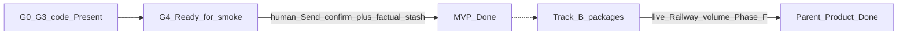

# REQ15 MVP readiness — code validation (2026-11-05)

**Role:** analysis / operator readiness note.  
**Method:** [`.cursor/rules/analysis.mdc`](../../.cursor/rules/analysis.mdc)  
**SSOT criteria:** [`req15-gap-closure-process-zeya888-2026-11-03.md`](./req15-gap-closure-process-zeya888-2026-11-03.md) §2 · [`req15-gap-closure-execution-order-2026-11-03.md`](./req15-gap-closure-execution-order-2026-11-03.md)  
**Related smoke ops:** [`req15-g4-smoke-session-2026-11-05.md`](./req15-g4-smoke-session-2026-11-05.md)

**Honesty:** MVP Done ≠ parent Product Done; Doc/package Done ≠ live Pass. No invent SUCCESS.

---

## Verdict

**MVP target code is Present → operator has the right to run G4 human E2E smoke now.**

**MVP Done is not yet claimed** — factual gateway stash + `continuation_url` evidence still **Open**.

**Claim «все G* Done»** = Builder/verify packages Done on disk for G5–G7; **not** full live/Railway Product Done. Prior root process/execution-order Status rows were stale (Todo/BLOCKED while story files said Done); synced in the same wave as this note.

---

## G0–G7 vs code (verified)

| Group | Plan role | Code / package | Status honesty |
|-------|-----------|----------------|----------------|
| **G0** | MVP-0 ops wire | [`local-five-serve-and-health.sh`](../../scripts/shell/local-five-serve-and-health.sh); healthz/ready in aibridge + telegram; env names in `.env.example` / `example.env` | **PASS** (ops) |
| **G1** | Accum hygiene LF | Docs hygiene executed · validate PASS | **PASS** |
| **G2** | V1 `continuation_url` | [`outbound.text_with_continuation_url`](../../doge-telegram/src/doge_telegram_channel/outbound.py) + tests | **PASS** |
| **G3** | 65→66 roles/semantic | [`channel_wire.apply_before_engine_turn`](../../doge-ai-bridge/src/aibridge/channel_wire.py); roles-schema in [`content.py`](../../doge-ai-bridge/src/aibridge/content.py); stories Product Done | **PASS** |
| **G4** | MVP-3 human smoke | Dual-confirm Present: [`confirm.offer_send_confirm`](../../doge-ai-bridge/src/aibridge/confirm.py) → [`gateway.execute_stash`](../../doge-ai-bridge/src/aibridge/gateway.py) → `build_continuation_url` | **Ready** · evidence **Open** (session: interview yes, stash no, late `has_actions=False`) |
| **G5** | TG-05 + TG-06 | Stories **Done**; `Dockerfile` / `railway.toml` Present; Railway deploy SUCCESS **Absent**; 05 = synthetic residual evidence | **Package Done · live/Railway Partial** |
| **G6** | GW59 + SPA15 | Verify packages **Done**; pytest/Vitest Present; live stash/SPA E2E **Unknown** | **Verify Done · live Unknown** |
| **G7** | AIBRIDGE-67 + Phase F | Code Done (`export_parity`, readyz); AC-05 live **Explicit Partial**; Phase F still **Open** | **Code Done · live Partial · F Open** |

---

## MVP completeness (process §2)

| Criterion | Code readiness | Operator test expectation |
|-----------|----------------|---------------------------|
| aibridge local + OpenAI | Present | Interview replies (latency OK) |
| telegram real bot, `BRIDGE_STUB` off, bearer pair | Ops Present | Real bridge turns, not stub |
| `AIBRIDGE_DRY_RUN=false` + gateway HTTPS | Ops Present | Real `POST /story-drafts` on **Send confirm** |
| Dual confirm → factual stash | Code Present | **Inline buttons**; free-text «отправляй» will **not** stash (by design) |
| `continuation_url` in TG when Present | G2 Present | URL after stash + nonempty `SPA_BASE_URL` |
| Roles path (optional MVP+) | G3 Present | Roles if `DOGESTONIA_INSTRUCTIONS_*` → `roles.manifest.json` |

**Not required for MVP Done:** Railway (TG-06), DeepSeek-primary, GW59/SPA verify packages, volume live Pass, parent Accepted.

---

## What the operator may / should test now

**In scope (right to test):**

1. Local six up → TG interview with OpenAI (G4 path).
2. Click understanding / Send confirm buttons when actions appear — this is the stash gate.
3. After Send: gateway draft + TG may append SPA `#/story/submit?draft_id=…`.
4. Optional: open that URL in SPA with citizen session (continuity code Present).
5. Negative: model refuses «отправь сама» — **correct**, not a bug.

**Do not expect yet:**

- MVP Done stamp without recording stash PASS.
- Railway channel SUCCESS (packaging only).
- Live GW59/SPA formal Pass beyond harness.
- Volume Consume Pass on Railway (67 Explicit Partial).
- Parent REQ15 Product Done / Phase F closed.

**Known friction (prior smoke):** late turns without actions; last `ops_outbound_failed`; typing send instead of button — wait for buttons / retry stack; do not ask model to HTTP-submit.

---

## Cite map (symbols)

| Capability | Path · symbol |
|------------|---------------|
| Six health script | `scripts/shell/local-five-serve-and-health.sh` |
| TG URL append | `doge-telegram/.../outbound.py` · `text_with_continuation_url` |
| Channel roles wire | `doge-ai-bridge/.../channel_wire.py` · `apply_before_engine_turn` |
| Roles-schema load | `doge-ai-bridge/.../content.py` · `peek_manifest_schema` / roles validate |
| Send confirm mint | `doge-ai-bridge/.../confirm.py` · `offer_send_confirm` |
| Stash + SPA URL | `doge-ai-bridge/.../gateway.py` · `execute_stash` · `build_continuation_url` |
