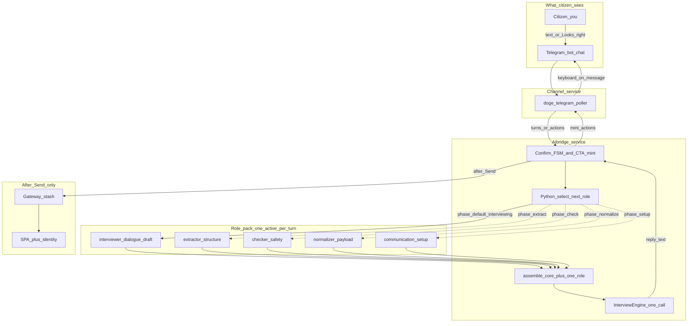
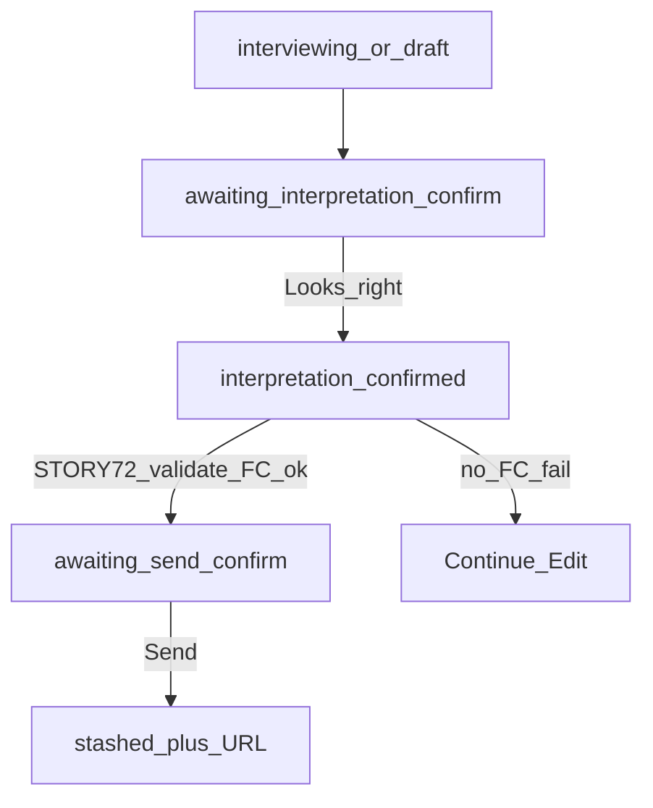

# REQ15 — обучение оператора: пайп, роли, сервисы, кнопки (2026-11-11)

**Role:** простой инженерный разбор для оператора · не Product Done stamp.  
**Method:** [`.cursor/rules/analysis.mdc`](../../.cursor/rules/analysis.mdc)  
**North star:** [`req15-tg-interviewer-citizen-conversation-north-star-2026-11-10.md`](./req15-tg-interviewer-citizen-conversation-north-star-2026-11-10.md)  
**Live classroom:** [`tg-interview-transcripts/req15-tg-interview-dialogue-2026-11-11-pille-buttons-present.md`](./tg-interview-transcripts/req15-tg-interview-dialogue-2026-11-11-pille-buttons-present.md) · [`req15-tg-interview-2026-11-11-buttons-present-log-note.md`](./req15-tg-interview-2026-11-11-buttons-present-log-note.md)  
**Validation:** [`req15-story-71-72-rol07-code-validation-test-2026-11-11.md`](./req15-story-71-72-rol07-code-validation-test-2026-11-11.md)

---

## 1. Одна картинка: кто что делает

В чате ты видишь **одно** сообщение бота. На самом деле там два разных «голоса» склеены:

| Слой | Кто | Что делает | Что ты видишь |
|------|-----|------------|---------------|
| **Текст** | Модель (Custom GPT + роли-инструкции) | Пишет слова про черновик | Длинный reply |
| **Кнопки** | **aibridge** (сервер) | Решает FSM и минтит `actions` | Looks right / Edit / Cancel / Send… |
| **Рисование** | **telegram** channel | Клавиатура Telegram из `actions` | Inline buttons |
| **Отправка в систему** | aibridge → **gateway** stash | Только после **Send** confirm | Потом ссылка |
| **Логин / финал** | **SPA** + identity | Login / OTP / submit | Браузер |

**Легенда:** ты = Citizen · чат с ботом = Telegram · `doge-telegram` + aibridge + gateway + SPA = сервисы.  
**Один turn:** Python `select_next_role(phase)` → `core.md` + **один** role-slice → один вызов модели (не mega-prompt со всеми ролями). Сплошная стрелка = live default (`interviewing` → **interviewer**); пунктир = другие phase из policy (Present в коде, без auto-chain на live).

**Главный урок:** Telegram-бот ≠ роли GPT. Модель пишет только текст и **не** рисует кнопки / **не** двигает FSM словами «иди дальше». Кнопки = токены aibridge. Текст может врать — смотри клавиатуру и `actions_count`.

---

## 2. «Роли» GPT — что это на самом деле

Это **не** отдельные боты в Telegram и **не** шаги, которые гражданин должен вызывать. Пакет `instructions-roles/` + Python policy: на каждый turn активна **ровно одна** роль.

| Role id | Owns (verified) | Для гражданина |
|---------|-----------------|----------------|
| `communication_setup` | Язык / тон / verbosity до интервью (`phase=setup`) | Не видит как отдельный бот |
| `interviewer` | Диалог, черновик, calm surface (`phase=interviewing`, **live default**) | Спокойный помощник в чате |
| `extractor` | Структура / gaps (`phase=extract`) | **Не** «передай экстрактору» |
| `checker` | Safety / policy gate (`phase=check` или `needs_check`) | **Не** шаг пользователя |
| `normalizer` | `normalized_issue_payload` для сервера (`phase=normalize`) | **Не** шаг пользователя |

Extract / check / normalize **не** auto-chain на live TG без смены `semantic_state.phase`. Если бот пишет «передача на extractor выполнена» без смены FSM/кнопок — это **искажение** (ROL-07 / north star).

---

## 3. Confirm FSM = какие кнопки когда

Состояние живёт в **aibridge**, не в голове модели.

### Набор A — «черновик верный?» (сейчас у тебя)

**State:** `awaiting_interpretation_confirm`  
**Кнопки (типичные labels):**

| Кнопка в TG | Технический kind | Смысл |
|-------------|------------------|-------|
| **Looks right** | `confirm_interpretation` | «Черновик ок — идём дальше по серверу» |
| **Edit** | `edit` | Вернуться править смысл / текст |
| **Cancel** | `cancel` | Отменить этот confirm-поток |

Пока ты **не** нажала Looks right, сервер снова и снова отдаёт **тот же** набор (STORY-71 remint). Поэтому кнопки «везде одинаковые» — это не баг, а «мы всё ещё ждём апрув черновика».

### Набор B — после Looks right (STORY-72)

Сервер сам гоняет post-confirm цепочку (не твой free-text):

| Исход | Кнопки | Смысл |
|-------|--------|-------|
| Validate + function call OK | **Send** / Edit / Cancel | Можно отправлять в DOGEstonia stash |
| Нет FC / validate fail | **Continue** / Edit | Черновик подтверждён, но Send ещё нельзя |

### Набор C — после Send

Stash на gateway → в чате может появиться **ссылка** (`continuation_url`) → SPA login / OTP / submit. Модель ссылку **не** выдумывает.

---

## 4. Текст vs кнопки vs команды

| Действие гражданина | Что происходит |
|---------------------|----------------|
| Пишешь «восстанови / что дальше / иди дальше» | Новый **текстовый** turn → модель отвечает → aibridge снова минтит кнопки **текущего** state |
| Жмёшь **Looks right** | Callback → `/v1/channel/actions` → FSM двигается → возможен набор B |
| Пишешь «отправляй» | **Не** Send (REQ-11); отказ модели правильный |

**Smooth path сегодня:** нажми **Looks right** под сообщением с черновиком — не пиши «иди дальше».

---

## 5. Карта искажений (урок по сессии 11.11)

| Искажение | Observed | Как распознать |
|-----------|----------|----------------|
| **A. Prose ≠ keyboard** | Бот: «как только появятся кнопки» · на сообщении уже Looks right/Edit/Cancel | Смотри клавиатуру + `actions_count≥2` в логе |
| **B. Role theater** | «interview завершён / передача на extractor…» | Гражданину это не нужно; этап = кнопки/FSM |
| **C. Одинаковые кнопки** | Remint Confirm/Edit пока state не сменился | Норма до Looks right |
| **D. Free-text advance** | «иди дальше» не даёт Send | By design |
| **E. EN labels** | «Looks right» при RU-чате | UX шероховатость; смысл = Confirm draft |

**Хорошая новость:** STORY-71 на живом канале **сработал** (`actions_count=3`, `has_actions=True`). Застряли не на «нет кнопок», а на «кнопку Confirm не нажали» + prose врёт про отсутствие кнопок.

---

## 6. Мини-чеклист оператора перед выводом «сломано»

1. В `aibridge.log`: `state=` и `actions_count=` на том же `event_id`.  
2. В `telegram.log`: `has_actions=` и `reply_prefix=`.  
3. Клавиатура на сообщении совпадает с `actions_count`?  
4. Ты нажала **кнопку** или написала текст?  
5. Prose про «extractor/кнопок нет» — расходится с фактом? → искажение модели / pack, не обязательно mint.

---

## Related

- Roles / soft conversation Q&A: [`req15-roles-soft-conversation-qna-2026-11-11.md`](./req15-roles-soft-conversation-qna-2026-11-11.md)  
- Q&A уточнения (Looks right→Send, FSM vs phase, FC/Validate): [`req15-operator-pipe-qna-clarify-2026-11-11.md`](./req15-operator-pipe-qna-clarify-2026-11-11.md)  
- Log note 11.11 buttons Present: [`req15-tg-interview-2026-11-11-buttons-present-log-note.md`](./req15-tg-interview-2026-11-11-buttons-present-log-note.md)  
- Looks right 409 Token expired: [`req15-tg-interview-2026-11-11-looks-right-token-expired-log-note.md`](./req15-tg-interview-2026-11-11-looks-right-token-expired-log-note.md)  
- STORY-71/72 + ROL-07 validate: [`req15-story-71-72-rol07-code-validation-test-2026-11-11.md`](./req15-story-71-72-rol07-code-validation-test-2026-11-11.md)  
- Arch 72 sequence: [`../../doge-ai-bridge/docs/architecture/req15-tg-channel-interviewer-ux/05-send-after-draft-confirm-validate.md`](../../doge-ai-bridge/docs/architecture/req15-tg-channel-interviewer-ux/05-send-after-draft-confirm-validate.md)  
