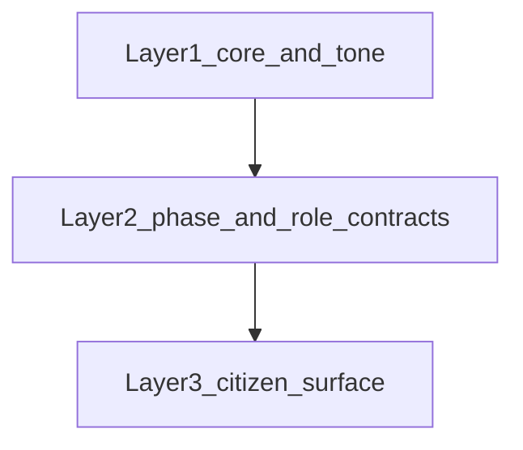

# REQ15 — роли, soft conversation, стыковка (Q&A) · 2026-11-11

**Role:** отдельный слой понимания «как роли складываются в спокойный разговор» · не Product Done.  
**Method:** [`.cursor/rules/analysis.mdc`](../../.cursor/rules/analysis.mdc)  
**Peer pipe/buttons:** [`req15-operator-pipe-and-buttons-training-2026-11-11.md`](./req15-operator-pipe-and-buttons-training-2026-11-11.md) · [`req15-operator-pipe-qna-clarify-2026-11-11.md`](./req15-operator-pipe-qna-clarify-2026-11-11.md)

**Честность:** каждый блок помечен **Present** (код/файлы сейчас) · **Desired** (инструкции/методология) · **Absent** (нет в live runtime). Auto-chain ролей на live TG **Absent** — это уже зафиксировано в pipe QnA; здесь раскрывается *почему* и *что вместо неё*.

**Authoring SSOT ролей:** [`GPT-UI/instructions-roles/`](../../GPT-UI/instructions-roles/) (twin path `GPT UI/instructions-roles/` — зеркало; цитаты ниже → GPT-UI).

---

## Три связанных слоя

| Слой | Вопрос | Суть |
|------|--------|------|
| **1** | Q1 (+ часть Q7) | Общие правила общения в `core` vs то, что только в role-slice |
| **2** | Q2–Q6 | Кто двигает `phase`, контракты ролей, передача артефактов, кто пишет reply |
| **3** | Q5–Q7 + пример | Что видит гражданин и за счёт чего стыки не должны «скрипеть» |
| Термины | Q8 | «Оператор» ≠ гражданин ≠ policy rulebook |

---

## Слой 1 — общие правила общения

### Q1. Что в `core`, что только в роли?

| Тема | Где | Статус |
|------|-----|--------|
| Civic identity → Issue; иерархия инструкций; awareness полей Issue | [`core.md`](../../GPT-UI/instructions-roles/core.md) | **Present** (prose) |
| Порядок цепочки interview→extract→…→server (methodology) | `core` Bounds / Result-shape | **Desired** в инструкции; **Absent** как auto runtime |
| Auto-advance без «дальше/проверяй» | `core` + `interviewer` | **Desired** (инструкция модели); server FSM/CTA — отдельно |
| Ban invent stash / SPA URL / fake status | `core` Ownership + bans | **Present** |
| **Citizen surface covenant** (не озвучивать кухню / HANDOFF / «передал») | `core` § Citizen surface | **Present** (ROL-07 prose) |
| TG style: air, blank lines, 🔸, emoji budget | `core` Telegram surface style | **Present** |
| i18n `{et,ru,en}` | `core` | **Present** |
| Тон / ненавязчивость / темп / неопределённость (глубина) | в основном **`interviewer`** + archive [`story-interview-flow.md`](../../GPT-UI/instructions-archive-module1-req48/story-interview-flow.md) | **Desired** methodology |
| Structure / gaps | `extractor` | role-only |
| Safety BLOCK/REQUEST + policy admission | `checker` | role-only |
| `normalized_issue_payload` | `normalizer` | role-only |
| `ui_lang` / tone presets / verbosity | `communication_setup` | role-only |
| Citizen fence «если пишешь reply — держи covenant» | все non-interviewer role md | **Present** fence lines |

**Сборка на turn (Present):** `assemble_role_prompt` = текст `core.md` + **один** role-slice (`assembly.py`); выбор slice — Python `select_next_role(phase[, flags])`, не LLM-router.

**Запрет озвучивать внутреннюю кухню:** канон в **core** (covenant); interviewer усиливает «Do not» на HANDOFF/extractor/…; остальные роли — fence. Это instruction surface; live compliance модели — отдельно (Open на 11.11).

---

## Слой 2 — выбор и стыковка ролей

### Q2. Кто меняет `phase` и таблица переходов?

**Кто выбирает роль:** только `select_next_role` по уже известной `phase` (+ optional flags).  
**Кто должен менять phase (Desired):** методология / будущий coordinator — в role prose «auto-advance» и handoff tables.  
**Кто меняет phase сейчас (Present live channel):**

- [`channel_wire.apply_before_engine_turn`](../../doge-ai-bridge/src/aibridge/channel_wire.py): читает `semantic_state`; если `phase is None` → `set_phase(..., "interviewing")`.
- Production-caller, который ставит `extract` / `check` / `normalize` / `setup` или флаг `needs_check` в channel path — **Absent** в `doge-ai-bridge/src` (флаг есть в policy + tests только).

| Текущая phase (policy) | Роль | Событие → следующая (Desired / methodology) | Runtime 11.11 |
|------------------------|------|-----------------------------------------------|---------------|
| `setup` | `communication_setup` | comm_context ready → `interviewing` | phase обычно не `setup` |
| `interviewing` | `interviewer` | soft understanding / ready for structure → `extract` (или needs_check → checker) | **Present default** — остаёмся здесь |
| `interviewing` + `needs_check=True` | `checker` | overlay в [`policy.py`](../../doge-ai-bridge/src/aibridge/roles/policy.py) | setter флага **Absent** в live channel |
| `extract` | `extractor` | validation report / gaps → `check` или назад в диалог | **Absent** auto hop |
| `check` | `checker` | approve → `normalize`; deny/block → remediate dialogue | **Absent** auto hop |
| `normalize` | `normalizer` | `normalized_issue_payload` → **server** handoff (не model HTTP) | **Absent** auto hop |

**Не путать:** Confirm FSM (`awaiting_interpretation_confirm` …) ≠ `semantic_state.phase`. FSM двигают кнопки aibridge; phase — semantic store (сейчас почти всегда `interviewing`).

---

### Q3. Контракт каждой роли

| Роль | Получает (логический input) | Обязана вернуть | Запрещено менять / делать | Done-signal (methodology) |
|------|----------------------------|-----------------|---------------------------|---------------------------|
| **communication_setup** | ранний session context | `comm_context` (lang/tone/verbosity/…) | extract/check/normalize; stash/SPA | session ready for interviewer |
| **interviewer** | диалог гражданина | soft understanding; draft Issue prose; scannable citizen reply | invent status/URL/stash; operable role theater; cold form | материал готов к extractor/checker (**model-facing**); Phase 7 confirm в archive flow |
| **extractor** | диалог / non-dialogue input | validation report; gaps; optional `deep_parsing_artifact` | final policy/safety; `normalized_issue_payload`; HTTP | validated material → checker/normalizer chain |
| **checker** | validated material | safety BLOCK/REQUEST/allow; `policy_gate_result` | deep parse; emit payload; stash/SPA | approve → normalizer; deny → stop/remediate |
| **normalizer** | admitted material | `normalized_issue_payload` (deterministic) | re-validate / re-admit; HTTP stash | artifact for **server** intake |

Источники: purpose/bounds/result-shape в каждом `*.md` под [`instructions-roles/`](../../GPT-UI/instructions-roles/).

---

### Q4. Через что роли передают результат?

| Канал | Present? | Что хранит |
|-------|----------|------------|
| История `InterviewEngine` (messages / replay) | **Present** live | слова гражданина + reply модели по turn |
| Confirm FSM + freeze/`draft_hash` | **Present** | dual-confirm / Send permission — не role handoff |
| `SemanticStateService` facts / corrections / hypotheses / gaps | **Present** API | facts/corrections → `invalidate_send_permission`; hypotheses/gaps — draft, без invalidate |
| Автозапись semantic facts на каждый TG turn | **Absent** | `channel_wire` делает get + default phase, не upsert facts |
| Structured artifacts из role prose (`validation report`, `policy_gate_result`, payload) | **Desired** в md | **Absent** как auto pipe между LLM-ролями на live TG |

**Поправки человека vs предположения модели (Desired):** archive Phase 7 — summary → invite corrections → update framing → re-confirm; semantic corrections vs hypotheses.  
**Present live:** поправка = новый текст в истории (± Edit CTA); отдельного proof «prose == FC» нет (см. pipe QnA §17).

---

### Q5. Кто имеет право говорить с человеком?

| Режим | Как устроено |
|-------|----------------|
| **Present runtime** | Один turn = одна роль в instructions → модель пишет **один** `reply_text`. Live default → **interviewer**. Нет отдельного слоя «внутренние роли молчат → interviewer озвучивает». |
| **Instruction design** | Любая роль *может* теоретически дать citizen-visible reply, но **должна** соблюдать core covenant / fence. Ideal continuity: гражданин не видит «вас передали в другой отдел» (ROL-07). |
| **Desired soft continuity** | Внутренние extract/check/normalize без theater; citizen surface = спокойный draft helper. Отдельного narrator microservice **Absent**. |

---

### Q6. Возврат из внутренней обработки в разговор?

| Сигнал (Desired) | Кто формулирует следующий вопрос | Present live |
|------------------|----------------------------------|--------------|
| extractor: нет даты / gap | назад в диалог без «отдела extractor» | нет hop → тот же interviewer (или prose theater = искажение) |
| checker: противоречие / BLOCK/REQUEST | remediate in dialogue (`checker` handoff) | нет hop |
| normalizer: нет обязательного поля | не должен «допрашивать» сам — structural only; gap → раньше по chain | нет hop |

**Кто выбирает вопрос сейчас:** активная role на turn (почти всегда interviewer) + server CTA (Looks right / Continue / Edit). Router «выбери роль и скрой стык» **Absent**.

---

## Слой 3 — что видит человек + «мягко»

### Q7. Что значит «мягко вести разговор» (целевое)?

Канон глубины — Module-1 [`story-interview-flow.md`](../../GPT-UI/instructions-archive-module1-req48/story-interview-flow.md) (interviewer ссылается на эту методологию):

| Правило | Содержание | Статус |
|---------|------------|--------|
| Soft entry | не начинать сухим «What is your complaint?» | **Desired** |
| Темп вопросов | prefer **one** reframe-focused follow-up per turn (FR-M1-017); не стекать три новых вопроса (FR-M1-018), если пользователь не просил fast batch | **Desired** |
| Неопределённость | не invent facts; name uncertainty; drop rejected reframe | **Desired** |
| Усталость / раздражение / смена темы | anti-patterns: formality, false empathy, pseudo-therapy (§8); civic scope (§12) | **Desired** |
| Отказ / исправления | Phase 7: summary → corrections → re-confirm; Edit CTA на server | Desired + **Present** Edit kind |
| «Достаточно» | completeness Q1–Q6; Q7 non-blocking; quality bar §9 | **Desired** (model judgment) |
| Looks right на сервере | FC-less + FSM `interviewing` → mint Confirm — **не** ready-detector черновика | **Present** (pipe QnA §16) |

Стиль поверхности (air / 🔸) — **core** ROL-06; это читаемость, не замена soft-entry дисциплины.

---

### Пример: один эпизод в трёх колонках

Сценарий: гражданин пишет про яму у дома; бот уточняет; появляется Looks right.

| Шаг | Гражданин видит (слой 3) | Desired внутренние hops (слой 2) | Present 11.11 |
|-----|--------------------------|----------------------------------|---------------|
| 1 | Спокойный вопрос / soft entry | setup→comm_context→interviewer phase 1–2 | обычно сразу interviewer; phase=`interviewing` |
| 2 | 1 уточнение (где/когда), без «передаю экстрактору» | interviewer внутри phases 2–3; gaps остаются у модели | тот же interviewer turn |
| 3 | Краткий черновик + кнопки Looks right/Edit/Cancel | после soft understanding → extract→check→normalize **тихо**; гражданину только confirm | **без** role hops: server mint Confirm на FC-less; модель может *врать* theater |
| 4 | После Looks right — Send или Continue | post-confirm: FC/validate (Python), не три LLM-роли | code Present STORY-72; live E2E на 11.11 Open (часто 409) |

---

## Q8. Кто такой «оператор»?

| Смысл слова | Кто | Решения |
|-------------|-----|---------|
| **Оператор анализа / Zeya888** (этот документ) | человек, читающий docs и ведущий обучение/очередь | что документировать, что валидировать, когда код/live |
| **Гражданин (citizen)** | рассказывает историю в Telegram / SPA | факты, правки, Looks right / Send / SPA submit |
| **Сотрудник-интервьюер в чате** | — | **Absent** на TG product path |
| **Operator rulebook** (в `checker` prose) | внешний policy/admission документ | правила допуска Issue — не участник чата |

В заголовках «operator training» = обучение **читателя docs**, не роль гражданина.

---

## Сводка для следующей визуализации

1. **Слой 1 (общий):** core задаёт covenant + style + bans; мягкость глубины — interviewer + interview-flow.  
2. **Слой 2 (стыки):** policy умеет 5 phase→role; live почти всегда interviewer; передача = история (+ semantic API), не auto role pipe.  
3. **Слой 3 (человек):** один спокойный голос + server buttons; техника стыков не должна звучать как «другой отдел».

---

## Path index (вместо архива)

| Файл | Зачем |
|------|--------|
| [`GPT-UI/instructions-roles/core.md`](../../GPT-UI/instructions-roles/core.md) | shared constitution / covenant / style |
| [`GPT-UI/instructions-roles/interviewer.md`](../../GPT-UI/instructions-roles/interviewer.md) | dialogue + soft draft |
| [`GPT-UI/instructions-roles/extractor.md`](../../GPT-UI/instructions-roles/extractor.md) | structure / gaps |
| [`GPT-UI/instructions-roles/checker.md`](../../GPT-UI/instructions-roles/checker.md) | safety / admission |
| [`GPT-UI/instructions-roles/normalizer.md`](../../GPT-UI/instructions-roles/normalizer.md) | payload |
| [`GPT-UI/instructions-roles/communication_setup.md`](../../GPT-UI/instructions-roles/communication_setup.md) | lang/tone bootstrap |
| [`GPT-UI/instructions-roles/roles.manifest.json`](../../GPT-UI/instructions-roles/roles.manifest.json) | assembly manifest |
| [`GPT-UI/instructions-archive-module1-req48/story-interview-flow.md`](../../GPT-UI/instructions-archive-module1-req48/story-interview-flow.md) | soft entry / phases / FR-M1 |
| [`doge-ai-bridge/src/aibridge/roles/policy.py`](../../doge-ai-bridge/src/aibridge/roles/policy.py) | `select_next_role` |
| [`doge-ai-bridge/src/aibridge/roles/assembly.py`](../../doge-ai-bridge/src/aibridge/roles/assembly.py) | core + one slice |
| [`doge-ai-bridge/src/aibridge/channel_wire.py`](../../doge-ai-bridge/src/aibridge/channel_wire.py) | phase seed + select |
| [`doge-ai-bridge/src/aibridge/semantic_state/service.py`](../../doge-ai-bridge/src/aibridge/semantic_state/service.py) | facts/corrections/gaps |

---

## Related

- Pipe QnA (Looks right→Send, phase≠FSM): [`req15-operator-pipe-qna-clarify-2026-11-11.md`](./req15-operator-pipe-qna-clarify-2026-11-11.md)  
- Training SSOT: [`req15-operator-pipe-and-buttons-training-2026-11-11.md`](./req15-operator-pipe-and-buttons-training-2026-11-11.md)  
- North star citizen surface: [`req15-tg-interviewer-citizen-conversation-north-star-2026-11-10.md`](./req15-tg-interviewer-citizen-conversation-north-star-2026-11-10.md)  
- ROL-07 story: [`../../GPT-UI/docs/tasks/backlog-stories/req15-tg-interviewer-roles-ux/STORY-GPT-ROL-07-citizen-surface-no-role-theater.md`](../../GPT-UI/docs/tasks/backlog-stories/req15-tg-interviewer-roles-ux/STORY-GPT-ROL-07-citizen-surface-no-role-theater.md)  
