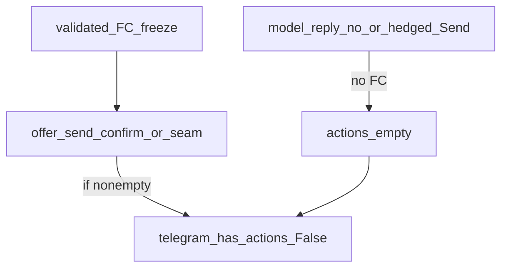

# REQ15 TG interview — actions + context diagnosis (2026-11-10)

**Role:** detailed ops diagnosis after operator retest · not Product Done / not invent live SUCCESS.  
**Method:** [`.cursor/rules/analysis.mdc`](../../.cursor/rules/analysis.mdc)  
**Transcripts:** [DeepSeek 14:06](./tg-interview-transcripts/req15-tg-interview-dialogue-2026-11-09-pille-deepseek.md) · prior [12:56 Send-claim](./tg-interview-transcripts/req15-tg-interview-dialogue-2026-11-09-pille.md)  
**Prior note:** [`req15-tg-interview-2026-11-09-deepseek-actions-log-note.md`](./req15-tg-interview-2026-11-09-deepseek-actions-log-note.md)  
**Logs:** [`scripts/logs/local-five/telegram.log`](../../scripts/logs/local-five/telegram.log) · [`aibridge.log`](../../scripts/logs/local-five/aibridge.log)  
**Operator screenshots:** evening 16:18–16:43 + next-day «отправляй» 12:25 (chat_id 293561290) · buttons Absent

---

## 1. Executive verdict

| Question | Verdict |
|----------|---------|
| Did Telegram receive nonempty `actions` on handoff turns? | **No** — `has_actions=False` for all turns after early welcome/lang-pick True |
| Can we see aibridge mint decision (`state` / `fc_count` / `actions_count`)? | **No** — `ops_channel_turn` **Absent** from `aibridge.log` (code Present in tree; logger had no StreamHandler → INFO not in uvicorn redirect file) |
| Is telegram process on current outbound logging? | **No** — no `reply_prefix=` ever; start line still **2026-11-04**; REUSE kept stale PID |
| Why «контекст» felt lost? | Narrative can return via **user paste** or PG history; **process CTAs / Send pipeline never attached**. Free-text «отправляй» does not Send (**REQ-11 Keep**) |
| Is memory-store the wipe cause *now*? | **Unlikely with current `.env`:** `DATABASE_URL` postgres + `AIBRIDGE_ALLOW_MEMORY_STORES=false` → `use_pg_runtime` should be True. Earlier dual `ALLOW_MEMORY=true` could explain prior wipes |

---

## 2. Telegram `has_actions` timeline (chat_id=293561290)

### 2.1 DeepSeek smoke 2026-11-09 14:06–14:13

| Time | Note | has_actions |
|------|------|-------------|
| 14:06:33 | first («куку») | **True** |
| 14:07:20 … 14:13:16 | interview → «все верно» | **False** |
| 14:13:50 | «действия не появились» | **False** |

### 2.2 Evening 2026-11-09 16:15–16:43

| Time | update_id | has_actions |
|------|-----------|-------------|
| 16:15:30 | 87952402 | **False** |
| 16:19:13 | 87952403 | **False** |
| 16:21:31 | 87952404 | **False** |
| 16:43:42 | 87952405 | **False** |

Matches screenshots: continue / restore paste / «Контекст восстановлен» — **no** Confirm/Edit/Send keyboard.

### 2.3 Next day 2026-11-10 12:25

| Time | update_id | has_actions |
|------|-----------|-------------|
| 12:25:59 | 87952406 | **False** |

User text «отправляй» → bot refuses model-owned send (instruction-correct); still **no** server CTAs.

### 2.4 Stale telegram process

- `telegram.log`: last `production_entry_started` **2026-11-04**; **zero** `reply_prefix=` lines despite Present code in [`outbound.py`](../../doge-telegram/src/doge_telegram_channel/outbound.py).
- `local-five-serve-and-health.sh` **REUSE** when port 8090 listening → code reload skipped.
- **Gate for fresh TG:** every new `ops_outbound_sent` must include `reply_prefix=`.

---

## 3. Aibridge log gap

`aibridge.log` = uvicorn access + restart banners only. Grep `ops_channel_turn` → **0**.

Working-tree logger in [`channel.py`](../../doge-ai-bridge/src/aibridge/channel.py) `log_ops_channel_turn` exists, but [`app.py`](../../doge-ai-bridge/src/aibridge/app.py) only did `getLogger("aibridge").setLevel(INFO)` **without attaching a StreamHandler** — so INFO from `aibridge.*` often never joins the redirected uvicorn stdout file.

**Consequence:** cannot prove for 14:06 / 16:xx / 12:25 whether:

- `fc_count=0` (no freeze → no Send),
- `state=interviewing` with failed/skipped seam mint,
- `send_claim` / `needs_control` gate,
- `session_id` continuity across restarts.

---

## 4. Why buttons missing (layered)

1. **Transport:** Telegram only renders nonempty `actions[]` — Observed empty → no keyboard. Not a «Telegram cannot draw» bug.
2. **Send path:** Send CTAs require validated FC → freeze → `offer_send_confirm` (STORY-68). Free-text «отправляй» / hedged «могут появиться» do **not** mint Send.
3. **STORY-70 remint:** needs Send-claim markers (e.g. «действие Send»); hedged copy may not match → no remint.
4. **STORY-68 FC-less:** INTERVIEWING turns **should** still get interpretation CTAs; Observed `has_actions=False` mid-interview → mint skip or wrong state — **root Unknown** until `ops_channel_turn` lands.
5. **Stale TG** confounds format/prefix evidence; does not invent empty `actions` by itself if bridge returns them.

---

## 5. Context loss — plain diagnosis

| Layer | What survives restart | Evidence this smoke |
|-------|----------------------|---------------------|
| Confirm FSM / pending tools | Postgres `confirm_session` if `use_pg_runtime` | Not proven (no session_id logs) |
| LLM conversation items | Postgres `conversation_history` if PG | Bot can recite draft after paste or from history — ambiguous |
| Semantic facts | Postgres `semantic_state` if PG | Not inspected |
| Telegram SQLite | seen update_id / outbox only | Not interview memory |
| In-process memory | Lost on aibridge restart | Only if `ALLOW_MEMORY=true` / non-PG |

**Screenshot «Контекст восстановлен»:** user pasted structured draft («ловите то что мы уже отработали…»); model acknowledged paste. That is **not** proof of durable hydrate.

**Product-felt loss:** interview prose OK / remembered, but **server step (buttons → stash → URL) never started**. User saying «отправляй» correctly refused by roles; without CTAs the pipeline is stuck.

**Env now (no secret values):** postgres `DATABASE_URL` Present · `AIBRIDGE_ALLOW_MEMORY_STORES=false` → code path expects PG. Fix earlier wipe risk: do not leave a later `ALLOW_MEMORY=true` override.

---

## 6. Fixes in this wave (logging only)

- Attach **StreamHandler** + time formatter to `aibridge` logger; log `ops_runtime use_pg_runtime= allow_memory=` at startup (no URL/secrets).
- Enrich `ops_channel_turn` with `event_id=` for join to TG `update_id` / `event_id`.
- Harden retest: **kill** telegram REUSE before next smoke.

**OOS here:** mint/Send code fix / new STORY until ops fields visible in file.

---

## 7. Retest checklist (operator)

1. Kill telegram on 8090 (do not REUSE Nov-era pid): e.g. stop process listening on 8090, remove stale `scripts/logs/local-five/telegram.pid` if needed.
2. Restart **aibridge** then **telegram** (fresh processes).
3. Prove logs:
   - `aibridge.log` contains `ops_runtime use_pg_runtime=` and later `ops_channel_turn … event_id= … state= … fc_count= … actions_count= …`
   - `telegram.log` `ops_outbound_sent` lines contain `reply_prefix=`
4. Short Pille path to handoff (or «все верно» / «отправляй»).
5. Paste into chat the matching `ops_channel_turn` + `ops_outbound_sent has_actions=` lines for those turns.

---

## Related

- Triage: [`req15-tg-interviewer-ux-gap-triage-2026-11-06.md`](./req15-tg-interviewer-ux-gap-triage-2026-11-06.md)  
- STORY-68/70: [`doge-ai-bridge/.../req15-tg-channel-interviewer-ux/`](../../doge-ai-bridge/docs/tasks/backlog-stories/req15-tg-channel-interviewer-ux/INDEX.md)  
- Stale TG / REUSE (start не kill): [`../../scripts/docs/analysis/local-five-telegram-reuse-orphan-2026-11-10.md`](../../scripts/docs/analysis/local-five-telegram-reuse-orphan-2026-11-10.md)  
- Handoff-chain paste 13:37: [`tg-interview-transcripts/req15-tg-interview-dialogue-2026-11-10-pille-handoff-chain.md`](./tg-interview-transcripts/req15-tg-interview-dialogue-2026-11-10-pille-handoff-chain.md) · [`req15-tg-interview-2026-11-10-handoff-chain-log-note.md`](./req15-tg-interview-2026-11-10-handoff-chain-log-note.md)  
