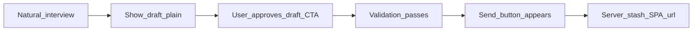
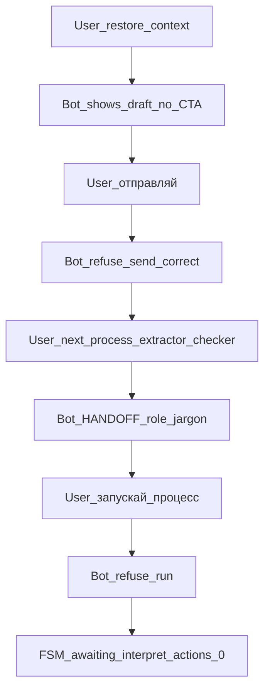
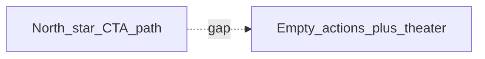

# REQ15 TG interviewer — citizen conversation gap (2026-11-10)

**Role:** detailed gap analysis (docs only) — Desired north star vs Observed live dialogue.  
**Method:** [`.cursor/rules/analysis.mdc`](../../.cursor/rules/analysis.mdc)  
**Desired:** [`req15-tg-interviewer-citizen-conversation-north-star-2026-11-10.md`](./req15-tg-interviewer-citizen-conversation-north-star-2026-11-10.md)  
**Observed (transcript):** [`tg-interview-transcripts/req15-tg-interview-dialogue-2026-11-10-pille-handoff-chain.md`](./tg-interview-transcripts/req15-tg-interview-dialogue-2026-11-10-pille-handoff-chain.md)  
**Ops:** [`req15-tg-interview-2026-11-10-handoff-chain-log-note.md`](./req15-tg-interview-2026-11-10-handoff-chain-log-note.md) · prior window [`req15-tg-interview-2026-11-10-actions-context-diagnosis.md`](./req15-tg-interview-2026-11-10-actions-context-diagnosis.md)  
**Logs:** [`scripts/logs/local-five/aibridge.log`](../../scripts/logs/local-five/aibridge.log) · [`scripts/logs/local-five/telegram.log`](../../scripts/logs/local-five/telegram.log)

**Not:** STORY emission, code/instruction edits, invent live stash PASS.

**Honesty:** Gap = Desired − **Observed**. **Present** = code/docs capability that may exist while Observed fails.

Severity: **Blocker** · **Major** · **Minor** · **Aligned** · **N/A this window**.

---

## 1. Method — three layers

| Layer | Meaning |
|-------|---------|
| **Desired** | Citizen conversation north star 2026-11-10 |
| **Observed** | Same `session_id=sess_15f4a70d1f084488` · windows **13:03–13:05** + **13:37–13:45** (chat_id 293561290) |
| **Present** | Dual-confirm / `offer_interpretation_confirm` / STORY-68–70 remint paths / PG runtime — cited when relevant |

Session after TG kill (13:26): outbound **`reply_prefix=` Present** — channel process freshness **not** the CTA gap.

---

## 2. Session skeleton

### 2.1 Desired (north star §3)

### 2.2 Observed (2026-11-10)

**Missing vs Desired:** Confirm/Edit CTA · validation-after-approve gate · Send button · stash/URL.  
**Extra vs Desired:** role/pipeline theater; user driven to invent commands.

---

## 3. Ops evidence (joinable)

All listed turns: `state=awaiting_interpretation_confirm` · `fc_count=0` · `actions_count=0` · `send_claim=False` · `needs_control=False` · TG `has_actions=False`.

| Window | event_id | user `text_prefix` (TG) |
|--------|----------|-------------------------|
| 13:03 | 87952407–12 | restore / continue / send-ish / validate / show button |
| 13:37–13:45 | 87952413 | восстанови контекст |
| | 87952414 | отправляй |
| | 87952415 | передай в следующий процесс |
| | 87952416 | выполняй теперь ты |
| | 87952417 | передай экстрактору |
| | 87952418 | передай чекеру |
| | 87952419 | запускай следующий процесс |

`ops_runtime use_pg_runtime=True allow_memory=False` (aibridge 13:01 / 13:26). Session continuity **Aligned**.

---

## 4. Gaps by north-star criterion

### 4.1 §1 — Natural talk / no role knowledge

| | |
|--|--|
| **Desired** | Citizen talks without knowing roles/seams; neighbor-like helper |
| **Observed** | Bot surfaces **interviewer / extractor / checker / normalizer / server**, «следующий процесс», structured HANDOFF blocks; user then commands those names |
| **Present** | Roles strip model-owned stash; ROL-05/06 aimed at proactivity — still allow (or fail to ban) pipeline jargon in replies |
| **Severity** | **Major** (trains low-AI-literacy users into operator mode) |
| **Close class** | Instruction: citizen surface forbids role/pipeline jargon; never ask user to «передай экстрактору» |

### 4.2 §2 — Golden middle

| Axis | Desired | Observed | Severity |
|------|---------|----------|----------|
| Proactive vs wait for commands | System advances; user not coach | User had to: восстанови / отправляй / передай… / запускай | **Major** |
| CTA vs free-text-only | One clear in-chat control at seam | **Zero** actions all turns | **Blocker** |
| Honesty vs theater | Admit limits without fake progress | Refuse send **and** claim «передача выполнена» / «вход для checker» with no state/FC/actions change | **Major** |
| Soft offer vs pressure | No nag/shame | No shame Observed · soft offers «поправить / новая проблема» | **Aligned** (pressure) |
| Low AI experience | No expect commands | Product **requires** commands because CTAs Absent | **Blocker** (combined with empty mint) |

### 4.3 §3 — Happy path steps

| Step | Desired | Observed | Severity |
|------|---------|----------|----------|
| **1** Natural interview | No pipeline jargon | Jargon + theater after draft | **Major** |
| **2** Show draft | Plain draft | Draft restored/shown (i18n pack) | **Aligned** (content) |
| **3** User approves via CTA | Confirm/Edit buttons | **No** CTA; only free-text path | **Blocker** |
| **4** Validation after approve | After Confirm | Soft self-check / «готово для checker» **without** prior CTA approve; not server validate gate | **Major** |
| **5** Send button after 3+4 | Server mint Send | Never; `fc_count=0` | **Blocker** |
| **6** Stash → SPA URL | After Send confirm | Not reached | **Blocker** (downstream of 3–5) · Present capability in code unexercised |

### 4.4 §4 — Forbidden list (Observed hit?)

| Forbidden | Hit in Observed? |
|-----------|------------------|
| Role/pipeline jargon as main UX | **Yes** |
| Fake handoff when server actions absent | **Yes** (HANDOFF / extractor / checker prose; logs unchanged) |
| Expect commands as normal path | **Yes** (user forced; product invites via missing CTAs) |
| Premature Send button | **No** (no Send button at all) |
| Invent stash / status / number / SPA URL | **No** (Aligned — model refused invent) |
| Shame / pressure «нажмите сейчас» | **No** (Aligned) |

### 4.5 §5 — Ownership split

| | |
|--|--|
| **Desired** | Agent proposes/acknowledges; server mints CTAs; REQ-11 stash |
| **Observed** | Agent talks about buttons/server; **server returns empty `actions`**; user stuck |
| **Present** | `offer_interpretation_confirm` / `_ensure_control_surface` / STORY-68–70 **Present** in aibridge; this session: remint gate `needs_control=False` + AWAITING_* path does not FC-less remint every turn → **actions stay empty** |
| **Severity** | **Blocker** |
| **Close class** | Aibridge: while `awaiting_interpretation_confirm` and `actions` empty → re-offer interpretation Confirm/Edit (existing `offer_interpretation_confirm` remint path); do not rely on Send-claim markers alone |

---

## 5. Aligned (keep)

| Item | Evidence |
|------|----------|
| Session / draft continuity (PG) | Same `session_id`; «Восстановил» + draft body |
| Free-text «отправляй» does not Send | Refuse + REQ-11 Keep |
| No invented SPA URL / submission number | Transcript + logs |
| No shame/pressure tone | Soft alternatives in bot replies |
| TG process freshness (post-13:26) | `reply_prefix=` on outbound |

---

## 6. Blocker summary

1. **Empty CTA mint** while FSM already `awaiting_interpretation_confirm` → citizen cannot approve draft the north-star way.  
2. **Role-theater prose** fills the vacuum → looks like progress, logs prove none → violates golden middle honesty.  
3. **Command dependence** — opposite of «низкий опыт с ИИ»; user must invent process verbs.  
4. Happy path **stops before** validate-after-approve and Send; stash/URL never in play this session.

---

## 7. Close STORYs (requirements emitted 2026-11-10)

| Priority | Gap | STORY |
|----------|-----|-------|
| P0 | Empty Confirm/Edit in `awaiting_interpretation_confirm` | [`STORY-AIBRIDGE-71`](../../doge-ai-bridge/docs/tasks/backlog-stories/req15-tg-channel-interviewer-ux/STORY-AIBRIDGE-71-awaiting-interpretation-actions-always.md) |
| P1 | Send only after draft confirm + validation | [`STORY-AIBRIDGE-72`](../../doge-ai-bridge/docs/tasks/backlog-stories/req15-tg-channel-interviewer-ux/STORY-AIBRIDGE-72-send-after-draft-confirm-and-validation.md) (hard-dep 71) |
| P0 | Role/HANDOFF theater + command coaching | [`STORY-GPT-ROL-07`](../../GPT-UI/docs/tasks/backlog-stories/req15-tg-interviewer-roles-ux/STORY-GPT-ROL-07-citizen-surface-no-role-theater.md) (soft-dep 71) |

Package INDEX: [aibridge](../../doge-ai-bridge/docs/tasks/backlog-stories/req15-tg-channel-interviewer-ux/INDEX.md) · [GPT roles](../../GPT-UI/docs/tasks/backlog-stories/req15-tg-interviewer-roles-ux/INDEX.md).  
**Code validation + how to test (2026-11-11):** [`req15-story-71-72-rol07-code-validation-test-2026-11-11.md`](./req15-story-71-72-rol07-code-validation-test-2026-11-11.md) · live smoke still Open (H-01 WAIVE).

---

## 8. Out of scope

- Editing `instructions-roles`, aibridge, telegram runtime (Apply/P3 = focused dialogs)  
- Epic/task pipeline folders / arch deepen this wave  
- Declaring Product Done / inventing live stash SUCCESS  

---

## Related

- North star: [`req15-tg-interviewer-citizen-conversation-north-star-2026-11-10.md`](./req15-tg-interviewer-citizen-conversation-north-star-2026-11-10.md)  
- Prior Pille gap (Goals 1–7): [`req15-tg-interviewer-ux-gap-pille-2026-11-06.md`](./req15-tg-interviewer-ux-gap-pille-2026-11-06.md)  
- Triage: [`req15-tg-interviewer-ux-gap-triage-2026-11-06.md`](./req15-tg-interviewer-ux-gap-triage-2026-11-06.md)  
- Handoff log-note: [`req15-tg-interview-2026-11-10-handoff-chain-log-note.md`](./req15-tg-interview-2026-11-10-handoff-chain-log-note.md)  
- Aibridge package (68–72): [`../../doge-ai-bridge/docs/tasks/backlog-stories/req15-tg-channel-interviewer-ux/INDEX.md`](../../doge-ai-bridge/docs/tasks/backlog-stories/req15-tg-channel-interviewer-ux/INDEX.md)  
- GPT roles package (05–07): [`../../GPT-UI/docs/tasks/backlog-stories/req15-tg-interviewer-roles-ux/INDEX.md`](../../GPT-UI/docs/tasks/backlog-stories/req15-tg-interviewer-roles-ux/INDEX.md)  
- Validation / test plan: [`req15-story-71-72-rol07-code-validation-test-2026-11-11.md`](./req15-story-71-72-rol07-code-validation-test-2026-11-11.md)  
