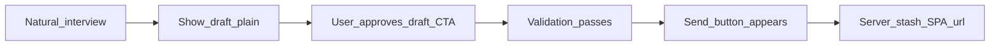

# REQ15 TG interviewer — citizen conversation north star (2026-11-10)

**Role:** product north star / conversation covenant for the Telegram interview surface (operator Desired).  
**SSOT home:** root [`docs/analysis/`](./) (cross-project UX).  
**Method:** [`.cursor/rules/analysis.mdc`](../../.cursor/rules/analysis.mdc)  
**Prior goals checklist (keep):** [`req15-tg-interviewer-target-ux-2026-11-06.md`](./req15-tg-interviewer-target-ux-2026-11-06.md) — Goals 1–7 + send/auth lock.  
**Anti-pattern evidence:** [`req15-tg-interview-2026-11-10-handoff-chain-log-note.md`](./req15-tg-interview-2026-11-10-handoff-chain-log-note.md) · [`tg-interview-transcripts/req15-tg-interview-dialogue-2026-11-10-pille-handoff-chain.md`](./tg-interview-transcripts/req15-tg-interview-dialogue-2026-11-10-pille-handoff-chain.md)

**Honesty:** Desired ≠ Present. Code/docs Done ≠ invent live TG SUCCESS. This file does **not** edit instructions or mint code.

---

## 1. North-star one-liner

Гражданин разговаривает с ботом как с спокойным помощником по соседской заявке: своими словами, без команд, без знания ролей и стыков. Система сама ведёт к понятному черновику, даёт подтвердить его кнопкой, после успешной проверки показывает **Send** — и только сервер реально отправляет.

---

## 2. Golden middle

| Тянуть сюда | Не перегибать туда |
|-------------|-------------------|
| Проактивно собрать факты и предложить черновик, когда данных хватает | Не ждать «дальше / валидируй / запускай процесс» |
| Один ясный контроль в чате на шве (Confirm / Edit / Send) | Не оставлять только free-text как единственный путь |
| Честно сказать, чего бот не делает (не выдумывает номер/статус/URL) | Не разыгрывать ролевой театр «передал экстрактору / чекеру» как будто pipeline уже пошёл |
| Мягко предложить следующий шаг | Не давить «отправляйте сейчас», не стыдить за паузу |
| Учитывать крайне низкий опыт с ИИ у среднего жителя | Не требовать знания внутренних ролей, FSM или «следующего процесса» |

---

## 3. Happy path (Desired)

1. **Natural interview** — вопросы по делу; без жаргона ролей/пайплайна.  
2. **Show draft** — понятный черновик на языке разговора (и i18n-пакет по политике продукта).  
3. **User approves draft** — in-chat CTA (Confirm / Edit), не «напишите всё верно» как единственный способ.  
4. **Validation passes** — проверка допуска/целостности **после** апрува черновика (не до; не вместо апрува).  
5. **Send button appears** — **только** когда (3) и (4) выполнены. Не на первое free-text «отправляй», не до апрува.  
6. **Server stash → SPA URL** — ownership как в [`target-ux-2026-11-06` §5](./req15-tg-interviewer-target-ux-2026-11-06.md); модель не HTTP-stash и не выдумывает ссылку.

Пользователь **не обязан** знать и называть роли, seams или «следующий процесс».

---

## 4. Forbidden on the citizen surface

- Ролевой / pipeline-жаргон как основной UX («extractor», «checker», «запусти следующий процесс»).  
- Fake handoff prose («передал чекеру», «HANDOFF выполнен»), когда серверные действия / реальный этап **не** сработали.  
- Ожидание команд: «дальше», «валидируй», «отправляй», «запускай» как нормальный путь.  
- Premature Send (кнопка или утверждение отправки до апрува черновика и до успешной валидации).  
- Invent stash / статус / номер / SPA URL.  
- Давление, стыд, «вы должны нажать сейчас».

---

## 5. Who owns what (Desired split)

| Layer | Owns |
|-------|------|
| **Agent (roles prose)** | Следующий полезный вопрос; предложить черновик; спокойно ждать; после швов **ссылаться** на in-chat действия, не имитировать их |
| **Server (aibridge CTAs)** | Mint Confirm / Edit / Send в нужный момент последовательности §3 |
| **Server (REQ-11)** | Stash + `continuation_url` после Send confirm |
| **SPA + identity** | Login / OTP / citizen submit после открытия URL |

Lock send/auth: см. [`req15-tg-interviewer-target-ux-2026-11-06.md`](./req15-tg-interviewer-target-ux-2026-11-06.md) §5 — не переопределять здесь.

---

## 6. Gap vs Observed (thin)

| Desired (§3) | Observed 2026-11-10 handoff-chain |
|--------------|-----------------------------------|
| Natural talk, no role theater | Bot emits HANDOFF / «вход для extractor/checker» prose |
| Confirm/Edit then validate then Send CTA | `actions_count=0` · `has_actions=False` throughout |
| Free-text «отправляй» not the send path | Refuse correct; no button appears either |
| Context continuity | Session + draft restore **Present** (good) |

Блокер north star на живом канале: пустой mint CTAs в `awaiting_interpretation_confirm` (см. log-note) — не «ещё одна команда пользователя».

---

## 7. Out of scope of this document

- Правки `instructions-roles`, aibridge mint, telegram orchestration  
- Новые STORY / LF планы (отдельный операторский заказ)  
- Объявление live stash SUCCESS  

---

## Related

- Gap vs live 2026-11-10: [`req15-tg-interviewer-citizen-conversation-gap-2026-11-10.md`](./req15-tg-interviewer-citizen-conversation-gap-2026-11-10.md)  
- Close STORYs: aibridge [`71`](../../doge-ai-bridge/docs/tasks/backlog-stories/req15-tg-channel-interviewer-ux/STORY-AIBRIDGE-71-awaiting-interpretation-actions-always.md) · [`72`](../../doge-ai-bridge/docs/tasks/backlog-stories/req15-tg-channel-interviewer-ux/STORY-AIBRIDGE-72-send-after-draft-confirm-and-validation.md) · GPT [`ROL-07`](../../GPT-UI/docs/tasks/backlog-stories/req15-tg-interviewer-roles-ux/STORY-GPT-ROL-07-citizen-surface-no-role-theater.md)  
- Code validation + retest: [`req15-story-71-72-rol07-code-validation-test-2026-11-11.md`](./req15-story-71-72-rol07-code-validation-test-2026-11-11.md)  
- Operator training (pipe + buttons) 2026-11-11: [`req15-operator-pipe-and-buttons-training-2026-11-11.md`](./req15-operator-pipe-and-buttons-training-2026-11-11.md)  
- Live buttons Present log note: [`req15-tg-interview-2026-11-11-buttons-present-log-note.md`](./req15-tg-interview-2026-11-11-buttons-present-log-note.md)  

- Goals checklist: [`req15-tg-interviewer-target-ux-2026-11-06.md`](./req15-tg-interviewer-target-ux-2026-11-06.md)  
- Triage: [`req15-tg-interviewer-ux-gap-triage-2026-11-06.md`](./req15-tg-interviewer-ux-gap-triage-2026-11-06.md)  
- Handoff-chain log: [`req15-tg-interview-2026-11-10-handoff-chain-log-note.md`](./req15-tg-interview-2026-11-10-handoff-chain-log-note.md)  
- GPT roles UX: [`../../GPT-UI/docs/tasks/backlog-stories/req15-tg-interviewer-roles-ux/INDEX.md`](../../GPT-UI/docs/tasks/backlog-stories/req15-tg-interviewer-roles-ux/INDEX.md)  
- Aibridge channel UX: [`../../doge-ai-bridge/docs/tasks/backlog-stories/req15-tg-channel-interviewer-ux/INDEX.md`](../../doge-ai-bridge/docs/tasks/backlog-stories/req15-tg-channel-interviewer-ux/INDEX.md)  
