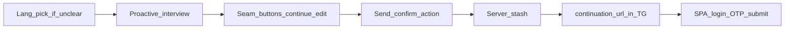

# REQ15 TG interviewer — target UX (2026-11-06)

**Role:** operator target-state note for the Telegram interview surface (Goals 1–7 + send/auth lock).  
**Conversation philosophy SSOT (2026-11-10):** [`req15-tg-interviewer-citizen-conversation-north-star-2026-11-10.md`](./req15-tg-interviewer-citizen-conversation-north-star-2026-11-10.md)  
**Method:** [`.cursor/rules/analysis.mdc`](../../.cursor/rules/analysis.mdc)  
**Evidence of current pain:** [`tg-interview-transcripts/req15-tg-interview-dialogue-2026-11-05-pille.md`](./tg-interview-transcripts/req15-tg-interview-dialogue-2026-11-05-pille.md)  
**Not:** STORY implement order, code change wave, or G4 PASS stamp.

**Honesty:** Present = verified in code/docs at write time. Desired = operator intent. Archive Module1 redirect prose is a **behavior cite** for URL shape only — do **not** restore model-owned HTTP stash (REQ-48 strip / REQ-11 server pipe).

---

## 1. Observed pain (Pille transcript)

- User repeatedly drove the pipeline: «проверяй», «принимаю, дальше», «дальше», «продолжай», «давай дальше уже отправлять».
- At send time the bot refused server send and pointed to a vague «интерфейс» — no clickable control / URL in that turn.
- User asked about redirect to auth; bot correctly said it does not redirect — but the **product** still owes a real handoff control.
- Dense `**` markdown and long packed bullet blocks; hard to scan in Telegram.
- No language picker when intent language is unclear.

---

## 2. Target principles

1. **Proactive stage advance** — ordinary users should not coach «дальше / валидируй / отправь».
2. **Seamless seams or explicit controls** — if role/instruction stages cannot join silently, mint Telegram actions (continue / edit / send).
3. **Server-owned submit** — stash + SPA continuation only via dual-confirm path, not model HTTP.
4. **Readable TG surface** — air, light markers, minimal star-bold spam.

---

## 3. Goals 1–7 (operator) — Present / Desired / Constraint

| # | Desired | Present (verified) | Constraint / note |
|---|---------|--------------------|-------------------|
| **1** | Greater proactivity; users should not keep saying «дальше» or coaching validate/send | Interview prose often waits for nudges; confirm actions exist in code but smoke often had `has_actions=False` late | Instruction stage policy + coordinator must auto-advance and mint actions |
| **2** | Factual send + redirect into SPA for login/signup + phone OTP (product path exists) | Dual-confirm → `execute_stash` → `build_continuation_url` Present in aibridge; TG append Present (G2); SPA `#/story/submit?draft_id=` protected + citizen submit Present; archive [`api-orchestrator.md`](../../GPT%20UI/instructions-archive-module1-req48/api-orchestrator.md) §5.2.B = URL shape cite | Wire via **Send confirm** actions → server stash → URL in message — **not** model-owned Actions stash / fake redirect prose |
| **3** | On start, if language cannot be identified (e.g. `888`) → language buttons: name + flag; English = US flag | Inbound `language_code` mapped in telegram; **no** lang-pick actions found | New session-locale actions + persist locale for rest of interview |
| **4** | Stage joins maximally seamless; if not possible → UI controls to continue or edit (esp. before validate/send) | `offer_interpretation_confirm` / `offer_send_confirm` Present | At every non-seamless seam: always return actions; never leave only free-text «дальше» |
| **5** | Prefer emoji over `**` star formatting; light load; bullets/markers as orange as possible | Model emits dense `**`; Telegram parse modes do **not** support CSS orange | Use sparse emoji + Unicode orange-ish bullets (e.g. 🔸 / orange square) where HTML/Markdown cannot color text; honesty: true brand orange CSS **Absent** in TG |
| **6** | More visual air; less packed text | Pille replies: long contiguous bullet walls | Instruction style: short paragraphs, blank lines between blocks, one idea per block |
| **7** | Agent additions in same key | — | §4 below (Desired, not Present) |

---

## 4. Agent additions (Desired — same UX key)

Marked **Desired**; not claimed Present unless cited elsewhere.

1. **One primary CTA per stage-boundary turn** — Telegram button preferred over prose «напишите дальше».
2. **Auto-offer Send confirm** when draft is ready — user must not invent «давай отправлять».
3. **One-line progress crumb** (e.g. «Сбор → проверка → отправка») — hierarchy only, no dashboard clutter.
4. **On stash success** — outbound must include clickable `continuation_url` (G2 append already Present when URL Present).
5. **Never say «используйте интерфейс»** without attaching the actual control that exists in-channel (action button) or the SPA URL after stash.
6. **Soft ops debt:** redacted turn summaries in logs so future transcripts need less copy-paste.

---

## 5. Lock: send / auth handoff

| Layer | Target ownership |
|-------|------------------|
| Interview / check / normalize prose | Roles instructions (proactive, airy, emoji-light) |
| Understanding / Send / Edit / Cancel | Server `ConfirmationGuard` actions |
| HTTPS stash | aibridge `GatewayExecutor.execute_stash` only |
| SPA URL | `build_continuation_url` → `{SPA}/#/story/submit?draft_id=` |
| Login / signup / SMS OTP / Story bind | SPA + identity (after user opens URL) |

**Forbidden target:** restoring Custom GPT model-owned `postStoryDraftStash` + prose-only «redirect» as the Telegram MVP path.

---

## 6. Out of scope of this document

- Editing `instructions-roles`, aibridge, or telegram code
- Emitting STORYs / LF plans (separate operator order)
- Declaring G4 MVP Done or inventing live stash PASS

---

## Related

- Citizen conversation north star: [`req15-tg-interviewer-citizen-conversation-north-star-2026-11-10.md`](./req15-tg-interviewer-citizen-conversation-north-star-2026-11-10.md)
- Transcript folder: [`tg-interview-transcripts/`](./tg-interview-transcripts/)
- Copy-paste prompt: [`tg-interview-transcripts/prompt-telegram-copypaste-to-transcript.md`](./tg-interview-transcripts/prompt-telegram-copypaste-to-transcript.md)
- UX gap (Pille vs this target): [`req15-tg-interviewer-ux-gap-pille-2026-11-06.md`](./req15-tg-interviewer-ux-gap-pille-2026-11-06.md)
- Triage (LF / STORY · statuses closed in docs/code): [`req15-tg-interviewer-ux-gap-triage-2026-11-06.md`](./req15-tg-interviewer-ux-gap-triage-2026-11-06.md)
- GPT UI roles UX: [`req15-tg-interviewer-roles-ux/INDEX.md`](../../GPT-UI/docs/tasks/backlog-stories/req15-tg-interviewer-roles-ux/INDEX.md) (ROL-05/06 · Done Awaiting Commits) · aibridge 68/69 Code Done · LF validate PASS
- MVP readiness: [`req15-mvp-readiness-validation-2026-11-05.md`](./req15-mvp-readiness-validation-2026-11-05.md)
- Gap execution order: [`req15-gap-closure-execution-order-2026-11-03.md`](./req15-gap-closure-execution-order-2026-11-03.md)
