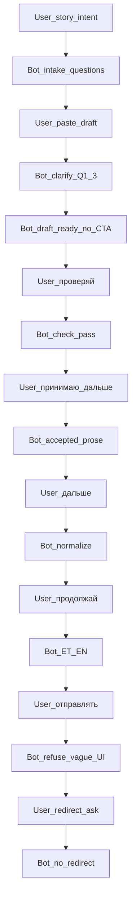
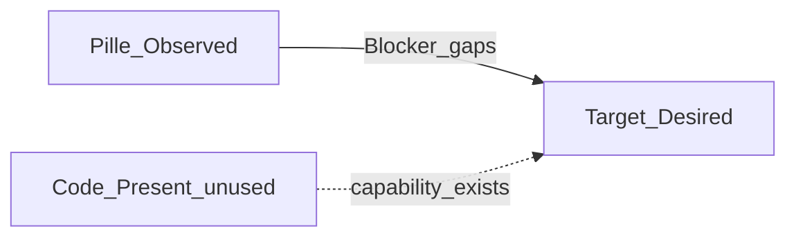

# REQ15 TG interviewer UX gap — Pille session vs target (2026-11-06)

**Role:** detailed gap analysis (docs only).  
**Method:** [`.cursor/rules/analysis.mdc`](../../.cursor/rules/analysis.mdc)  
**Observed:** [`tg-interview-transcripts/req15-tg-interview-dialogue-2026-11-05-pille.md`](./tg-interview-transcripts/req15-tg-interview-dialogue-2026-11-05-pille.md)  
**Desired:** [`req15-tg-interviewer-target-ux-2026-11-06.md`](./req15-tg-interviewer-target-ux-2026-11-06.md)  
**Ops cite (actions):** [`req15-g4-dialogue-2026-11-05-1504.md`](./req15-g4-dialogue-2026-11-05-1504.md) · `scripts/logs/local-five/telegram.log` 15:03–15:38

**Not:** STORY emission, code/instruction edits, inventing G4 stash PASS.

---

## 1. Method — three layers

| Layer | Meaning |
|-------|---------|
| **Observed** | What happened in the Pille Telegram session (transcript text) |
| **Present** | What the codebase can do (dual-confirm, stash, URL append, etc.) |
| **Desired** | Target UX 2026-11-06 |

**Gap (this doc)** = Desired − **Observed** (session).  
**Honesty:** Present capability can exist while Observed fails (e.g. `offer_send_confirm` Present in aibridge; this session mostly `has_actions=False` after 15:03:59).

Severity: **Blocker** (blocks MVP handoff UX) · **Major** (hurts ordinary-user completion) · **Minor** · **N/A this session** · **Soft** (ops debt).

---

## 2. Session skeleton (Observed)

**Ops (same window):** one early outbound `has_actions=True` (15:03:59 / `87952378`); subsequent turns through `87952388` logged `has_actions=False`; no `ops_action` / callback in that window. Transcript shows **no** inline CTA labels.

---

## 3. Per-goal gaps

### Goal 1 — Proactive advance (no constant «дальше»)

| | |
|--|--|
| **Desired** | Ordinary users do not coach validate/send/next |
| **Observed** | User drove stages: «проверяй»; «принимаю, дальше»; «дальше»; «продолжай»; «давай дальше уже отправлять» |
| **Present** | Roles interview can continue in prose; confirm actions exist in coordinator — not used as auto-advance in this session |
| **Severity** | **Major** (Blocker when combined with Goal 4/2 at send) |
| **Close class** | Instructions stage policy + mint actions at boundaries |

### Goal 2 — Factual send + SPA auth handoff

| | |
|--|--|
| **Desired** | Send confirm → server stash → `continuation_url` in TG → SPA login/signup/OTP/submit |
| **Observed** | Bot: «я не могу сам выполнить серверную отправку…»; «используйте действие подачи истории в **интерфейсе** DOGEstonia» — **no** URL, **no** in-chat Send button in that turn. User then asked about redirect to auth; bot refused redirects (instruction-correct for model; product control still missing) |
| **Present** | Dual-confirm → `execute_stash` → `build_continuation_url`; TG append (G2); SPA `#/story/submit?draft_id=` protected |
| **Severity** | **Blocker** for MVP handoff UX |
| **Close class** | Coordinator: always offer Send confirm when draft ready; never prose «интерфейс» without action/URL |

### Goal 3 — Language picker when language unclear

| | |
|--|--|
| **Desired** | e.g. `888` → buttons name+flag (EN = US flag) |
| **Observed** | Start was clear RU «историю хочу подать» — lang pick **not exercised** |
| **Present** | `language_code` on inbound mapper only; lang-pick actions **Absent** |
| **Severity** | **N/A this session** (still Desired product gap for other starts) |
| **Close class** | New lang-pick actions + session locale |

### Goal 4 — Seamless seams or UI controls

| | |
|--|--|
| **Desired** | Seamless join between instruction stages; else continue/edit/send controls |
| **Observed** | Seams check → accept → normalize → i18n → send crossed only via free-text nudges; no continue/edit/send controls visible in transcript |
| **Present** | `offer_interpretation_confirm` / `offer_send_confirm` Present in code |
| **Severity** | **Blocker** (session gap) / Present capability unused |
| **Close class** | Always mint actions at non-seamless seams |

### Goal 5 — Formatting (emoji over `**`; orange-ish markers)

| | |
|--|--|
| **Desired** | Sparse emoji; less star-bold; orange-ish bullets where possible |
| **Observed** | Dense `**` throughout («**Просьба…**», «**Что в порядке**», «**Заголовок**», field lists, ET/EN headers) |
| **Present** | Model emits markdown; TG has no CSS orange |
| **Severity** | **Major** (readability) |
| **Close class** | Instruction style guide; TG honesty on color |

### Goal 6 — Visual air

| | |
|--|--|
| **Desired** | Short paragraphs, blank lines, scannable blocks |
| **Observed** | Long contiguous bullet walls (check report, normalize field list, trilingual pack) |
| **Present** | No formatter enforcement |
| **Severity** | **Major** |
| **Close class** | Instruction spacing rules |

### Goal 7 / target §4 — Agent additions

| Addition | Observed | Severity |
|----------|----------|----------|
| One primary CTA at stage boundary | Absent in transcript | **Blocker** with Goal 4 |
| Auto-offer Send confirm when draft ready | User had to say «отправлять»; then refuse | **Blocker** |
| Progress crumb | Absent | **Minor** |
| `continuation_url` on stash success | Stash not reached; URL Absent | **Blocker** (path not completed) |
| Never «интерфейс» without control | Explicit violation in send refuse turn | **Blocker** |
| Redacted turn logging | Transcript required copy-paste | **Soft** |

---

## 4. Severity rollup

| Severity | Items |
|----------|--------|
| **Blocker** | Goal 2 (send without URL/action); Goal 4 (no seam controls); §4 auto-Send CTA / «интерфейс» without control |
| **Major** | Goal 1 (user coaching); Goals 5–6 (format/air) |
| **N/A this session** | Goal 3 (lang pick) |
| **Minor / Soft** | Progress crumb; ops redacted logging |

---

## 5. Code vs session honesty

| Capability | Present in code? | Exercised in Pille Observed? |
|------------|------------------|------------------------------|
| Interpretation / Send confirm actions | Yes (`confirm.py` / coordinator) | **No** (late `has_actions=False`; no CTA text) |
| `execute_stash` + `continuation_url` | Yes | **No** |
| TG URL append (G2) | Yes | **No** (no URL to append) |
| Model refuses owning stash/redirect | Yes (roles `core` / strip) | **Yes** — correct model behavior; wrong product UX without server CTA |

Aligns with G4: Ready for smoke · evidence Open · this session did not complete Send → stash → URL.

---

## 6. Recommended close order (analysis only)

1. **Instructions:** proactive stage advance + air + emoji-light style (Goals 1, 5, 6).  
2. **Coordinator / channel:** always mint continue/edit/Send actions at seams; auto Send confirm when draft ready (Goals 2, 4, §4).  
3. **Ban pattern:** prose «интерфейс» without attached action or post-stash URL.  
4. **Later:** lang-pick for unclear language (Goal 3).  
5. **Soft:** redacted turn summaries in logs (§4.6).

STORY/LF emission: see triage [`req15-tg-interviewer-ux-gap-triage-2026-11-06.md`](./req15-tg-interviewer-ux-gap-triage-2026-11-06.md) (ROL-05/06 Done Awaiting Commits · aibridge 68/69 Code Done · LF validate PASS · Code≠live SUCCESS).

---

## 7. Out of scope

- Editing `instructions-roles`, aibridge, telegram  
- Restoring model-owned archive stash  
- Declaring MVP Done / inventing live stash PASS  

---

## Related

- Target UX: [`req15-tg-interviewer-target-ux-2026-11-06.md`](./req15-tg-interviewer-target-ux-2026-11-06.md)  
- Triage (LF / STORY · statuses closed in docs/code): [`req15-tg-interviewer-ux-gap-triage-2026-11-06.md`](./req15-tg-interviewer-ux-gap-triage-2026-11-06.md)  
- GPT UI roles UX: [`req15-tg-interviewer-roles-ux/INDEX.md`](../../GPT-UI/docs/tasks/backlog-stories/req15-tg-interviewer-roles-ux/INDEX.md) (ROL-05/06 · Done Awaiting Commits)  
- Transcript: [`tg-interview-transcripts/req15-tg-interview-dialogue-2026-11-05-pille.md`](./tg-interview-transcripts/req15-tg-interview-dialogue-2026-11-05-pille.md)  
- MVP readiness: [`req15-mvp-readiness-validation-2026-11-05.md`](./req15-mvp-readiness-validation-2026-11-05.md)  
