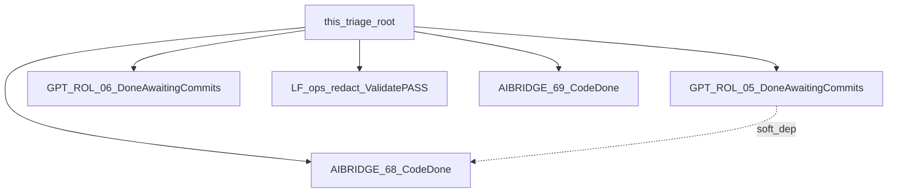

# REQ15 TG interviewer UX gap — triage (2026-11-06)

**Role:** triage map — distribute Pille UX gaps to LF / STORY (cross-project).  
**Method:** [`.cursor/rules/analysis.mdc`](../../.cursor/rules/analysis.mdc) · LF gate [`lightweight-followup.md`](../methodology/Zeya888-builder-queue/guides/lightweight-followup.md) §3  
**Gap:** [`req15-tg-interviewer-ux-gap-pille-2026-11-06.md`](./req15-tg-interviewer-ux-gap-pille-2026-11-06.md)  
**Target:** [`req15-tg-interviewer-target-ux-2026-11-06.md`](./req15-tg-interviewer-target-ux-2026-11-06.md)  
**Transcript:** [`tg-interview-transcripts/req15-tg-interview-dialogue-2026-11-05-pille.md`](./tg-interview-transcripts/req15-tg-interview-dialogue-2026-11-05-pille.md)

**SSOT home:** **root** `docs/analysis/` (cross-project). GPT UI owns instruction STORYs; aibridge owns channel action STORYs; telegram owns ops LF.  
**Honesty:** Code/docs Done ≠ invent live TG smoke SUCCESS · G4 stash evidence still operator-run.  
**Update:** 2026-11-06 — execution wave closed in docs/code: LF validate **PASS**; aibridge 68/69 **Product/Code Done**; GPT ROL-05/06 **Done (Awaiting Commits)**; accumulative **Superseded**.  
**Update:** 2026-11-09 — residual STORY-70 **Product/Code Done** (pkg-000073 · P8; live smoke H-01 WAIVE) · transcript [`2026-11-09-pille`](./tg-interview-transcripts/req15-tg-interview-dialogue-2026-11-09-pille.md).  
**Update:** 2026-11-10 — citizen north-star gap → residual **STORY-71/72** (aibridge) + **ROL-07** (GPT) **Emitted · requirements only** · [gap](./req15-tg-interviewer-citizen-conversation-gap-2026-11-10.md) · [north star](./req15-tg-interviewer-citizen-conversation-north-star-2026-11-10.md).

---

## 1. Goal → bucket → artifact · status

| Goal / item | Bucket | Artifact | Status (2026-11-06) |
|-------------|--------|----------|---------------------|
| 1 proactivity; ban vague «интерфейс»; no-regress strip (instruction side) | **STORY** GPT UI | [`STORY-GPT-ROL-05`](../../GPT-UI/docs/tasks/backlog-stories/req15-tg-interviewer-roles-ux/STORY-GPT-ROL-05-channel-interview-stage-proactivity.md) · [package](../../GPT-UI/docs/tasks/backlog-stories/req15-tg-interviewer-roles-ux/INDEX.md) | **Done (Awaiting Commits)** · `instructions-roles` Present |
| 5 format; 6 air / markers | **STORY** GPT UI | [`STORY-GPT-ROL-06`](../../GPT-UI/docs/tasks/backlog-stories/req15-tg-interviewer-roles-ux/STORY-GPT-ROL-06-channel-interview-surface-readability.md) | **Done (Awaiting Commits)** |
| Soft §4.6 redacted TG ops turn summaries | **LF** telegram | [LF triage](./req15-lf-triage-telegram-ops-turn-redact-2026-11-06.md) · [implement](../../doge-telegram/docs/analysis/telegram-ops-turn-redact-summary.md) · [validate **PASS**](../../doge-telegram/docs/analysis/telegram-ops-turn-redact-summary-validate.md) · [LAUNCH](../../doge-telegram/docs/tasks/prompts/telegram-ops-turn-redact-summary-LAUNCH.md) | **Validate PASS** · code Present |
| 2+4+§4 seam/Send CTAs always; no «интерфейс» without control | **STORY** aibridge | [`STORY-AIBRIDGE-68`](../../doge-ai-bridge/docs/tasks/backlog-stories/req15-tg-channel-interviewer-ux/STORY-AIBRIDGE-68-channel-seam-send-actions-always.md) · [package](../../doge-ai-bridge/docs/tasks/backlog-stories/req15-tg-channel-interviewer-ux/INDEX.md) | **Product Done · Code Done** |
| 3 lang-pick buttons (name+flag; EN=US) | **STORY** aibridge | [`STORY-AIBRIDGE-69`](../../doge-ai-bridge/docs/tasks/backlog-stories/req15-tg-channel-interviewer-ux/STORY-AIBRIDGE-69-session-language-pick-actions.md) | **Product Done · Code Done** |
| Live residual: Send named in prose, no button (2026-11-09) | **STORY** aibridge | [`STORY-AIBRIDGE-70`](../../doge-ai-bridge/docs/tasks/backlog-stories/req15-tg-channel-interviewer-ux/STORY-AIBRIDGE-70-send-claim-requires-actions.md) · [transcript](./tg-interview-transcripts/req15-tg-interview-dialogue-2026-11-09-pille.md) | **Product Done · Code Done** · live smoke WAIVE (H-01) |
| Live residual: empty Confirm/Edit in `awaiting_interpretation_confirm` (2026-11-10) | **STORY** aibridge | [`STORY-AIBRIDGE-71`](../../doge-ai-bridge/docs/tasks/backlog-stories/req15-tg-channel-interviewer-ux/STORY-AIBRIDGE-71-awaiting-interpretation-actions-always.md) | **Emitted · requirements only** |
| North star: Send only after draft confirm + validation | **STORY** aibridge | [`STORY-AIBRIDGE-72`](../../doge-ai-bridge/docs/tasks/backlog-stories/req15-tg-channel-interviewer-ux/STORY-AIBRIDGE-72-send-after-draft-confirm-and-validation.md) | **Emitted · requirements only** · hard-dep 71 |
| Live residual: role/HANDOFF theater + command coaching (2026-11-10) | **STORY** GPT UI | [`STORY-GPT-ROL-07`](../../GPT-UI/docs/tasks/backlog-stories/req15-tg-interviewer-roles-ux/STORY-GPT-ROL-07-citizen-surface-no-role-theater.md) | **Emitted · requirements only** · soft-dep 71 |
| ~~Accumulative roles prose batch~~ | **Superseded** | [`req15-roles-interview-ux-prose-accum-batch.md`](./req15-roles-interview-ux-prose-accum-batch.md) → ROL-05/06 | Do not execute |

---

## 2. LF complexity gate (historical → outcome)

| Item | Gate (then) | Outcome (now) |
|------|-------------|----------------|
| Ops redact logging | **PASS** LF | Validate **PASS** · Present |
| Seam/Send CTA wiring | **ESCALATE** → STORY-68 | STORY-68 **Code Done** |
| Lang-pick actions | **ESCALATE** → STORY-69 | STORY-69 **Code Done** |
| Roles prose UX | **ESCALATE** → ROL-05/06 | ROL-05/06 **Done (Awaiting Commits)** |

---

## 3. Execute order — closed (docs/code)

1. ~~STORY-68~~ **Done** (blocker handoff CTAs).  
2. ~~STORY-GPT-ROL-05 / 06~~ **Done (Awaiting Commits)**.  
3. ~~LF~~ telegram ops redact — **Validate PASS**.  
4. ~~STORY-69~~ **Done**.  

**Residual (operator):** re-smoke TG after STORY-70 (Send-claim remint); Send→stash→`continuation_url`; set `SPA_BASE_URL`; Custom GPT upload of roles if needed. Code Done ≠ invent live SUCCESS.

### Handoff / redirect (verified split)

| Step | Owner |
|------|--------|
| Mint Send CTA + `execute_stash` + `continuation_url` | **aibridge** · `build_continuation_url` from **`SPA_BASE_URL`** → `{base}/#/story/submit?draft_id=` |
| Append URL into chat text | **telegram** · `text_with_continuation_url` |
| Login/signup if unauthenticated | **spa-app** · protected `/story/submit` → `/login?next=…` |

---

## 4. Dashboards (tips)

- Aibridge: [`aibridge-active-package.current.yaml`](../../doge-ai-bridge/docs/tasks/aibridge-active-package.current.yaml) — pkg-000073 STORY-70 Done (H-01 live smoke WAIVE).  
- Telegram: tip still pkg-000006 Railway — LF was not a BQ package (OK).  

---

## Related

- Gap: [`req15-tg-interviewer-ux-gap-pille-2026-11-06.md`](./req15-tg-interviewer-ux-gap-pille-2026-11-06.md)  
- Target (Goals 1–7): [`req15-tg-interviewer-target-ux-2026-11-06.md`](./req15-tg-interviewer-target-ux-2026-11-06.md)  
- Citizen conversation north star: [`req15-tg-interviewer-citizen-conversation-north-star-2026-11-10.md`](./req15-tg-interviewer-citizen-conversation-north-star-2026-11-10.md)  
- Citizen gap 2026-11-10: [`req15-tg-interviewer-citizen-conversation-gap-2026-11-10.md`](./req15-tg-interviewer-citizen-conversation-gap-2026-11-10.md)  
- GPT UI package: [`req15-tg-interviewer-roles-ux/INDEX.md`](../../GPT-UI/docs/tasks/backlog-stories/req15-tg-interviewer-roles-ux/INDEX.md) · 05/06 Done · **ROL-07 Emitted**  
- Aibridge package: [`req15-tg-channel-interviewer-ux/INDEX.md`](../../doge-ai-bridge/docs/tasks/backlog-stories/req15-tg-channel-interviewer-ux/INDEX.md) · 68/69/70 Code Done · **71/72 Emitted**  

- MVP readiness: [`req15-mvp-readiness-validation-2026-11-05.md`](./req15-mvp-readiness-validation-2026-11-05.md) · G4 Ready · live stash evidence Open until re-smoke  
