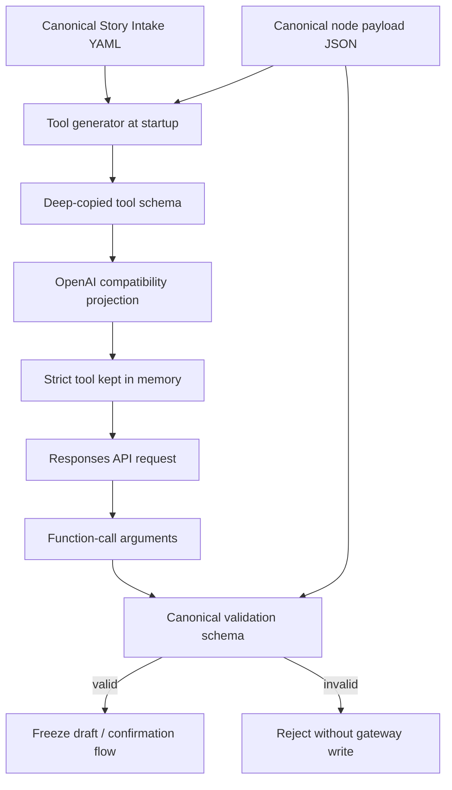

# REQ-06 — OpenAI strict-schema compatibility projection

**Status:** Ready for implementation  
**Version:** 1.0.0  
**Date:** 2026-09-23  
**Target repository:** `DOGE-Complaints/doge-ai-bridge`  
**Target branch at analysis time:** `dev`  
**Baseline commit:** `907bf8a7a3eb9ec44d765f6c17e7b9404998292f`  
**Priority:** Pilot blocker  
**Primary owner:** aibridge runtime  

**Related — Architecture:** [`../architecture/TECH-ARCH-REQ-07-openai-strict-schema-compat.md`](../architecture/TECH-ARCH-REQ-07-openai-strict-schema-compat.md)  
**Related — Interview:** [`../analysis/zeya888.target-tech-arch-interview-REQ-07-openai-strict-schema-compat-2026-09-24.md`](../analysis/zeya888.target-tech-arch-interview-REQ-07-openai-strict-schema-compat-2026-09-24.md)  
**Related — Backlog:** [`../tasks/backlog-stories/req-07-openai-strict-schema-compat/INDEX.md`](../tasks/backlog-stories/req-07-openai-strict-schema-compat/INDEX.md) (STORY-AIBRIDGE-41…45)

---

## 1. Decision summary

aibridge MUST keep one canonical node payload schema with all DOGEstonia validation rules, including `"uniqueItems": true`.

During application initialization, aibridge MUST:

1. load the canonical Story Intake OpenAPI YAML and canonical node payload JSON;
2. preserve both source artifacts unchanged;
3. build the ordinary strict OpenAI function tool from deep-copied in-memory data;
4. recursively remove OpenAI-incompatible schema keywords from the OpenAI-facing copy, initially `uniqueItems`;
5. retain the canonical node schema separately for server-side validation;
6. fail readiness if a usable OpenAI tool cannot be produced.

The application MUST NOT rewrite the YAML or JSON files on disk. The OpenAI-compatible projection is an in-memory runtime artifact created once per process initialization and reused for turns handled by that process.

The requirement represented by `uniqueItems: true` MUST remain enforced by DOGEstonia after the model returns function-call arguments. Removing the keyword from the OpenAI-facing copy MUST NOT weaken canonical validation.

---

## 2. Problem statement

The production Telegram flow reaches aibridge, but the Responses API rejects the generated strict function tool before the model can complete the turn.

Observed API failure:

```text
HTTP 400
invalid_function_parameters
Invalid schema for function 'postStoryDraftStash'
schema_binding.structured_payload.geo.streets[].houses
'uniqueItems' is not permitted
```

The canonical node schema contains the required constraint at:

```text
src/instructions/schema-packs.uus_veerenni_civic.v3.payload.schema.json
properties.geo.properties.streets.items.properties.houses.uniqueItems = true
```

This rule is meaningful to the product: the same house number must not appear twice within one street entry.

The current generator in `src/aibridge/tool_gen.py`:

- loads `docs/openapi/story-intake-actions.openapi.yaml`;
- loads the active node payload JSON;
- deep-copies the pack into `schema_binding.structured_payload`;
- forces the schema into strict object form;
- retains `uniqueItems` in the tool sent to OpenAI.

The current internal validator in `src/aibridge/request_assembly.py` does not enforce `uniqueItems`. Therefore simply stripping the keyword before the OpenAI request would currently remove the rule from every effective validation layer. This REQ closes both sides of that gap.

---

## 3. Product outcome

After implementation:

- ordinary Telegram interview turns are no longer rejected because the tool schema contains `uniqueItems`;
- the canonical node schema stays correct and remains the only source of truth;
- duplicate house identifiers are still rejected inside aibridge before a draft can be frozen or sent to the gateway;
- adding another node with the same kind of constraint does not require a custom hand-edited OpenAI schema;
- redeploying or restarting the service deterministically rebuilds a clean OpenAI-compatible projection from canonical content.

---

## 4. Scope

### 4.1 In scope

1. Compatibility projection for the strict OpenAI function tool generated by `generate_strict_tool()`.
2. Recursive handling of `uniqueItems` at any depth in the model-facing schema.
3. Preservation and verification of canonical schema immutability.
4. Canonical server-side enforcement of `uniqueItems: true` in validation Gates 1–3 wherever the keyword appears.
5. Startup/readiness fail-closed behavior.
6. Deterministic tool generation and hashing.
7. Unit, integration, readiness, and regression tests.
8. Redacted observability sufficient to diagnose future schema compatibility failures.

### 4.2 Out of scope

1. Changing the meaning of the Uus Veerenni node schema.
2. Creating a second node-specific YAML.
3. Modifying `docs/openapi/aibridge-channel-v1.openapi.yaml`.
4. Editing or deleting `uniqueItems` in the canonical payload JSON.
5. Turning off strict function calling.
6. Moving validation responsibility to n8n, Telegram, or the model prompt.
7. Calling OpenAI during `/readyz`.
8. Automatically guessing how every possible unsupported JSON Schema keyword should be represented.

---

## 5. Source-of-truth boundaries

| Artifact | Current path | Purpose | May runtime modify it? |
|---|---|---|---|
| Story Intake OpenAPI | `docs/openapi/story-intake-actions.openapi.yaml` | Canonical gateway wire contract and source for `postStoryDraftStash` | No |
| Channel OpenAPI | `docs/openapi/aibridge-channel-v1.openapi.yaml` | n8n ↔ aibridge transport contract | No; unrelated to this change |
| Node payload schema | `src/instructions/schema-packs.uus_veerenni_civic.v3.payload.schema.json` | Canonical product/domain validation rules | No |
| OpenAI strict tool | In-memory `DeploymentBundleState.strict_tool` | Compatibility projection sent to Responses API | Yes; generated, never canonical |
| Validation context | In-memory `ValidationContext` | Canonical validation after model output | Built from canonical schemas only |

### 5.1 Mandatory clarification about YAML

This REQ does **not** require editing the YAML file during startup.

The generator uses the YAML as one input and injects the node payload JSON under `schema_binding.structured_payload`. The incompatible `uniqueItems` originates in the node payload JSON, not in the channel YAML. The sanitization target is the final in-memory function-tool schema produced from those inputs.

No generated compatibility YAML or compatibility JSON file is required on disk.

---

## 6. Required runtime design



### 6.1 Lifecycle

The projection MUST be generated during the existing content/deployment initialization path:

```text
create_app
  → _init_stores
  → verify_and_register_deployment
  → generate_strict_tool
  → compatibility projection
  → DeploymentBundleState.strict_tool
  → _apply_deployment_to_engine
  → InterviewEngine.tools
```

Each process/worker may build its own immutable in-memory projection at startup. No shared filesystem cache or database row is required for the pilot.

### 6.2 Immutability

The implementation MUST use deep copies before removing or rewriting any schema keyword.

After generation:

- the parsed canonical pack object MUST equal its value before projection;
- the bytes and hash of the source JSON file MUST remain unchanged;
- the source YAML bytes and hash MUST remain unchanged;
- no startup code may write to either content file;
- later request handling MUST treat the generated tool as immutable.

---

## 7. Functional requirements

### AIB-COMPAT-01 — Separate canonical and OpenAI-facing schemas

The runtime MUST maintain two logically distinct representations:

1. **Canonical validation schema:** complete node JSON Schema, including `uniqueItems`.
2. **OpenAI-facing tool schema:** deep-copied compatibility projection used only in the API request.

The canonical representation MUST NOT be derived back from the reduced OpenAI projection.

### AIB-COMPAT-02 — Recursive projection

The projection MUST traverse the complete final tool `parameters` tree recursively, including schemas nested under:

- `properties`;
- `items`;
- `additionalProperties` when it is a schema object;
- supported combinator branches if such branches are accepted by the generator in the future;
- arbitrary schema-object positions introduced by later compatible generator changes.

For this release, every occurrence of the key `uniqueItems` MUST be omitted from the OpenAI-facing projection regardless of nesting depth.

The projection MUST NOT delete user/domain fields merely because a field is named `uniqueItems`; removal applies only when traversing JSON Schema objects, not arbitrary example or data payload values.

### AIB-COMPAT-03 — Preserve all other semantics

Except for explicitly configured compatibility removals and existing OpenAPI-only normalization, the projection MUST preserve the generated schema.

In particular, it MUST preserve where supported by the selected strict-tool path:

- `type`;
- `properties`;
- `required`;
- `additionalProperties`;
- `items`;
- `enum`;
- `const`;
- length and numeric bounds already supported by the current runtime;
- the existing `strict: true` setting;
- `x_aibridge` metadata.

The implementation MUST NOT set `strict: false` as a workaround.

### AIB-COMPAT-04 — Canonical `uniqueItems` validation

The canonical validator used by Gate 2 MUST implement JSON Schema `uniqueItems: true` semantics for arrays.

At minimum:

- arrays with all distinct elements pass;
- arrays containing equal strings fail;
- arrays containing equal numbers fail;
- arrays containing structurally equal JSON objects or arrays fail;
- `uniqueItems: false` behaves as no uniqueness restriction;
- absence of `uniqueItems` behaves as no uniqueness restriction;
- non-array instances continue to be governed by their normal `type` rule.

Equality MUST follow JSON-value structural equality and MUST NOT depend on object key order.

For the active Uus Veerenni schema, this MUST reject:

```json
{
  "geo": {
    "streets": [
      {
        "street": "Veerenni",
        "houses": ["24", "24"]
      }
    ]
  }
}
```

and accept:

```json
{
  "geo": {
    "streets": [
      {
        "street": "Veerenni",
        "houses": ["24", "26"]
      }
    ]
  }
}
```

### AIB-COMPAT-05 — Gate coverage

The generic internal schema validator SHOULD enforce `uniqueItems` at every validation gate that receives a canonical schema containing that keyword. Gate 2 is mandatory because it validates the node payload.

The OpenAI-facing reduced tool parameters MUST be used for Gate 1 only if Gate 1 is explicitly intended to validate exactly what OpenAI was allowed to emit. Gate 2 MUST always use the untouched canonical pack schema.

### AIB-COMPAT-06 — Initialization and reuse

The compatibility projection MUST be computed once during process initialization/content deployment loading, not once per Telegram message.

All turns in that process MUST reuse the generated `DeploymentBundleState.strict_tool` attached to `InterviewEngine.tools`.

### AIB-COMPAT-07 — Fail closed

If any of the following occurs, the deployment MUST be not ready and MUST NOT accept normal channel traffic as ready:

- canonical YAML cannot be parsed;
- canonical node JSON cannot be parsed;
- schema projection raises an unexpected error;
- final strict tool is missing required shape;
- the generated tool still contains a keyword explicitly listed as OpenAI-incompatible;
- canonical validation capability required by the active pack is not implemented;
- the generated tool cannot be deterministically serialized.

The readiness reason MUST be stable, non-secret, and diagnostic, for example:

```text
tool_gen_failed:openai_schema_projection_failed
tool_gen_failed:unsupported_keyword_remaining:uniqueItems
schema_validation_incomplete:uniqueItems
```

Exact wording may follow existing error conventions, but tests MUST assert the chosen contract.

### AIB-COMPAT-08 — Readiness must remain local

`/readyz` MUST validate the already-generated projection or regenerate it only from local immutable files. It MUST NOT call OpenAI and MUST NOT write to the gateway.

### AIB-COMPAT-09 — Determinism

For identical input YAML, node JSON, schema ID, schema version, and code version:

- generated tool canonical bytes MUST be identical across runs;
- compatibility projection MUST be identical across runs;
- tool hashing and prompt prefix ordering MUST remain stable.

### AIB-COMPAT-10 — Configuration ownership

The compatibility rule set MUST live in a clearly named code-level constant or policy in `src/aibridge/tool_gen.py`, for example:

```python
OPENAI_UNSUPPORTED_SCHEMA_KEYWORDS = frozenset({"uniqueItems"})
```

This is a provider-compatibility policy, not node content. Node authors MUST NOT remove domain constraints from node schemas to satisfy the provider.

The implementation SHOULD distinguish:

- constructs that make canonical-to-tool conversion impossible and must fail generation;
- valid canonical constraints that OpenAI does not accept but aibridge can safely enforce after generation and therefore may be omitted only from the provider projection.

`uniqueItems` belongs to the second category.

### AIB-COMPAT-11 — No silent broad stripping

The code MUST NOT recursively delete arbitrary unknown schema keywords.

Only explicitly reviewed compatibility keywords may be removed. A future unsupported keyword requires one of:

1. an explicit projection rule plus equivalent canonical server-side enforcement; or
2. fail-closed startup/readiness.

### AIB-COMPAT-12 — No per-request mutation

Request assembly MUST NOT modify `InterviewEngine.tools`, `DeploymentBundleState.strict_tool`, canonical schemas, or source files.

If defensive copying is needed when assembling a Responses payload, it MUST not change the stored initialized projection.

---

## 8. Recommended implementation seam

The concrete function names are implementation guidance, not an API contract.

### 8.1 `src/aibridge/tool_gen.py`

Add a pure recursive function similar to:

```python
def project_schema_for_openai(schema: dict[str, Any]) -> dict[str, Any]:
    """Return a deep-copied OpenAI-compatible schema; never mutate input."""
```

Preferred order inside `generate_strict_tool()`:

1. load and dereference Story Intake OAS;
2. load canonical pack JSON;
3. deep-copy canonical pack into the model schema;
4. apply existing OpenAPI normalization and strict-object normalization;
5. apply or complete OpenAI compatibility projection recursively;
6. verify forbidden compatibility keywords are absent;
7. return the deterministic strict tool.

The implementation may project the pack before injection if and only if tests prove that every final schema position is covered. A final whole-tool assertion is still required.

### 8.2 `src/aibridge/request_assembly.py`

Extend the canonical validator:

- add `uniqueItems` to the supported validation keyword set;
- enforce it when the instance is an array and the schema value is `true`;
- compare nested JSON values canonically;
- ensure validation errors identify the failing path without including sensitive narrative content.

Update `schema_validation_complete()` so readiness proves uniqueness enforcement behavior rather than relying only on membership in a constant.

### 8.3 `src/aibridge/deployment.py`

Keep the generated compatibility tool in `DeploymentBundleState.strict_tool`. On projection failure, return a fail-closed `tool_gen_failed:*` state and do not register a ready deployment.

### 8.4 `src/aibridge/readiness.py`

Readiness MUST verify:

- strict tool generation succeeds;
- explicit OpenAI-incompatible keywords are absent from the OpenAI projection;
- the active canonical validator supports and enforces the projected-away constraints.

---

## 9. Validation and error behavior

### 9.1 Duplicate handling

If the model produces duplicate values for an array whose canonical schema says `uniqueItems: true`:

- Gate 2 MUST fail;
- no frozen draft may be created;
- no Send confirmation action may be minted;
- no gateway request may be made;
- the response to the channel MUST remain safe and actionable;
- logs MAY record schema path and validation category but MUST NOT record the full user narrative or full argument payload.

Whether the application asks the model to retry or asks the user to correct the data is outside the minimal fix. It MUST at least fail safely rather than accepting invalid data.

### 9.2 Source mutation detection

Tests MUST compare the canonical Python object before and after projection. A failure indicates a programming defect.

The application does not need to re-hash source files after every request. Existing content hashes plus startup immutability tests are sufficient.

---

## 10. Observability requirements

At initialization, emit one structured, redacted event such as:

```json
{
  "event": "openai_schema_projection_ready",
  "tool": "postStoryDraftStash",
  "removed_keywords": {"uniqueItems": 1},
  "canonical_pack_hash": "<sha256>",
  "projected_tool_hash": "<sha256>"
}
```

Requirements:

- counts and hashes are allowed;
- file paths may be included if they contain no secret;
- no API key, Bearer token, user narrative, function arguments, or schema payload contents may be logged;
- ordinary turns MUST NOT emit the full tool schema;
- metrics cardinality MUST remain bounded; do not use arbitrary schema paths as Prometheus labels.

An initialization event is recommended but MUST NOT become a readiness dependency if logging itself fails.

---

## 11. Test requirements

### 11.1 Unit tests — projection

Add tests to `tests/test_tool_gen.py` or a dedicated test module.

| ID | Scenario | Expected result |
|---|---|---|
| T-COMPAT-01 | Nested canonical schema contains `uniqueItems: true` | Generated OpenAI tool contains no `uniqueItems` |
| T-COMPAT-02 | Projection is called | Input Python object remains exactly unchanged |
| T-COMPAT-03 | Same inputs projected twice | Canonical serialized tool bytes are identical |
| T-COMPAT-04 | `uniqueItems` appears at multiple depths | Every schema-key occurrence is removed |
| T-COMPAT-05 | Ordinary data/example object contains a field named `uniqueItems` outside schema traversal | It is not accidentally treated as a schema keyword |
| T-COMPAT-06 | Existing supported constraints are present | They remain in the OpenAI projection |
| T-COMPAT-07 | Generator produces forbidden keyword after projection | Fail closed with stable error |
| T-COMPAT-08 | Source JSON and YAML files are read-only | Startup generation succeeds without attempting writes |

### 11.2 Unit tests — canonical validation

| ID | Scenario | Expected result |
|---|---|---|
| T-UNIQUE-01 | `['24', '26']` with `uniqueItems: true` | Pass |
| T-UNIQUE-02 | `['24', '24']` with `uniqueItems: true` | Gate error at correct path |
| T-UNIQUE-03 | Equal nested objects with different key order | Fail as duplicates |
| T-UNIQUE-04 | Repeated nested arrays | Fail as duplicates |
| T-UNIQUE-05 | Duplicates with `uniqueItems: false` | Pass |
| T-UNIQUE-06 | Duplicates with keyword absent | Pass |
| T-UNIQUE-07 | Empty and one-element arrays | Pass |
| T-UNIQUE-08 | Active Uus Veerenni pack, duplicate houses under one street | Gate 2 rejects |
| T-UNIQUE-09 | Active pack, same house number under two different street objects | Follow canonical structure; do not conflate different arrays |

### 11.3 Startup/readiness tests

| ID | Scenario | Expected result |
|---|---|---|
| T-READY-01 | Active canonical pack contains `uniqueItems` and projector supports it | `/readyz` is eligible for 200 if all other dependencies are ready |
| T-READY-02 | Projector disabled/broken | `/readyz` returns 503 with projection reason |
| T-READY-03 | Canonical validator does not enforce `uniqueItems` | `/readyz` returns 503 with validation-incomplete reason |
| T-READY-04 | Restart with identical image/content | Same canonical and projected hashes |
| T-READY-05 | No configured schema IDs | Existing documented behavior remains unchanged; no accidental regression |

### 11.4 Responses request contract test

Using a recording/fake transport, assert that the actual payload passed to `/v1/responses`:

- uses a Responses-flat function tool;
- has `name = postStoryDraftStash`;
- retains `strict = true`;
- contains no `uniqueItems` anywhere under `tools[*].parameters`;
- has `store = false`;
- has `parallel_tool_calls = false`;
- does not mutate the stored tool after request assembly.

### 11.5 Live smoke test

After deploy, perform one real non-consequential Telegram interview turn and verify:

1. n8n receives the Telegram update;
2. `POST /v1/channel/turns` succeeds;
3. aibridge receives an OpenAI 2xx response rather than `invalid_function_parameters`;
4. Telegram receives a meaningful interview reply;
5. no gateway stash occurs before the existing dual confirmation;
6. logs show the projection initialized without exposing schema contents or secrets.

The live smoke MUST NOT be the only proof. Unit and integration tests remain mandatory.

---

## 12. Acceptance criteria

Implementation is accepted only when all criteria below are satisfied.

### AC-01 — Canonical source preserved

`src/instructions/schema-packs.uus_veerenni_civic.v3.payload.schema.json` still contains `"uniqueItems": true` at the houses-array rule after implementation and tests.

### AC-02 — No canonical YAML mutation

`docs/openapi/story-intake-actions.openapi.yaml` is not rewritten, patched, or generated at runtime.

### AC-03 — Compatible strict tool

The actual tool sent to OpenAI contains no `uniqueItems`, remains `strict: true`, and is accepted by the Responses API.

### AC-04 — Internal rule retained

Duplicate house identifiers in one canonical `houses` array are rejected by Gate 2 before freeze/confirmation/gateway execution.

### AC-05 — Initialization, not per-turn rebuilding

The projection is created during deployment/application initialization and reused. Tests or instrumentation prove that ordinary turns do not reload and rewrite schema files.

### AC-06 — Fail closed

A broken projection or missing canonical enforcement makes readiness fail; the service never silently falls back to weakened validation or `strict: false`.

### AC-07 — Deterministic and immutable

Repeated generation from identical inputs produces identical canonical bytes/hashes, and the input schemas remain unchanged.

### AC-08 — Regression suite green

All existing tests plus the tests in §11 pass. Existing channel auth, `store:false`, dry-run, dual-confirmation, gateway protection, and content pinning behavior remain unchanged.

### AC-09 — Live Telegram proof

One real Telegram turn completes through Telegram → n8n → aibridge → OpenAI → aibridge → n8n → Telegram without the prior schema error.

---

## 13. Definition of Done

- [ ] Compatibility projection implemented in the tool-generation path.
- [ ] No runtime writes to canonical YAML or JSON.
- [ ] `uniqueItems` absent from the OpenAI-facing function parameters.
- [ ] `uniqueItems` implemented in canonical internal validation.
- [ ] `schema_validation_complete()` proves uniqueness enforcement.
- [ ] Readiness fails when projection or canonical enforcement is incomplete.
- [ ] Projection and canonical validation tests added.
- [ ] Responses payload integration test added.
- [ ] Full existing test suite passes.
- [ ] Deployed service reports `{"status":"ready"}`.
- [ ] Live Telegram interview reply succeeds.
- [ ] No secrets, narrative, or full tool payload added to logs.
- [ ] Documentation states that node authors keep full canonical constraints.

---

## 14. Implementation prohibitions

The following solutions do not satisfy this REQ:

1. Manually deleting `uniqueItems` from the node schema.
2. Maintaining two hand-edited node schemas, one for DOGEstonia and one for OpenAI.
3. Rewriting the source JSON or YAML at startup.
4. Removing and restoring a line on every request.
5. Turning off strict mode.
6. Trusting the prompt alone to prevent duplicate house identifiers.
7. Stripping all unrecognized JSON Schema keywords without explicit review.
8. Accepting duplicate values because OpenAI cannot enforce them.
9. Calling OpenAI from `/readyz`.

---

## 15. Rollout and rollback

### 15.1 Rollout

1. Implement projection and canonical uniqueness validation.
2. Run the full local/CI suite.
3. Build a new immutable image with unchanged canonical content.
4. Deploy to Railway.
5. Confirm `/readyz` is 200.
6. Run an authenticated channel smoke from n8n.
7. Run one real Telegram interview turn.
8. Inspect redacted aibridge logs for successful OpenAI response.

No new Railway environment variable is required for this change.

### 15.2 Rollback

Rollback means redeploying the previous image. Canonical content does not need restoration because this implementation never modifies it.

If the previous image is restored, the original OpenAI schema failure may return; therefore rollback is operationally safe for data but does not restore full Telegram interview functionality.

---

## 16. Traceability to current code

| Requirement concern | Current implementation seam |
|---|---|
| Load YAML and pack | `src/aibridge/tool_gen.py::generate_strict_tool` |
| Inject pack into function schema | `src/aibridge/tool_gen.py::generate_strict_tool` |
| Store generated tool at startup | `src/aibridge/deployment.py::DeploymentBundleState.strict_tool` |
| Attach generated tool to engine | `src/aibridge/app.py::_apply_deployment_to_engine` |
| Reuse tool in Responses turns | `src/aibridge/interview.py::InterviewEngine.tools` |
| Gate 2 canonical validation | `src/aibridge/request_assembly.py::validate_gate2_pack_payload` |
| Validation readiness probe | `src/aibridge/request_assembly.py::schema_validation_complete` |
| Readiness decision | `src/aibridge/readiness.py::_strict_tool_ok` and `evaluate_readiness` |
| Existing generator tests | `tests/test_tool_gen.py` |

---

## 17. External compatibility basis

OpenAI strict function calling uses Structured Outputs. Official OpenAI documentation states that Structured Outputs supports only a subset of JSON Schema and that a request using `strict: true` with an unsupported schema is rejected. Strict function tools also require every object to use `additionalProperties: false` and require all declared properties.

For this deployment, the decisive compatibility evidence is the reproduced API response identifying `uniqueItems` at `schema_binding.structured_payload.geo.streets[].houses` as not permitted. The compatibility policy must therefore be covered by regression tests rather than assumed from the general JSON Schema standard.

Relevant official documentation:

- https://developers.openai.com/api/docs/guides/structured-outputs
- https://developers.openai.com/api/docs/guides/function-calling

---

## 18. Final implementation instruction to the IDE agent

Implement this as a provider-compatibility projection over immutable canonical schemas. Do not “fix the content” by weakening the node schema. The source YAML and JSON remain canonical and read-only; the OpenAI-facing tool is a generated in-memory derivative; the internal validation gates retain every domain rule that was projected away for provider compatibility.

