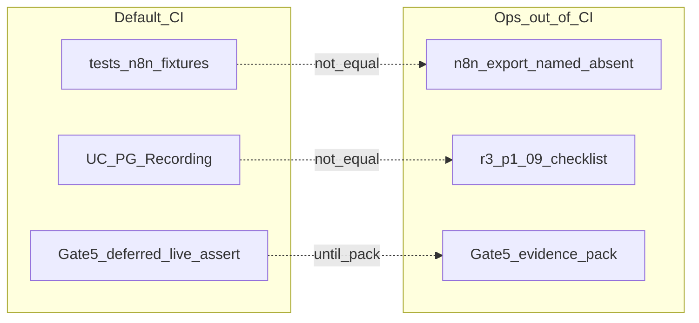
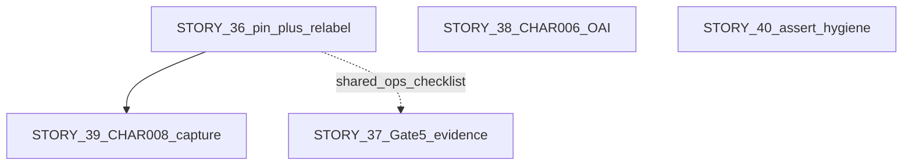

# TECHNICAL ARCHITECTURE — Gaps closure (stories 36–40)

**Package:** [`qa-inbound-outbound-data-flow`](./INDEX.md)  
**Parent harness arch (23–35):** [`TECHNICAL-ARCHITECTURE.md`](./TECHNICAL-ARCHITECTURE.md)  
**Qualification SSOT:** [`TEST-QUALIFICATION-20260918.md`](./TEST-QUALIFICATION-20260918.md)  
**Traceability:** [`TRACEABILITY-MATRIX.md`](./TRACEABILITY-MATRIX.md)  
**Stories:** [36](./STORY-AIBRIDGE-36-qa-n8n-workflow-contract-honesty.md) · [37](./STORY-AIBRIDGE-37-qa-gate5-live-pilot-evidence.md) · [38](./STORY-AIBRIDGE-38-qa-oai-channel-error-outcome.md) · [39](./STORY-AIBRIDGE-39-qa-char008-send-edit-capture.md) · [40](./STORY-AIBRIDGE-40-qa-suite-assert-hygiene.md)  
**Ops n8n:** [`docs/ops/n8n-channel-workflow/`](../../../ops/n8n-channel-workflow/README.md)  
**As-of:** 2026-09-18  
**Method:** analysis.mdc — claims verified against code/ops/qualification; named paths are **acceptance targets** until an explicit execute wave (**name ≠ create**)

---

## 1. Problem / goal

**Problem:** Suite stories 23–35 can report **244 passed** while qualification still finds false confidence:

| Class | Gap IDs | Symptom |
|-------|---------|---------|
| P0 | P0-Q1…Q3 | n8n fixture ≠ workflow; UC ≠ live Gate-5; Gate-5 “pass” = defer recorded |
| P1 | P1-Q1…Q4 | VAL tautology band; OAI channel 500 lock; CHAR-008 file-presence; hash_eq misread as behavior |
| P2 | P2-Q1…Q3 | Layer E over-mock label; Recording-heavy; UC mock vs pilot |

**Goal:** One execute-ready architecture for stories **36–40**: seams, artifact paths, decision forks, test/doc changes — **without** inventing workflow JSON, OAS enums, or materializing `task-*` in this docs wave.

---

## 2. As-built (verified)

| Fact | Evidence |
|------|----------|
| Adapter-contract n8n tests (no Bot API / no workflow JSON exec) | `tests/n8n/test_n8n_telegram_mapping.py` |
| UC journeys = disposable PG + Recording OAI/GW; no live TG | `tests/integration/test_product_journey_scenarios.py` docstring + `build_e2e_harness` |
| Gate-5 / Layer F deferred in default CI | `tests/test_qa_gates_layers_dod.py`::`test_gate5_live_deferred_out_of_default_ci` |
| CHAR meta = refs / bound_tests / defer_reason existence | `test_char_capture_first_bound_refs_or_defer` |
| Ops workflow contract; export path **named**, body **absent** | `docs/ops/n8n-channel-workflow/README.md` §6 · `exports/aibridge-telegram-channel-v1.json` |
| Live checklist exists | `docs/ops/n8n-channel-workflow/r3-p1-09-live-gate-checklist.md` |
| Live evidence blocked historically | `docs/ops/n8n-channel-workflow/live-evidence-BLOCKED-20260913.md` |
| OpenAI transport outcomes | `responses_client.py` `ResponsesOutcome.RATE_LIMITED` / `TRANSIENT_FAILURE` / `ResponsesTransportError` |
| Channel HTTP client rate limit → 429 `rate_limited` | `app.py` `channel_rate_limit_middleware` (Bearer principal hash) |
| Unhandled channel exceptions → 500 `internal_error` retryable | `app.py` `unhandled_channel_exception` |
| OAI-008/009 channel path locks 500 characterization | `tests/integration/test_openai_prompt_behavior.py` |
| VAL characterization tautology band | `tests/contract/test_json_schema_boundary.py`::`test_val_characterization_capture_first` |
| Channel OAS error `code` is free string | `aibridge-channel-v1.openapi.yaml` `ChannelErrorBody.error.code` |



---

## 3. Cross-story dependencies and execute order



| Order | Story | Why |
|-------|-------|-----|
| 1 | **36** | Export pin + Layer E honesty; input for 39 |
| ∥ | **37**, **38** | Gate-5 evidence and OAI decision independent of each other |
| 2 | **39** | Needs pinned export (36) or explicit defer if pin still absent |
| ∥ | **40** | Suite hygiene; can run after docs baseline anytime |

**Do not** close Gate-5 from STORY-34 UC greens. **Do not** invent `exports/*.json` in a docs-only wave.

---

## 4. Shared acceptance-target paths (name ≠ create)

| Path | Role | Present now? |
|------|------|--------------|
| `docs/ops/n8n-channel-workflow/exports/aibridge-telegram-channel-v1.json` | Credential-stripped workflow pin | **No** (named in README only) |
| `docs/ops/n8n-channel-workflow/META.yaml` | Optional n8n/channel versions | Optional / may be absent |
| Package `fixtures/meta/n8n-wf-001-pin-pointer.json` | Hash + relative path to ops export | **Present** · `status=deferred` (export absent · capture-first · P3 2026-09-18T12:32:14Z) |
| Package `fixtures/meta/gate5-evidence-index.json` (or docs pack under ops) | Gate-5 evidence index | **Present** · `status=deferred` (no pilot env · capture-first · P3 2026-09-18T12:53:26Z) |
| Package `fixtures/n8n/char-008-send-edit-capture.json` | CHAR-008 capture envelope | **Not present** until execute |
| Package `fixtures/openai/char-006-decision.json` (or story decision note) | CHAR-006 product decision | **Present** · Option A · P3 2026-09-18T13:43:00Z · promote=copy |

Promote rule unchanged: package `fixtures/` originals stay; `tests/fixtures/{cluster}/` = **copy**.

---

## 5. Per-story solutions

### §36 — N8N-WF-001 / Layer E honesty (P0-Q1, P2-Q1)

**Intent:** Keep STORY-25 as **fixture-covered** owner of N8N-001…018. Add runtime honesty: pin real export + label `tests/n8n/` as adapter-contract.

**Seams:**

1. **Docs relabel** — package INDEX / [`TECHNICAL-ARCHITECTURE.md`](./TECHNICAL-ARCHITECTURE.md) Layer E / story 25 context: `tests/n8n/` = fixture + pure Python helpers (`render_outbound_keyboard`, `simulate_post_ack_failure_timeline`), **not** workflow binary e2e.
2. **Export pin** — operator places credential-stripped JSON at ops path above; package pointer fixture records `sha256`, `relative_path`, `channel_openapi_version`, `verified_at`.
3. **Out-of-CI smoke** — reuse/extend [`r3-p1-09-live-gate-checklist.md`](../../../ops/n8n-channel-workflow/r3-p1-09-live-gate-checklist.md); **not** added to default pytest suite in [`TEST-MANUAL.md`](../../../qa/inbound-outbound/TEST-MANUAL.md).

**Non-goals:** invent export body; live TG in CI; CHAR-008 answers (→ §39).

**Nested task mapping:** T01 relabel → T02 pin pointer → T03 out-of-CI checklist bind → T04 TRACEABILITY N8N-WF-001.

---

### §37 — Gate-5 live pilot evidence (P0-Q2, P0-Q3, P2-Q3)

**Intent:** Own Gate-5; UC-01…10 remain PG-journey (STORY-34). Evidence pack out of default CI.

**Seams:**

1. **Docs** — TRACEABILITY already notes UC ≠ Gate-5; reinforce in STORY-34/37 cross-links and ops README if needed.
2. **Checklist** — Gate-5 bullets from guide §15 mapped onto `r3-p1-09-live-gate-checklist.md` (dry-run first, then staging stash; no claim_published; ack before `/actions`).
3. **Evidence pack** — redacted artifacts (paths listed in package meta or ops `live-evidence-*.md`); secrets scrubbed.
4. **Meta / CI** — `fixture-index` / gates program: keep `deferred_live` **until** pack accepted; only then change status. Default CI may keep asserting “defer recorded” **or** split: meta test allows `deferred_live|pass_with_evidence` — decide in T04 without inventing live automation.

**Non-goals:** Railway SUCCESS invent; production Story submit; closing N8N-WF-001 or CHAR-008 alone.

**Nested task mapping:** T01 UC vs Gate-5 docs → T02 checklist → T03 evidence pack → T04 status/CI policy.

---

### §38 — CHAR-006 / OAI-008/009 channel outcome (P1-Q2)

**Intent:** Stop locking channel `500` + `internal_error` as permanent characterization success when transport already classifies OpenAI 429/5xx.

**As-built chain (verified):**

1. Transport maps HTTP → `ResponsesOutcome` (`map_http_to_outcome`); raises `ResponsesTransportError(outcome, …)`.
2. If channel path does not catch that error, `unhandled_channel_exception` → **500** `internal_error` `retryable=true`.
3. Separate path: client rate-limit middleware → **429** `rate_limited` (not OpenAI).

**Decision fork (T01 must record before product/test change):**

| Option | Channel HTTP | `error.code` | When |
|--------|--------------|--------------|------|
| **A (recommended default)** | Map transport `rate_limited` / `transient_failure` / `timeout` to bounded channel errors (`retryable=true`); reuse string codes already used in product where sensible (`rate_limited` already emitted by middleware; OAS `code` is free string) | Prefer distinct from accidental 500 | Align channel with transport classification |
| **B** | Keep 500 `internal_error` as intentional product | `internal_error` | Only if decision note explicitly accepts characterization forever |

**Tests:**

- Keep transport-layer asserts in `test_oai_008_*` / `test_oai_009_*`.
- Rewrite **channel** asserts to match T01; if product lags, channel test is **fail-until-fixed** (not green characterization).

**Non-goals:** invent new OAS schema fields; authorize gateway on OpenAI errors; Gate-5.

**Nested task mapping:** T01 decision note/fixture → T02 product map (if A) + test split → T03 expect envelopes → T04 TRACEABILITY CHAR-006.

---

### §39 — CHAR-008 Send/Edit capture (P1-Q3)

**Intent:** Behavioral capture of Send vs Edit per response state + n8n retry dedupe — not file-presence of `bound_tests`.

**Inputs:** pinned export (§36) + ops README §2 Send/Edit / ack order.

**Capture envelope (fields named for execute — body not created here):**

```text
matrix_ids: [CHAR-008]
payload:
  response_states: [{ state, telegram_api: send_message|edit_message, notes }]
  retry_dedupe_policy: <captured string>
  source_export_path: docs/ops/n8n-channel-workflow/exports/...
  source_export_sha256: ...
```

**Assert:** load capture; assert non-empty `response_states` and `retry_dedupe_policy`; optionally cross-check node names in export if export present. Meta `test_char_*` may keep path checks **plus** behavioral assert.

If export still absent: keep **visible** `defer_reason` in fixture-index / DoD (not silent covered).

**Nested task mapping:** T01 observe export → T02 write capture fixture + promote → T03 bind assert → T04 TRACEABILITY.

---

### §40 — Suite assert hygiene (P1-Q1, P1-Q4, P2-Q2)

**QUAL-001:** In `test_val_characterization_capture_first`, **remove** `assert 100 <= response.status_code < 600`; keep explicit `== 200` (or expected error shape) for VAL-014/018.

**QUAL-002:** Package DoD / INDEX / TECH note: `*_hash_eq*` = **integrity-only**; never sole evidence for matrix Expected.  
**Policy recorded (STORY-40 P3 2026-09-18T14:28:02Z):** INDEX DoD line + this §40 — promote SHA256 ≠ behavioral coverage.

**QUAL-003 (default WAIVE):** Explicit waive with reason:

- UC (STORY-34) + LIFE live rebuild already exercise disposable PG.
- GW matrix covered via `RecordingGatewayTransport` (STORY-30).
- Non-Recording HTTPS gateway probe is **not** Gate-5 and is optional product-risk work — **WAIVE** unless operator un-waives later.

**Nested task mapping:** T01 VAL tautology → T02 hash_eq policy docs → T03 QUAL-003 WAIVE note in TRACEABILITY → T04 story gate.

---

## 6. What this wave does / does not create

| This docs wave | Later execute / P1 |
|----------------|--------------------|
| This architecture file | Workflow export JSON body |
| Story nested-task table refinement | `task-*` / epic folders |
| INDEX / Meta links | pytest/product patches |
| Named acceptance paths | Evidence pack binary artifacts |

---

## 7. Verification checklist (for story Done later)

- [x] N8N-WF-001: pin present or open status honest; Layer E wording = adapter-contract · **P3 2026-09-18T12:32:14Z** (deferred pin + adapter-contract)
- [x] Gate-5: evidence pack accepted before coverage leaves `deferred_live` · **P3 2026-09-18T12:53:26Z** (pack deferred · deferred_live kept · no invent)
- [x] CHAR-006: decision recorded; channel tests match; no forever-500 by accident · **P3 2026-09-18T13:43:00Z** Option A
- [ ] CHAR-008: capture payload asserted or defer visible
- [x] QUAL-001…003: tautology gone; hash_eq policy; QUAL-003 WAIVE · **P3 2026-09-18T14:28:02Z**
- [ ] Default CI still without live TG invent
