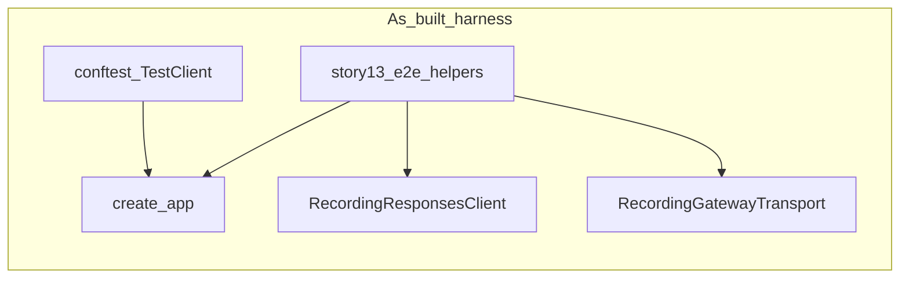
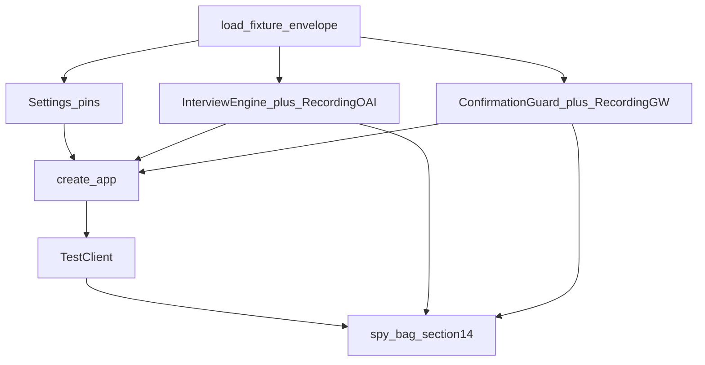

# TECHNICAL ARCHITECTURE — QA inbound/outbound (stories 23–35)

**Package:** [`qa-inbound-outbound-data-flow`](./INDEX.md)  
**Parent SSOT:** [`AIBRIDGE-QA-INBOUND-OUTBOUND-DATA-FLOW-GUIDE.md`](../../qa-requirements/AIBRIDGE-QA-INBOUND-OUTBOUND-DATA-FLOW-GUIDE.md)  
**Traceability:** [`TRACEABILITY-MATRIX.md`](./TRACEABILITY-MATRIX.md) (186 IDs)  
**Stories:** [23](./STORY-AIBRIDGE-23-qa-auth-ops-boundaries.md) … [35](./STORY-AIBRIDGE-35-qa-gates-layers-dod.md)  
**Channel OAS:** `docs/openapi/aibridge-channel-v1.openapi.yaml` · **Gateway OAS:** `docs/openapi/story-intake-actions.openapi.yaml`  
**Status:** Target architecture for **future** automation waves (statement + sim-data contracts)  
**As-of:** 2026-09-17  
**Method:** claims verified against code/guide; named fixture paths are **acceptance targets** — **not present on disk** until an explicit create wave (analysis.mdc: name ≠ create)

---

## 1. Problem / goal

**Problem:** Package 23–35 states *what* to prove across Telegram → n8n → aibridge → OpenAI → gateway → SPA, but implementers need a shared:

1. test **infra / harness** anchored in existing doubles (`RecordingResponsesClient`, `RecordingGatewayTransport`, `story13_e2e_helpers`);
2. **simulation data** layout and load contract so matrix IDs map to JSON files;
3. **generation prompts** (per data cluster) that emit a **standard envelope JSON** for another dialog / LLM to fill fixtures without inventing code APIs.

**Goal:** One architecture doc that (a) binds stories → seams → harness mode, (b) defines fixture clusters + envelope schema + usage, (c) ships copy-paste prompts per cluster. **Does not** materialize fixture files or pytest suites in this wave.

---

## 2. As-built (verified)

| Fact | Evidence |
|------|----------|
| ASGI app factory + inject points | `src/aibridge/app.py` `create_app(...)` |
| In-memory dedupe + wait | `src/aibridge/dedupe.py` `EventDedupeStore` |
| OpenAI test double (scripted + `calls[]`) | `src/aibridge/responses_client.py` `RecordingResponsesClient` |
| Gateway test double (scripted `RawHttpResponse` + `calls[]`) | `src/aibridge/gateway.py` `RecordingGatewayTransport` |
| E2E harness: disposable PG + fake OpenAI + fake/dry-run gateway | `tests/story13_e2e_helpers.py` `build_e2e_harness` / `E2EHarness` |
| Unit façade fixtures (Settings, TestClient, sample turn) | `tests/conftest.py` |
| Content fixtures only today | `tests/fixtures/content/**` |
| Guide fixture families (target names) | QA guide §12 |
| Guide layers / spies / gates | QA guide §9 · §14 · §15 |

**Verified absent (as-of 2026-09-17):** `tests/fixtures/telegram/`, `openai/`, `gateway/`, `channel/`, `settings/`, `n8n/`, `spies/`, `meta/` — **do not invent presence**.



---

## 3. Target harness flow



**Invariant:** Channel Bearer ≠ Gateway Bearer; dry-run paths never post live `/story-drafts`; Recording* never contact OpenAI/gateway; secrets never appear in CI artifacts or assertion failure messages.

---

## 4. Story × architectural seam

| Story | Seam / layer | Primary harness | Fixture clusters |
|-------|--------------|-----------------|------------------|
| **23** AUTH | Channel Bearer / ops endpoints | TestClient + auth variants | `channel`, `settings`, `spies` |
| **24** VAL | JSON / OAS boundary | TestClient | `channel` |
| **25** N8N | Adapter mapping + ack order | n8n contract / fixture-driven | `telegram`, `n8n`, `channel` |
| **26** IDEM | Dedupe + concurrency | memory or PG + barriers | `channel`, `openai`, `spies` |
| **27** OAI | Responses I/O | RecordingResponsesClient | `openai`, `channel` |
| **28** TOOL | Function-call gates | RecordingResponsesClient + validation ctx | `openai`, `gateway` (schema pin) |
| **29** ACT | Tokens + FSM | create_app + guard | `channel`, `openai`, `spies` |
| **30** GW | Stash outcomes + URL | RecordingGatewayTransport | `gateway`, `channel`, `spies` |
| **31** LIFE | Restart / TTL / GC | disposable PG + rebuild_app_same_pg | `settings`, `channel`, `spies` |
| **32** SEC | Redaction / no secret leak | spies on logs/metrics/calls | `spies`, `channel`, `openai`, `gateway` |
| **33** READY | `/readyz` reasons | Settings overrides | `settings` |
| **34** UC | Journeys | E2EHarness | all primary + `n8n` |
| **35** Gates/DoD | Program acceptance | index + layers | `meta` |

Build order (automation): `23 → 24 → 25 ∥ 26 → 27 → 28 → 29 → 30 → 31 ∥ 32 → 33 → 34 → 35`.

---

## 5. Infrastructure architecture

### 5.1 Test layers (guide §9) ↔ storage mode

| Layer | Directory (target) | Storage | Stories |
|-------|--------------------|---------|---------|
| A unit | `tests/unit/` | memory / no PG | 24, 28, parts of 29 |
| B contract | `tests/contract/` | memory TestClient | 23, 24 |
| C integration | `tests/integration/` | disposable PG + migrations | 26, 29–32 |
| D container | optional | image smoke | 33 partial |
| E n8n | `tests/n8n/` | fixtures only (no live TG) | 25 |
| F live pilot | ops smoke | real network | Gate 5 / 35 — out of default CI |

### 5.2 Env contract (QA)

| Knob | Unit/contract | Integration/E2E |
|------|---------------|-----------------|
| `AIBRIDGE_CHANNEL_BEARER_TOKEN` | synthetic long token | same |
| `GATEWAY_SERVICE_API_TOKEN` | **different** synthetic | same |
| `GATEWAY_BASE_URL` | `https://gateway.example.invalid` | same (Recording GW origin) |
| `SPA_BASE_URL` | `https://spa.example.invalid` | same |
| `AIBRIDGE_DRY_RUN` | true unless GW live case | true default; false only with Recording scripted 201 |
| `DATABASE_URL` | omit / memory path via allow | disposable PG URL (story13 pattern) |
| `AIBRIDGE_ALLOW_MEMORY_STORES` | true for unit only | **false** for PG SSOT tests |
| `OPENAI_API_KEY` | empty or dummy — engine uses Recording client | empty |

### 5.3 Reuse, do not fork

- Extend [`tests/story13_e2e_helpers.py`](../../../../tests/story13_e2e_helpers.py) (`build_e2e_harness`, `rebuild_app_same_pg`) for PG journeys.
- Keep [`tests/conftest.py`](../../../../tests/conftest.py) for thin façade tests; add `load_fixture` helper in a **future** `tests/fixture_loader.py` (not created this wave).
- Prefer parameterized matrices over one mega-E2E (guide §13).

### 5.4 Concurrency and time

- Use `threading.Barrier` / `asyncio.Event` — **not** `sleep` — for IDEM-004/007/008.
- Inject a **fake clock** (callable returning `float`) for ACT expiry and LIFE TTL; do not depend on wall clock in CI.
- Spy bag (guide §14): update_id, request_id, session_id, HTTP status/code, OpenAI call count, gateway call count, state/revision, dedupe hit, elapsed — **never** raw Bearer, full narrative, raw token, full draft body.

### 5.5 ADRs

| ADR | Decision |
|-----|----------|
| **ADR-Q1** | Fixture root = `tests/fixtures/{cluster}/` + `meta/fixture-index.json` (paths named; files later). |
| **ADR-Q2** | Every on-disk fixture is a **v1.0 envelope** (`schema_version`, `cluster`, `fixture_id`, `matrix_ids`, `story_keys`, `notes`, `payload`). |
| **ADR-Q3** | Generation prompts live in **§8 of this document**; output must be one JSON object (envelope). No generator scripts in this wave. |
| **ADR-Q4** | OpenAI scripts = response JSON **or** transport-error stubs consumed by Recording client / future transport wrapper; Gateway scripts = `RawHttpResponse`-compatible `{status_code, body, headers?}`. |
| **ADR-Q5** | n8n tests assert **mapping** using fixture refs; they do not call live Telegram. |

---

## 6. Simulation data — layout, envelope, loader (target)

### 6.1 Target tree (not present yet)

```text
tests/fixtures/
  meta/fixture-index.json
  telegram/     # Update-like payloads
  openai/       # Responses bodies or error stubs
  gateway/      # HTTP outcome stubs for /story-drafts
  channel/      # /v1/channel/turns|actions request bodies
  settings/     # Settings / env override packs for /readyz
  n8n/          # adapter cases linking telegram↔channel
  spies/        # expected spy snapshots (no secrets)
  content/      # EXISTING — pack/instructions (keep)
```

### 6.2 Universal envelope schema (`schema_version` = `"1.0"`)

```json
{
  "schema_version": "1.0",
  "cluster": "telegram",
  "fixture_id": "telegram.message-private-ru",
  "matrix_ids": ["N8N-003"],
  "story_keys": ["STORY-AIBRIDGE-25-qa-n8n-telegram-mapping"],
  "notes": "synthetic; no PII/secrets",
  "payload": {}
}
```

| Field | Rule |
|-------|------|
| `schema_version` | Must be `"1.0"` for this architecture. |
| `cluster` | One of: `telegram` \| `openai` \| `gateway` \| `channel` \| `settings` \| `n8n` \| `spies` \| `meta`. |
| `fixture_id` | `{cluster}.{kebab-name}` unique. |
| `matrix_ids` | Non-empty subset of TRACEABILITY-MATRIX IDs. |
| `story_keys` | Owning STORY-AIBRIDGE-* keys. |
| `notes` | Must state synthetic; forbid real tokens/PII. |
| `payload` | Cluster-specific object (see §7–8). |

### 6.3 Loader contract (target API — implement later)

```python
# tests/fixture_loader.py  (NAME ONLY — not created this wave)
def load_fixture(cluster: str, name: str) -> dict: ...
# returns full envelope; tests use envelope["payload"]
# resolves path: tests/fixtures/{cluster}/{name}.json
# validates schema_version == "1.0" and cluster match
```

**Pseudo-use:**

```python
env = load_fixture("channel", "turns-valid-private")
r = client.post("/v1/channel/turns", json=env["payload"], headers=auth_header)
assert r.status_code == 200
assert set(env["matrix_ids"]) <= {"VAL-001", "AUTH-001"}
```

### 6.4 Fixture index (`meta`)

`tests/fixtures/meta/fixture-index.json` payload shape:

```json
{
  "fixtures": [
    {
      "fixture_id": "telegram.message-private-ru",
      "path": "telegram/message-private-ru.json",
      "matrix_ids": ["N8N-003"],
      "story_keys": ["STORY-AIBRIDGE-25-qa-n8n-telegram-mapping"]
    }
  ]
}
```

---

## 7. Cluster payload shapes + examples

### 7.1 `telegram` — Update-like

`payload` = Telegram Bot API Update object (or minimal subset) with synthetic ids.

**Example envelope:**

```json
{
  "schema_version": "1.0",
  "cluster": "telegram",
  "fixture_id": "telegram.message-private-ru",
  "matrix_ids": ["N8N-001", "N8N-003"],
  "story_keys": ["STORY-AIBRIDGE-25-qa-n8n-telegram-mapping"],
  "notes": "synthetic private text; Cyrillic",
  "payload": {
    "update_id": 87952341,
    "message": {
      "message_id": 7,
      "date": 1720000000,
      "text": "Яма на улице Примерная",
      "from": {"id": 424242, "is_bot": false, "language_code": "ru"},
      "chat": {"id": 424242, "type": "private"}
    }
  }
}
```

### 7.2 `openai` — Responses body or error stub

Discriminated by `payload.kind`:

- `kind: "responses_json"` → body for `RecordingResponsesClient` scripted list entry.
- `kind: "http_error"` → `{ "status": 429, "body": ... }` for future transport tests.

**Example:**

```json
{
  "schema_version": "1.0",
  "cluster": "openai",
  "fixture_id": "openai.text-only",
  "matrix_ids": ["OAI-001"],
  "story_keys": ["STORY-AIBRIDGE-27-qa-openai-prompt-behavior"],
  "notes": "synthetic assistant text",
  "payload": {
    "kind": "responses_json",
    "body": {
      "id": "resp_test_text_only",
      "output": [
        {
          "type": "message",
          "role": "assistant",
          "content": [{"type": "output_text", "text": "Уточните адрес, пожалуйста."}]
        }
      ],
      "usage": {"input_tokens": 100, "output_tokens": 20, "cached_tokens": 0}
    }
  }
}
```

### 7.3 `gateway` — HTTP stub for `/story-drafts`

Maps to `RawHttpResponse` fields used by `RecordingGatewayTransport`.

```json
{
  "schema_version": "1.0",
  "cluster": "gateway",
  "fixture_id": "gateway.stashed-201",
  "matrix_ids": ["GW-002", "UC-02"],
  "story_keys": ["STORY-AIBRIDGE-30-qa-gateway-continuation"],
  "notes": "synthetic draft_id/trace_id",
  "payload": {
    "status_code": 201,
    "headers": {"content-type": "application/json"},
    "body": {
      "data": {"draft_id": "draft_syn_001"},
      "trace_id": "trace_syn_001"
    }
  }
}
```

### 7.4 `channel` — aibridge request bodies

```json
{
  "schema_version": "1.0",
  "cluster": "channel",
  "fixture_id": "channel.turns-valid-private",
  "matrix_ids": ["VAL-001", "AUTH-001"],
  "story_keys": ["STORY-AIBRIDGE-24-qa-json-schema-boundary"],
  "notes": "matches channel OAS minimal turn",
  "payload": {
    "method": "POST",
    "path": "/v1/channel/turns",
    "body": {
      "channel": "telegram",
      "event_id": "87952341",
      "principal": {"user_id": "424242", "chat_id": "424242"},
      "message": {"message_id": "7", "text": "hello"}
    }
  }
}
```

### 7.5 `settings` — readiness overrides

```json
{
  "schema_version": "1.0",
  "cluster": "settings",
  "fixture_id": "settings.ready-missing-channel-bearer",
  "matrix_ids": ["READY-002"],
  "story_keys": ["STORY-AIBRIDGE-33-qa-readiness-configuration"],
  "notes": "empty channel bearer; gateway present",
  "payload": {
    "overrides": {
      "AIBRIDGE_CHANNEL_BEARER_TOKEN": "",
      "GATEWAY_SERVICE_API_TOKEN": "gateway-token-bbbbbbbbbbbbbbbbbbbbbbbbbbbbbbbb",
      "GATEWAY_BASE_URL": "https://gateway.example.invalid",
      "AIBRIDGE_DRY_RUN": true
    },
    "expect_readyz": {"http_status": 503, "reason": "channel_auth_missing"}
  }
}
```

### 7.6 `n8n` — mapping case

```json
{
  "schema_version": "1.0",
  "cluster": "n8n",
  "fixture_id": "n8n.callback-ack-before-actions",
  "matrix_ids": ["N8N-013", "N8N-014"],
  "story_keys": ["STORY-AIBRIDGE-25-qa-n8n-telegram-mapping"],
  "notes": "ordering contract only",
  "payload": {
    "inbound_telegram_fixture_id": "telegram.callback-owner",
    "expected_channel_fixture_id": "channel.actions-valid-send",
    "ack_order": ["answerCallbackQuery", "POST /v1/channel/actions", "SendOrEditMessage"],
    "outbound_telegram": {
      "must_ack_callback_before_actions": true,
      "keyboard_from_actions": true
    }
  }
}
```

### 7.7 `spies` — expected observations

```json
{
  "schema_version": "1.0",
  "cluster": "spies",
  "fixture_id": "spies.idem-same-event-once-openai",
  "matrix_ids": ["IDEM-001"],
  "story_keys": ["STORY-AIBRIDGE-26-qa-idempotency-concurrency"],
  "notes": "no secrets in expectations",
  "payload": {
    "openai_call_count": 1,
    "gateway_call_count": 0,
    "dedupe": "hit_on_second",
    "forbid_substrings_in_logs": ["Bearer ", "sk-", "callback_data_raw"]
  }
}
```

---

## 8. Generation prompts (copy-paste for another dialog)

**Shared rules for every prompt below**

1. Output **exactly one** JSON object (no markdown fences unless the host UI requires them; prefer raw JSON).
2. Must validate against envelope §6.2 (`schema_version` = `"1.0"`).
3. Synthetic IDs only (`424242`, `draft_syn_*`, `trace_syn_*`, `resp_test_*`).
4. Never invent production Channel/Gateway tokens, real phone/email, or real Telegram user dumps.
5. Include at least one `matrix_ids` entry from TRACEABILITY-MATRIX and matching `story_keys`.
6. `notes` must contain the word `synthetic`.

**Seed Inputs (filled):** each prompt below ends with a concrete **Input** block for the **first** generation pass per cluster (aligned with §7 examples + TRACEABILITY-MATRIX). For the next matrix ID, replace only that Input block — keep the role/rules unchanged.

---

### Prompt: `telegram`

```text
You are generating a QA fixture for doge-ai-bridge (Telegram Update → n8n mapping tests).

Return ONE JSON object with this exact top-level shape:
{
  "schema_version": "1.0",
  "cluster": "telegram",
  "fixture_id": "telegram.<kebab-name>",
  "matrix_ids": ["N8N-001", "N8N-003"],
  "story_keys": ["STORY-AIBRIDGE-25-qa-n8n-telegram-mapping"],
  "notes": "synthetic; …",
  "payload": { /* Telegram Bot API Update */ }
}

Constraints:
- payload must be a valid minimal Telegram Update for the scenario.
- Use synthetic numeric ids; chat.id may be negative for groups.
- For media-without-text cases, omit message.text.
- For callback_query cases, include data as a short opaque string ≤64 bytes (not a real token).
- Unicode: support et/ru/en text when matrix_ids require it.
- Do not include bot tokens or real usernames that look production.

Input (seed — paste as-is for first telegram fixture):
- matrix_ids: ["N8N-001", "N8N-003"]
- scenario title: Private Telegram text message in Russian about a civic pothole observation (Tallinn / uus_veerenni_civic v3); chat.type=private
- expected nuances: synthetic Cyrillic text; language_code=ru; Unicode preserved; maps later to POST /v1/channel/turns; no PII
```

---

### Prompt: `openai`

```text
You are generating a QA fixture for doge-ai-bridge OpenAI Responses recording tests.

Return ONE JSON object:
{
  "schema_version": "1.0",
  "cluster": "openai",
  "fixture_id": "openai.<kebab-name>",
  "matrix_ids": ["OAI-001"],
  "story_keys": ["STORY-AIBRIDGE-27-qa-openai-prompt-behavior"],
  "notes": "synthetic; …",
  "payload": {
    "kind": "responses_json" | "http_error",
    "body": { } ,
    "status": 429
  }
}

Rules:
- If kind=responses_json: payload.body is a Responses-like object with id, output[], usage.
  For tool-call cases: include exactly one function_call with name suitable for postStoryDraftStash allowlist tests, or unknown/malformed per matrix_id.
- If kind=http_error: set status (429/500/…) and optional body; omit Responses success shape.
- Never set store:true in any nested request hint.
- No API keys in the JSON.
- Parallel tool calls must not be encouraged (single call or none).

Input (seed — paste as-is for first openai fixture):
- matrix_ids: ["OAI-001"]
- scenario: Ordinary assistant text-only Responses body (no function_call); interviewing clarification in Russian; usable by RecordingResponsesClient scripted list
- tool_name_hint: none (text-only; no tool call)
```

---

### Prompt: `gateway`

```text
You are generating a QA fixture for doge-ai-bridge gateway RecordingGatewayTransport scripts.

Return ONE JSON object:
{
  "schema_version": "1.0",
  "cluster": "gateway",
  "fixture_id": "gateway.<kebab-name>",
  "matrix_ids": ["GW-002"],
  "story_keys": ["STORY-AIBRIDGE-30-qa-gateway-continuation"],
  "notes": "synthetic; …",
  "payload": {
    "status_code": 201,
    "headers": {"content-type": "application/json"},
    "body": { }
  }
}

Rules:
- body for 201 success MUST include data.draft_id (string) AND top-level trace_id (string) when modeling GW-002.
- For contract_mismatch cases, omit draft_id and/or trace_id deliberately.
- For 422 use geo-style error JSON without secrets.
- body may be a JSON object (preferred) or a string if testing invalid JSON (then set notes accordingly).
- Never include Channel Bearer or real intake credentials.

Input (seed — paste as-is for first gateway fixture):
- matrix_ids: ["GW-002"]
- scenario: Valid gateway stash success for live Send path; outcome maps to stashed + continuation URL
- status_code: 201
```

---

### Prompt: `channel`

```text
You are generating a QA fixture for doge-ai-bridge channel façade requests
(POST /v1/channel/turns or /v1/channel/actions) per docs/openapi/aibridge-channel-v1.openapi.yaml.

Return ONE JSON object:
{
  "schema_version": "1.0",
  "cluster": "channel",
  "fixture_id": "channel.<kebab-name>",
  "matrix_ids": ["VAL-001", "AUTH-001"],
  "story_keys": ["STORY-AIBRIDGE-24-qa-json-schema-boundary"],
  "notes": "synthetic; …",
  "payload": {
    "method": "POST",
    "path": "/v1/channel/turns" | "/v1/channel/actions",
    "body": { }
  }
}

Rules:
- channel must be the string "telegram" unless testing VAL-008.
- principal.user_id / chat_id / message_id / event_id are decimal strings when valid.
- For invalid cases, intentionally violate OAS (unknown fields, empty event_id, non-string ids, etc.) as matrix_id requires.
- action tokens in actions body: opaque ≤64 bytes synthetic; never real secrets.
- Do not include Authorization header inside payload (tests add headers separately).

Input (seed — paste as-is for first channel fixture):
- matrix_ids: ["VAL-001", "AUTH-001"]
- path: /v1/channel/turns
- scenario: Minimal valid private /turns body (channel=telegram, decimal-string ids); tests add Channel Bearer separately for AUTH-001
```

---

### Prompt: `settings`

```text
You are generating a QA fixture for doge-ai-bridge /readyz configuration cases
using Settings env aliases (GATEWAY_BASE_URL, bearers, dry-run, etc.).

Return ONE JSON object:
{
  "schema_version": "1.0",
  "cluster": "settings",
  "fixture_id": "settings.<kebab-name>",
  "matrix_ids": ["READY-002"],
  "story_keys": ["STORY-AIBRIDGE-33-qa-readiness-configuration"],
  "notes": "synthetic; …",
  "payload": {
    "overrides": { "ENV_NAME": "value" },
    "expect_readyz": { "http_status": 503, "reason": "…" }
  }
}

Rules:
- Use env names as in .env.example / config.py (e.g. GATEWAY_BASE_URL, not removed aliases).
- Channel and Gateway bearer values must differ when both non-empty; for READY-004 set them equal deliberately.
- HTTPS required for intake URL when testing positive paths; use http://… only for negative HTTPS checks.
- expect_readyz.reason must be a bounded reason string (no secrets).
- OPENAI_API_KEY may be empty string for missing-config cases.

Input (seed — paste as-is for first settings fixture):
- matrix_ids: ["READY-002"]
- expect_reason: channel_auth_missing
- scenario: Empty AIBRIDGE_CHANNEL_BEARER_TOKEN; Gateway bearer still set and unequal; HTTPS intake URL present; expect /readyz 503
```

---

### Prompt: `n8n`

```text
You are generating a QA fixture describing n8n thin-adapter mapping behavior
(no live Telegram). Reference other fixture_ids; do not inline huge duplicates.

Return ONE JSON object:
{
  "schema_version": "1.0",
  "cluster": "n8n",
  "fixture_id": "n8n.<kebab-name>",
  "matrix_ids": ["N8N-013", "N8N-014"],
  "story_keys": ["STORY-AIBRIDGE-25-qa-n8n-telegram-mapping"],
  "notes": "synthetic; …",
  "payload": {
    "inbound_telegram_fixture_id": "telegram.…",
    "expected_channel_fixture_id": "channel.…",
    "ack_order": ["answerCallbackQuery", "POST /v1/channel/actions", "SendOrEditMessage"],
    "outbound_telegram": {
      "must_ack_callback_before_actions": true,
      "keyboard_from_actions": true,
      "claim_published_forbidden": true
    }
  }
}

Rules:
- For non-callback message flows, ack_order may start with mapping to POST /v1/channel/turns.
- Unsupported media: expected_channel_fixture_id may be null; set outbound_telegram.unsupported_prompt=true.
- Never embed Gateway Bearer.
- claim_published_forbidden must be true whenever outcome stashed/continuation is involved.

Input (seed — paste as-is for first n8n fixture):
- matrix_ids: ["N8N-013", "N8N-014"]
- scenario: Callback query path — answerCallbackQuery before POST /v1/channel/actions; if aibridge is slow after ack, Telegram callback still acknowledged promptly (ordering contract only; reference telegram.callback-* and channel.actions-* fixture_ids)
```

---

### Prompt: `spies`

```text
You are generating a QA spy-expectation fixture for doge-ai-bridge integration tests
(guide §14). No secrets, no full narratives, no raw tokens.

Return ONE JSON object:
{
  "schema_version": "1.0",
  "cluster": "spies",
  "fixture_id": "spies.<kebab-name>",
  "matrix_ids": ["IDEM-001"],
  "story_keys": ["STORY-AIBRIDGE-26-qa-idempotency-concurrency"],
  "notes": "synthetic; …",
  "payload": {
    "openai_call_count": 0,
    "gateway_call_count": 0,
    "dedupe": "miss|hit_on_second|conflict",
    "http_status": 200,
    "error_code": null,
    "outcome": null,
    "state": null,
    "revision_delta": 0,
    "forbid_substrings_in_logs": ["Bearer ", "sk-"]
  }
}

Rules:
- Counts are integers ≥ 0.
- forbid_substrings_in_logs must never include the actual secret values—only patterns.
- Align counts with matrix_id (e.g. IDEM-001 → openai_call_count=1 after two identical turns).

Input (seed — paste as-is for first spies fixture):
- matrix_ids: ["IDEM-001"]
- scenario: Same /turns body and same event_id posted twice; expect openai_call_count=1, gateway_call_count=0, dedupe=hit_on_second, http_status=200; no secrets in logs
```

---

### Prompt: `meta` (fixture-index row or full index)

```text
You are generating or updating the fixture registry for doge-ai-bridge QA.

Return ONE JSON object:
{
  "schema_version": "1.0",
  "cluster": "meta",
  "fixture_id": "meta.fixture-index",
  "matrix_ids": ["Gate-5"],
  "story_keys": ["STORY-AIBRIDGE-35-qa-gates-layers-dod"],
  "notes": "synthetic registry; paths relative to tests/fixtures/",
  "payload": {
    "fixtures": [
      {
        "fixture_id": "telegram.message-private-ru",
        "path": "telegram/message-private-ru.json",
        "matrix_ids": ["N8N-003"],
        "story_keys": ["STORY-AIBRIDGE-25-qa-n8n-telegram-mapping"]
      }
    ]
  }
}

Rules:
- Every listed fixture_id must be unique.
- path must be relative under tests/fixtures/.
- Prefer aggregating all known envelopes from the operator’s batch.

Input (seed — paste as-is for first meta registry after seed cluster batch):
- fixture_list (expected relative paths / ids from this seed pass):
  - telegram.message-private-ru → telegram/message-private-ru.json (N8N-001, N8N-003)
  - openai.text-only → openai/text-only.json (OAI-001)
  - gateway.stashed-201 → gateway/stashed-201.json (GW-002)
  - channel.turns-valid-private → channel/turns-valid-private.json (VAL-001, AUTH-001)
  - settings.ready-missing-channel-bearer → settings/ready-missing-channel-bearer.json (READY-002)
  - n8n.callback-ack-before-actions → n8n/callback-ack-before-actions.json (N8N-013, N8N-014)
  - spies.idem-same-event-once-openai → spies/idem-same-event-once-openai.json (IDEM-001)
- matrix_ids for this registry envelope: ["Gate-5"]
```

---

## 9. How another dialog should use the prompts

0. **Cold-start first:** attach files + paste Init from [`CONTEXT-INIT-PROMPT.md`](./CONTEXT-INIT-PROMPT.md) (civic node lock `uus_veerenni_civic` / `v3`); wait for ACK.
1. Pick cluster + matrix ID(s) from [`TRACEABILITY-MATRIX.md`](./TRACEABILITY-MATRIX.md).
2. Paste the matching §8 prompt **including its seed Input** (already filled for the first pass). For later IDs, replace only the Input block.
3. Save returned JSON later as `tests/fixtures/{cluster}/{name}.json` (create wave).
4. Wire test via future `load_fixture`; script Recording* with `payload` fields from §7.
5. Assert spy expectations without printing secrets.

---

## 10. Out of scope (this document / wave)

- Creating any `tests/fixtures/{telegram,openai,gateway,…}` files on disk.
- Implementing `tests/fixture_loader.py`, new pytest modules, or n8n workflows.
- Nested story tasks / epic pipelines.
- Live Railway / real Telegram pilot as CI default.
- Changing runtime product code.

---

## 11. Doc self-check

| Check | Status |
|-------|--------|
| Stories 23–35 linked | yes §4 |
| Clusters telegram…meta each have prompt | yes §8 |
| Envelope schema single source | yes §6.2 |
| Fixture paths marked not present | yes §2 / §6.1 |
| Harness grounded in Recording* + story13 | yes §2 / §5 |
| No `# type: ignore` / fantasy APIs | yes |
