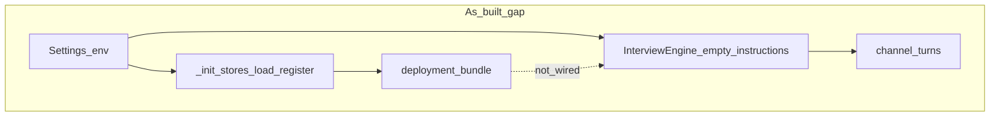
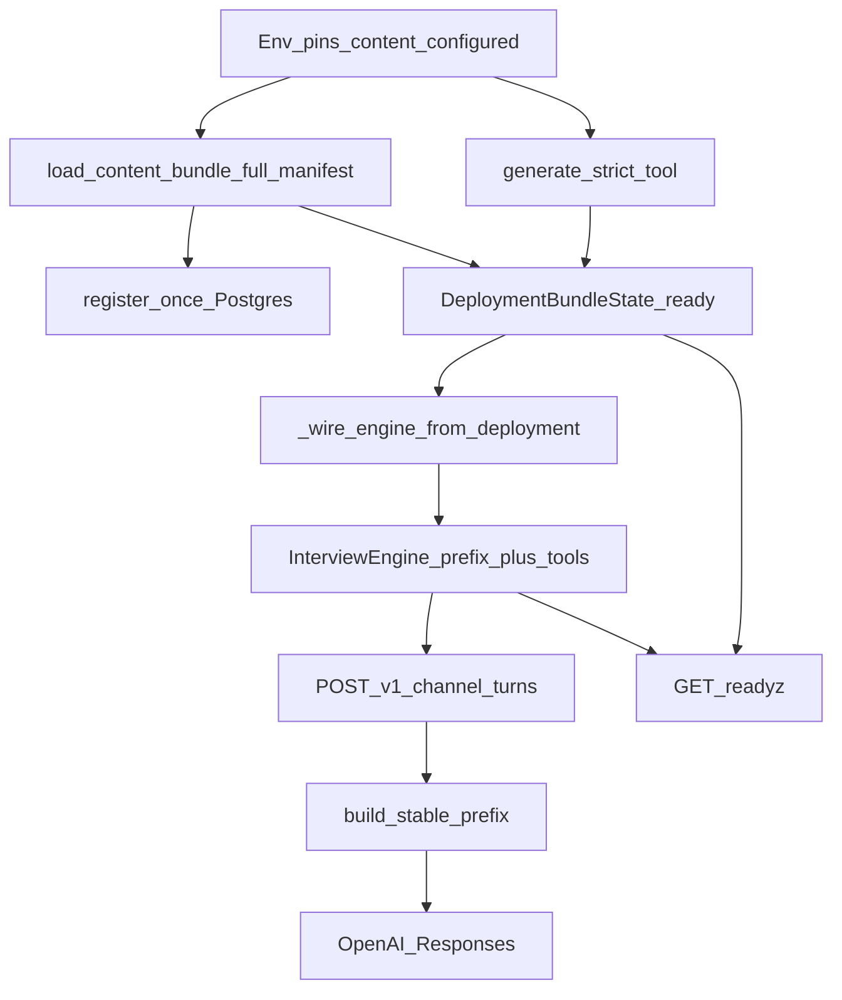

# TECHNICAL ARCHITECTURE — REQ-05 Phase A (stories 19–22)

**Package:** [`req-05-content-phase-a-flat-launch`](./INDEX.md)  
**Parent REQ:** [`REQ-05`](../../../requirements/REQ-05-CONTENT-PHASE-A-FLAT-LAUNCH.md) v0.2.0  
**Stories covered:** [19](./STORY-AIBRIDGE-19-assembled-instructions-engine-wire.md) · [20](./STORY-AIBRIDGE-20-full-instructions-manifest.md) · [21](./STORY-AIBRIDGE-21-oas-image-env-docs.md) · [22](./STORY-AIBRIDGE-22-content-phase-a-proof.md)  
**Skills SSOT:** [`ARCHITECTURE-SKILLS-ACTIVATED.md`](./ARCHITECTURE-SKILLS-ACTIVATED.md)  
**Related:** [02-content-packaging.md](../../../architecture/runtime/02-content-packaging.md) · [GPT UI 05](../../../../../GPT%20UI/docs/architecture/05-python-bridge-instruction-delivery.md) · [analysis.mdc](../../../../../.cursor/rules/analysis.mdc)  
**Status:** Target architecture for implementation (not yet code-complete)  
**As-of:** 2026-09-16  
**Method:** claims verified against code/REQ; fantasies omitted

---

## 1. Problem / goal

**Problem:** Content loader, hashes и Postgres register-once уже работают (STORY-02 Done), но:

1. `InterviewEngine` стартует **без** `assembled_instructions` и **без** strict tool из deploy → модель не получает Module-1/pack текст (GPT UI `05` §5 gap).
2. Manifest сейчас **6-file subset** → неполный относительно загруженного `src/instructions/`.
3. Docker image **не** копирует `docs/openapi/` → Railway `content_configured()` ломается на missing OAS.

**Goal Phase A:** полная комплектация flat dump + wire OAS в image + wiring в **stable prefix**, без multi-repo CI (это REQ-06).

«Лайтовость» — только в архитектуре доставки (один flat dir, manifest v1, mutate composition), **не** в урезании контента.

---

## 2. As-built (verified)

| Fact | Evidence |
|------|----------|
| Loader: manifest `files[]` root children, join `\n\n`, hashes | `src/aibridge/content.py` |
| Deploy register + optional `strict_tool` dict | `src/aibridge/deployment.py` (`DeploymentBundleState`, `generate_strict_tool`) |
| `content_configured()` | `src/aibridge/config.py` |
| Engine ctor **без** instructions/tools from bundle | `src/aibridge/app.py:290–298` |
| Default `prompt_channel="prefix"`, `instructions=""`, `tools=[]` | `src/aibridge/interview.py:42–50` |
| Prefix build: `<<<INSTRUCTIONS>>>` + tool JSON + pack id | `src/aibridge/request_assembly.py:74–103`; used `interview.py:78–112` |
| XOR: prefix mode ⇒ `"instructions" not in request.payload` | `interview.py:111–112` |
| `_init_stores` / `app.state.deployment_bundle` **после** engine creation | `app.py:383–392` vs `290–298` |
| `/readyz` → `evaluate_readiness(cfg, dep)` | `app.py:468–474` |
| Dockerfile: `COPY src`, `COPY migrations` only | `Dockerfile:10–12` |
| Manifest subset (6 files) | `src/instructions/instructions.manifest.json` |



---

## 3. Target runtime flow



**Invariant:** при `content_configured()` и `deployment.ready` — `engine.instructions` non-empty и участвует в stable prefix; `prompt_channel=="prefix"`; API `instructions=` отсутствует.

---

## 4. Story coverage matrix

| Story | Architectural seam | REQ AC | Primary code touchpoints (target) |
|-------|-------------------|--------|-----------------------------------|
| **19** | Composition: deploy → engine | §4.1 | `app.py` after `deployment_bundle`; `interview.py` (consume); `deployment.py` (source) |
| **20** | Full ordered manifest | §4.2 | `src/instructions/instructions.manifest.json`; loader unchanged |
| **21** | OAS in image + env docs | §4.3–4.4 | `Dockerfile`; `.env.example`; `docs/runbooks/aibridge-web-service-local-railway.md` |
| **22** | Proof | §4.5 | `tests/**`; readiness; named smoke checklist target |

Build order: `19 ∥ 20 ∥ 21 → 22`.

---

## 5. ADR-1 — Composition wiring (story 19)

### Decision

После `_init_stores(...)` и присвоения `app.state.deployment_bundle`, если `deployment` ready и `loaded` есть:

1. `engine.prompt_channel = "prefix"` (already default).  
2. `engine.instructions = deployment.loaded.assembled_instructions`.  
3. Если `deployment.strict_tool` is not None: `engine.tools = [deployment.strict_tool]` (Responses flat function tool dict from `tool_gen.generate_strict_tool`).  
4. `engine.pack_id = f"{schema_id}/{schema_version}"` из Settings (или эквивалент уже используемый в prefix telemetry).  
5. Если `content_configured()` и deploy **не** ready / assembled empty → **не** silently serve empty instructions: fail-closed через существующий readiness error path (`deployment.error` / content reasons). Boot may still bind HTTP for `/healthz`; `/readyz` 503.

Helper name (implementation detail): e.g. `_apply_deployment_to_engine(engine, deployment, settings)` рядом с `create_app` — **не** новый сервисный слой.

### Rationale

- `InterviewEngine` уже читает `self.instructions` в `build_stable_prefix` (`interview.py:78–82`).  
- Минимальный churn: не переставлять создание guard/dedupe/pg относительно engine.  
- Confirm path уже получает тот же `engine` object (`app.py:309–310`) — mutate до приёма трафика достаточен.

### Rejected for Phase A

| Alternative | Why rejected |
|-------------|--------------|
| Full reorder: `_init_stores` before engine ctor | Larger diff across confirm/pg wiring; same end state; defer unless mutate proves awkward |
| Switch to `instructions=` API channel | Operator decision: stable prefix only (REQ-05) |
| Lazy load instructions per turn from disk | Violates pin/hash model; request-time IO; contradicts AIB-INS-04 |

### Fail-closed notes

- `content_configured()==False`: engine может остаться без bundle (dev/tests) — documented; not Phase A production path.  
- `content_configured()==True` + missing files: `verify_and_register_deployment` sets `error`; readiness already fails; wiring must not overwrite with empty string pretending success.

---

## 6. ADR-2 — Content assembly (story 20)

### Decision

In-place `src/instructions/instructions.manifest.json`:

- `files[]` = **каждый** root-child в `src/instructions/` кроме самого манифеста, ровно один раз.  
- Порядок слоёв — REQ-05 §4.2 (wrappers → nav/model → interview → chain → HTTP text → pack v3 md+json → legacy).  
- Pack JSON **в** `files[]` (Knowledge parity с Custom GPT).  
- `DOGESTONIA_PAYLOAD_SCHEMA_PATH` → тот же `schema-packs.uus_veerenni_civic.v3.payload.schema.json` для `pack_hash` / `generate_strict_tool`.

Loader schema **не** меняется (`bundle_version` + `files[]`, root-child-only в `content.py`).

### Rationale

- Operator: Phase A = полное воспроизведение загруженного набора, не subset.  
- Architecture lite: один flat dir + один manifest v1; без nested paths / layered schema (REQ-06 / out of Done).

### Completeness rule

Новый файл в `src/instructions/` без записи в manifest = **FAIL** Phase A Done (REQ-05 §4.2). Implementation/tests should detect omit (e.g. compare dir listing vs `files[]`).

### Prompt / token risk (document only)

Full Module-1 + pack JSON в каждом turn prefix — высокий token cost / lost-in-the-middle risk. Phase A **не** урезает набор; mitigation = REQ-06 `pilot-minimal` profile later. Ops should monitor latency/cost after wiring.

---

## 7. ADR-3 — OAS packaging (story 21)

### Decision

1. Dockerfile: `COPY docs/openapi ./docs/openapi` (или эквивалент, сохраняющий оба YAML).  
2. `DOGESTONIA_OPENAPI_PATH` = Story Intake wire  
   - local: `docs/openapi/story-intake-actions.openapi.yaml`  
   - image: `/app/docs/openapi/story-intake-actions.openapi.yaml` (WORKDIR `/app`)  
3. `aibridge-channel-v1.openapi.yaml` копируется с каталогом, **не** входит в instruction `files[]` (channel façade ≠ Module-1 Knowledge).

### Rationale

- `content_configured` / tool_gen требуют readable wire OAS.  
- Two-contract rule (api-designer): channel vs Story Intake must not merge into one env path.

### Rejected

- Copy only story-intake file and leave channel out of image — loses deploy artifact for façade contract tests/ops.  
- Put OAS inside `src/instructions/` — mixes wire contract with prompt Knowledge; unnecessary if Dockerfile COPY works.

---

## 8. ADR-4 — Fail-closed / proof (story 22)

### Decision

**Automated**

- Given content env + full manifest fixtures (or real dump paths in test cwd): after `create_app`, `app.state.interview_engine.instructions` non-empty; `prompt_channel=="prefix"`; first Responses assembly path would include prefix system message (unit via engine `_build_request` / recording client).  
- Given broken instruction path / incomplete manifest: `deployment_bundle.ready` false; `/readyz` 503 with content reason; no silent empty prefix in production content_configured path.  
- Optional: assert `set(files)` == set(dir) − `{manifest}` for completeness.

**Ops smoke (named acceptance target, not created in this doc wave)**

- Path: `docs/ops/req-05-phase-a-smoke.md`  
- Checks: `/healthz` 200; full env → `/readyz` not `content_bundle_not_ready` due to OAS/manifest/wiring.

### Surfaces

| Surface | Role |
|---------|------|
| pytest | Composition + readiness |
| `/healthz` | Process liveness only |
| `/readyz` | Bundle + wiring invariants |
| Smoke checklist | Manual/ops Railway or local |

---

## 9. Env and path map

| Variable | Local (cwd `doge-ai-bridge`) | Image (`WORKDIR /app`) |
|----------|------------------------------|-------------------------|
| `DOGESTONIA_INSTRUCTIONS_DIR` | `src/instructions` | `/app/src/instructions` |
| `DOGESTONIA_INSTRUCTIONS_MANIFEST` | `src/instructions/instructions.manifest.json` | `/app/src/instructions/instructions.manifest.json` |
| `DOGESTONIA_OPENAPI_PATH` | `docs/openapi/story-intake-actions.openapi.yaml` | `/app/docs/openapi/story-intake-actions.openapi.yaml` |
| `DOGESTONIA_PAYLOAD_SCHEMA_PATH` | `src/instructions/schema-packs.uus_veerenni_civic.v3.payload.schema.json` | `/app/src/instructions/schema-packs.…payload.schema.json` |
| `DOGESTONIA_SCHEMA_ID` | `uus_veerenni_civic` | same |
| `DOGESTONIA_SCHEMA_VERSION` | `v3` | same |
| `DOGESTONIA_CONTENT_SOURCE_COMMIT` | pin SHA / label | same |
| `DOGESTONIA_TOOL_SCHEMA_PATH` | empty OK | empty OK |

Document in `.env.example` + web runbook (story 21).

---

## 10. Component contracts (target)

### 10.1 Stable prefix payload shape

Из `stable_prefix_parts` (`request_assembly.py:74–88`):

```text
<<<INSTRUCTIONS>>>
{assembled_instructions}
<<<TOOL_SCHEMA>>>
{json.dumps(engine.tools)}
<<<PACK_ID>>>
{engine.pack_id}
```

В Responses: system message with prefix; `tools=` request list; **no** top-level `instructions` key when `prompt_channel=="prefix"`.

### 10.2 DeploymentBundleState → engine

| Field | Engine field |
|-------|--------------|
| `loaded.assembled_instructions` | `instructions` |
| `strict_tool` (dict \| None) | `tools` = `[strict_tool]` or `[]` |
| Settings schema_id/version | `pack_id` string |

### 10.3 Dual use of payload schema

| Consumer | Path |
|----------|------|
| Prompt assembly (text in manifest) | basename in `files[]` |
| `pack_hash` + `generate_strict_tool` | `DOGESTONIA_PAYLOAD_SCHEMA_PATH` absolute/relative file |

Same bytes on disk; two consumers — acceptable per REQ-05.

---

## 11. Risks and mitigations

| Risk | Mitigation |
|------|------------|
| Huge prefix tokens / model ignore middle | Accept in Phase A; monitor; REQ-06 profiles |
| Mutate after guard.interview_engine assign | Mutate **same object** after stores; guard already holds reference — OK if wire before traffic |
| Injected `interview_engine=` in tests | Wire only when deployment ready; tests may pass pre-wired engine |
| Image path mismatch | Document `/app/...` pins; smoke checklist |
| Completeness drift | Test dir vs manifest set |
| Channel OAS confused with wire | ADR-3; OPENAPI_PATH = story-intake only |

---

## 12. Out of scope (this package / Phase A)

- REQ-06: GPT UI SSOT sync, stage CI, `pilot-minimal` / `full-set` profile split beyond Phase A baseline  
- Nested loader paths; layered manifest schema  
- REQ-04 ValidationContext deep redesign  
- Channel OAS redesign / n8n  
- Switching prompt channel to `instructions=`  
- Object storage / Pack Builder / federation  

---

## 13. Implementation sequence (for P3 agents)

1. **20** — write full `instructions.manifest.json` (§4.2).  
2. **21** — Dockerfile COPY `docs/openapi`; env/runbook pins.  
3. **19** — `_apply_deployment_to_engine` after `app.state.deployment_bundle = deployment`.  
4. **22** — tests + create smoke checklist at named path `docs/ops/req-05-phase-a-smoke.md`.  

Parallelism: 19/20/21 independent until 22.

---

## 14. Definition of Done (architecture → REQ)

Architecture is **implemented** when stories 19–22 Done and REQ-05 §4 AC pass. This document alone does not change runtime.

---

## 15. Version log

- v0.1.0 — 2026-09-16: initial target tech architecture for stories 19–22; ADR-1 mutate wiring; full dump; OAS COPY; proof surfaces.
